<p align="center">
  
</p>

<h1 align="center">Meghnaad</h1>

<p align="center">
  <a href="https://taskwarrior.org">Taskwarrior 3</a> in your browser, on your phone and in your terminal. The Rust engine
  runs in the page (and natively in the Android app), and your tasks live where you choose: a git repository, an S3 or R2
  bucket, or a TaskChampion sync server.
</p>

<p align="center">
  <a href="https://deploy.workers.cloudflare.com/?url=https://github.com/uroybd/Meghnaad/tree/release"></a>
  &nbsp;
  <a href="https://github.com/uroybd/Meghnaad/releases/latest"></a>
  &nbsp;
  <a href="docs/terminal.md#install"></a>
</p>

---

Meghnaad is another **replica** of your Taskwarrior data. The `task` CLI keeps syncing as it does today, and Meghnaad
reads and writes the same store. A task added here shows up on your laptop after `task sync`, and the other way round.
It is **console-first** (type `task` commands) with tables, forms and charts beside it; both use the same command
engine. It comes as a **web app** you host yourself, as an **Android app** with home-screen widgets that keeps the tasks
on the phone and syncs with your store directly, and, on the desktop, as a **terminal app** that puts the same console,
completion and task commands around your own `task` CLI.

## Philosophy

- **It complements Taskwarrior, it does not replace it.** Same store, same data, same rules: your `task` CLI keeps
  working beside it.
- **It behaves exactly like `task`.** Where it doesn't, that is a bug: please
  [file an issue](https://github.com/uroybd/Meghnaad/issues).
- **Power tools for advanced users, usable by everyone.** A console as capable as the CLI, with tables, forms and buttons
  for anyone who would rather click.
- **Free to run.** The static site needs only a free static host; on Cloudflare, Workers, R2 and Access each have a free
  plan that is enough ([limits](docs/architecture.md#limits-of-the-platform)).

## Get it

- **In a browser, with nothing to install:** [mn.utsob.me](https://mn.utsob.me) is the static web app, for tasks that
  sync with a git repository. Your token, secret and tasks stay in your browser and your repository.
- **Your own web app:** [on any static host](docs/web-static.md), or [on Cloudflare](docs/web-cloudflare.md) with Access and an R2
  bucket or a git repository. The button above deploys the R2 one; `npm run setup` from the `release` branch deploys
  either, with only Node.js.
- **On Android:** the APK from the [latest release](https://github.com/uroybd/Meghnaad/releases/latest), then
  [connect it](docs/android.md#first-run) to your store.
- **In a terminal:** `brew install uroybd/tap/meghnaad`, or a [prebuilt download](docs/terminal.md#install).

## Four flavours

The same app comes in four flavours. The first three run Meghnaad's own engine, written in Rust; the terminal app runs
your real `task`.

| | Static web app | Web app on Cloudflare | Android app | Terminal app |
| --- | --- | --- | --- | --- |
| **Runs** | in any browser, from any static host | in any browser, behind a Cloudflare Worker | on your phone or tablet | in your desktop's terminal |
| **The engine** | in the page, as WebAssembly | in the page, as WebAssembly | on the phone, natively | your own `task` 3.6.0 (or 3.5) |
| **Your tasks live in** | a git repository | an R2 bucket or a git repository | a git repository, any S3-compatible bucket or a sync server | wherever `task sync` reaches |
| **Sign-in** | the encryption secret unlocks the page | Cloudflare Access | none: it is your phone | none: it is your desktop |
| **The secret is held by** | your browser, sealed at rest | the Worker, as a Cloudflare secret | the Android Keystore | your taskrc |
| **Offline** | keeps working once open; starts only online | keeps working once open; starts only online | yes | yes |
| **Hooks** | your Lua script, in the page | your Lua script, on the Worker | your Lua script, on the phone | `task`'s own hooks, and the same Lua script through `meghnaad-hook` |
| **What only it has** | nothing to run: use [mn.utsob.me](https://mn.utsob.me) or any free static host | one sign-in for every browser, no secret on any device | reminders with the app closed, home-screen widgets | your own data and taskrc, as they are |
| **Get it** | [The static web app](docs/web-static.md) | [The web app on Cloudflare](docs/web-cloudflare.md) | [The Android app](docs/android.md) | [The terminal app](docs/terminal.md) |

### Which one?

- **You sync `task` with a git repository and want it in a browser:** the static web app. There is nothing to deploy if
  you use the public copy, and the page talks to your repository from your browser alone.
- **You sync with R2, or want a sign-in rather than a secret on each device:** the web app on Cloudflare. It runs on
  Cloudflare's free plans.
- **You want it on your phone:** the Android app, whatever your store. It needs no server of its own.
- **You live in a terminal:** the terminal app, beside the `task` you already use.

They are not exclusive. On the same store they are replicas of the same tasks, so any mix of them stays in step with
each other and with your `task` CLI. The web app and the Android app can share their settings and hooks through the
store as well (never the secrets); the terminal app keeps its own in `~/.config/meghnaad`.

## Features

- **Your store, as it is.** The same git repository, bucket or sync server and the same encryption secret your `task`
  CLI uses. No migration, and nothing changes for the CLI.
- **Taskwarrior's behaviour, not an imitation.** Filters, virtual tags, urgency, reports, recurrence, regexes,
  contexts, `calendar`, `summary`, `burndown`, `history`, `timesheet`, `stats`, `export`, `import`, `purge`, `calc` and
  the confirmations, ported from the source and checked against the real `task`.
- **A console with everything around it.** Tab completion, a preview of the task an `add` will make, chains with `&&`
  `||` `;`, and Taskwarrior's yes/no/all/quit as a table of ticks ([The console](docs/using/console.md)).
- **Pages for what you look at most.** Any report as a table or as cards, Projects, Tags, Summary, Calendar, Burndown,
  and a detail for each task with its annotations, history and tracked time ([The pages](docs/using/pages.md)).
- **Iterative tasks**, Taskwarrior 3.6.0's new way to repeat: the next one made when you complete this one, from a rule
  such as `monthly` or `"every other day"` ([Iterative tasks](docs/using/iterative.md)).
- **Boards.** Pages of your own made of numbers, tables and charts, each with its own filter, laid out on a grid, with
  controls (a date range, a pick of projects) that feed every filter on them ([Boards](docs/using/boards.md)).
- **Kanban.** Your tasks as columns of cards; moving a card runs that column's command line ([Kanban](docs/using/kanban.md)).
- **Your own commands.** A word for a whole command line, such as `fail` for `done outcome:fail`, typed or picked from a
  task's menu, with an icon ([Settings](docs/using/settings.md)).
- **Your `taskrc`.** Paste it, upload a folder or import it from your dotfiles; UDAs, reports, contexts, holidays,
  urgency and colours are read ([taskrc support](docs/taskrc-support.md)).
- **tasksh's `review`**, with tasksh's keys, as a card or in the console.
- **Time tracking and reminders.** `start` and `stop` become sessions with a running total, and due tasks remind you
  ([Time tracking and reminders](docs/using/time-tracking.md)).
- **Hooks, as Lua.** `on-add`, `on-modify`, `on-launch` and `on-exit` as functions in one script, sandboxed, with
  network calls and secrets you allow; the same script runs with the real `task` ([Hooks](docs/using/hooks.md)).
- **Keys, as in a terminal app**, the same across the web, the phone and the terminal, and yours to change
  ([Keys](docs/using/settings.md#keys)).
- **On Android**, home-screen widgets (a report, a calendar, a burndown, a card of a board) and reminders with the app
  closed ([The Android app's own](docs/using/android.md)).

## A look at it

**In the browser:** the Tasks page, a report as a table with the console underneath.

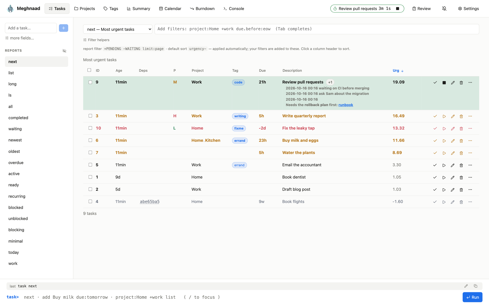

**On Android:** the same report as cards with the console underneath, a task's detail, and the menu of pages; and on
the home screen, widgets for a report, the calendar and a burndown.

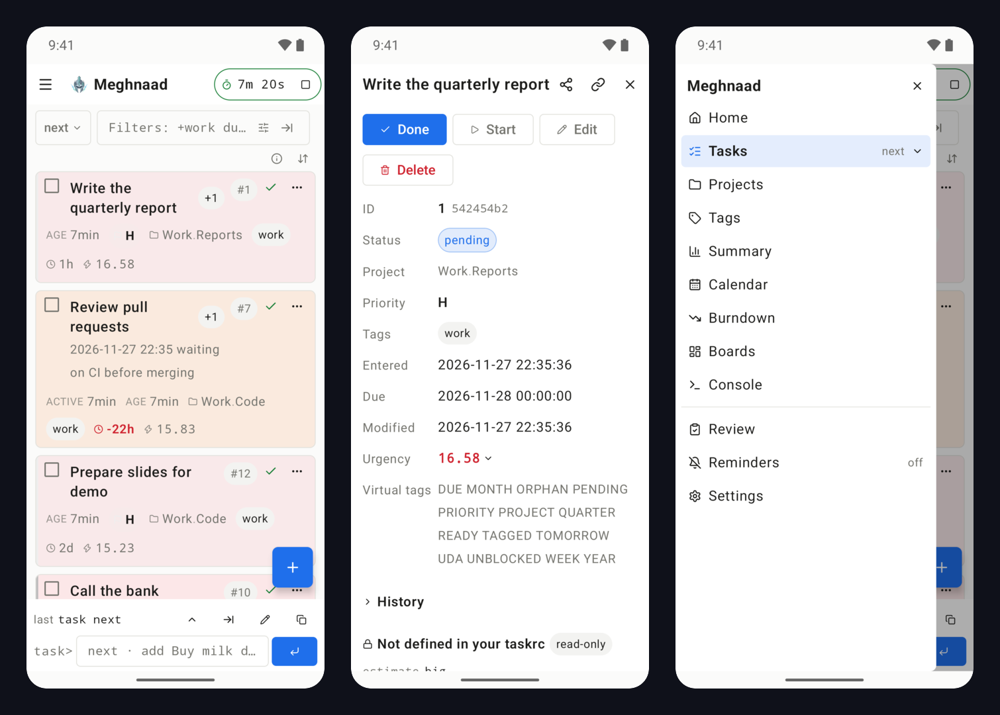

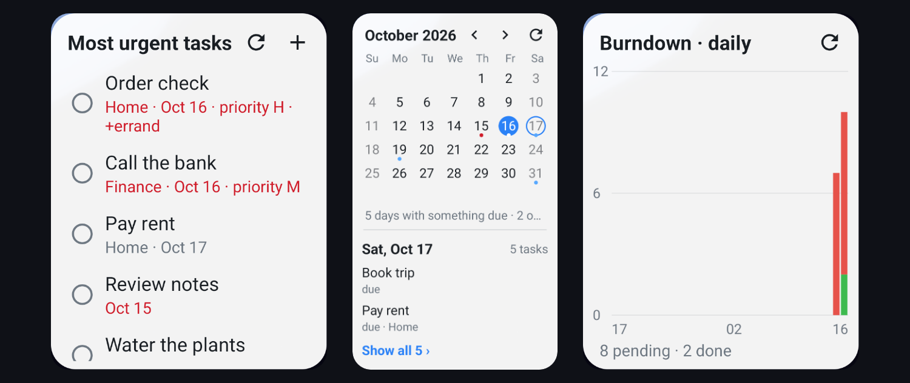

**In the terminal:** the same pages around your own `task`, with its colours and your keys.

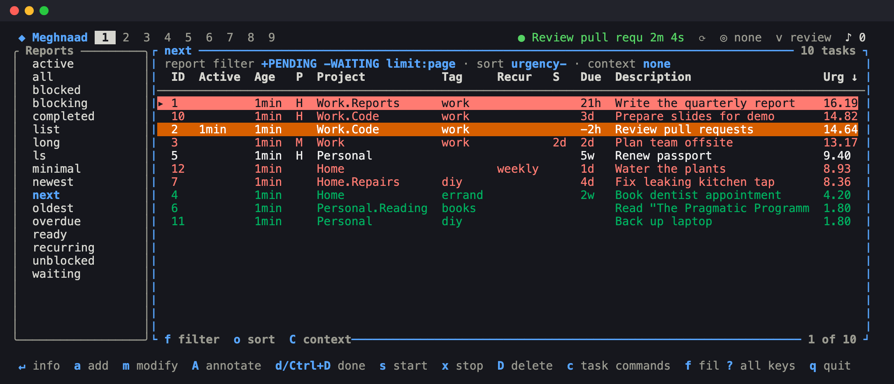

> **Status.** Verified against the released `task` 3.5.0 on a local S3-compatible server, in both directions (tasks,
> UDAs, reports, recurring series, snapshots, purge, import), and in use on a real R2 bucket.

<table>
  <tr>
    <td width="50%">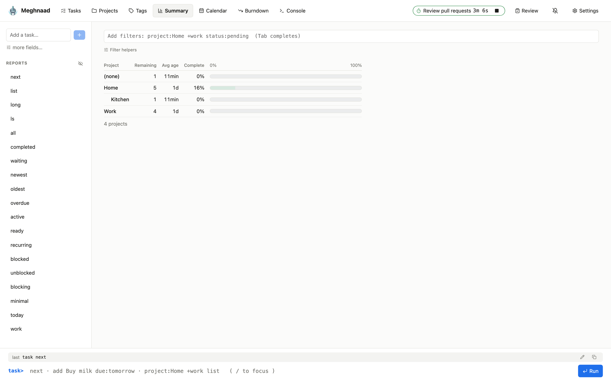</td>
    <td width="50%">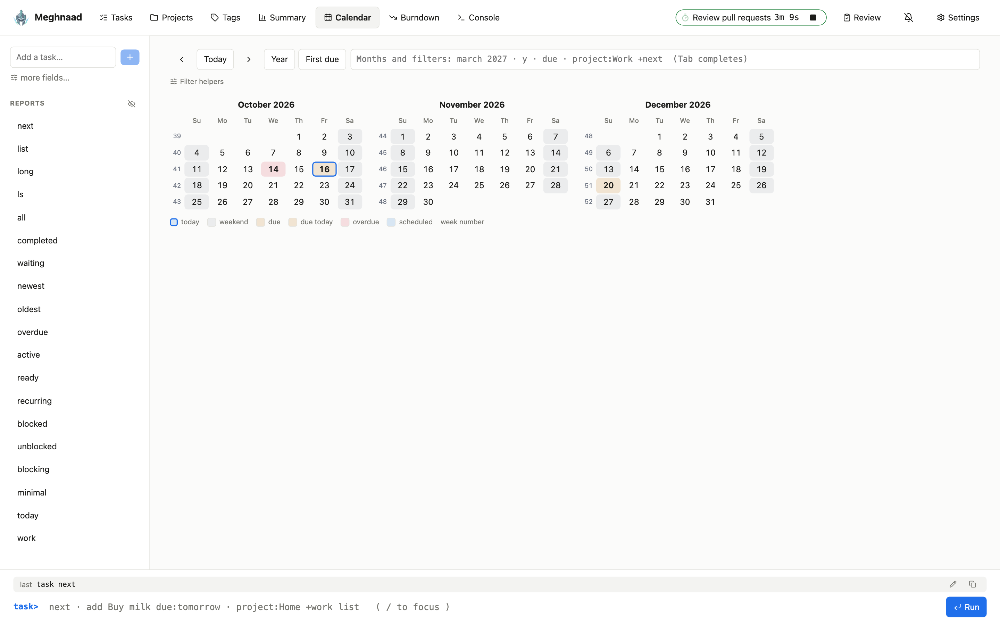</td>
  </tr>
  <tr>
    <td align="center"><sub>Summary: how far along each project is</sub></td>
    <td align="center"><sub>Calendar: click a day to see what is due</sub></td>
  </tr>
  <tr>
    <td>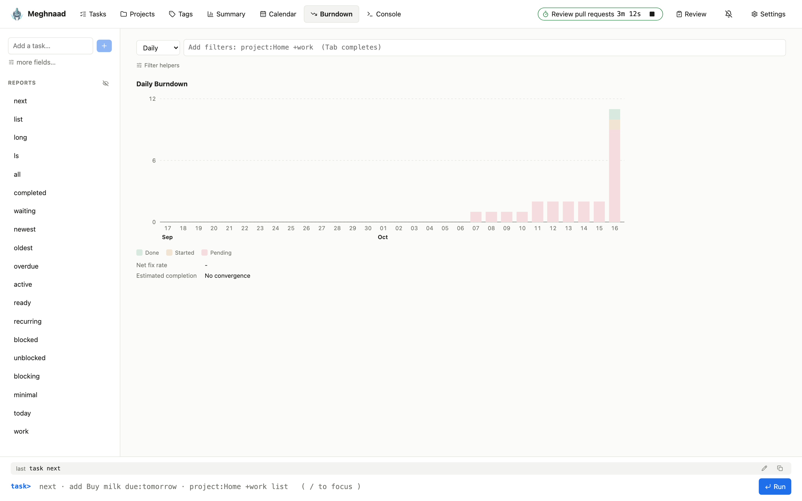</td>
    <td>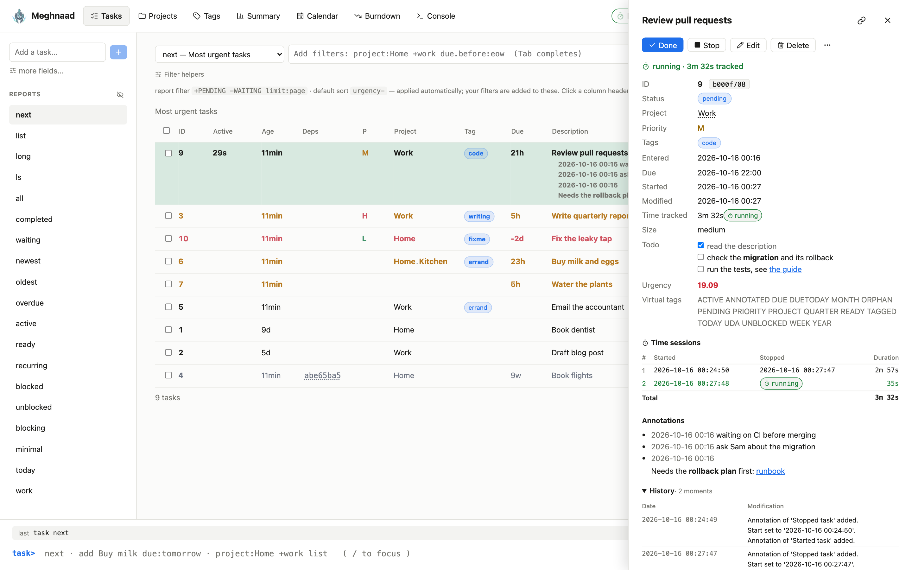</td>
  </tr>
  <tr>
    <td align="center"><sub>Burndown, drawn the way <code>task burndown</code> counts</sub></td>
    <td align="center"><sub>Task detail: time tracking, annotations, history</sub></td>
  </tr>
  <tr>
    <td>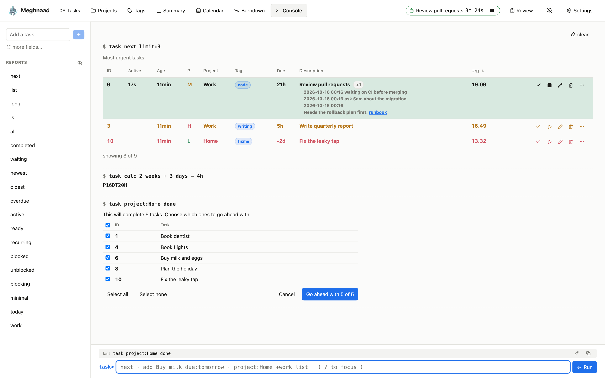</td>
    <td align="center">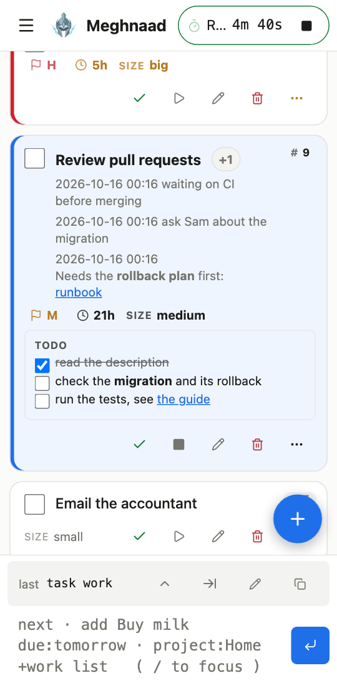</td>
  </tr>
  <tr>
    <td align="center"><sub>The console. Taskwarrior's yes/no/all/quit becomes a table of ticks</sub></td>
    <td align="center"><sub>On a phone</sub></td>
  </tr>
  <tr>
    <td>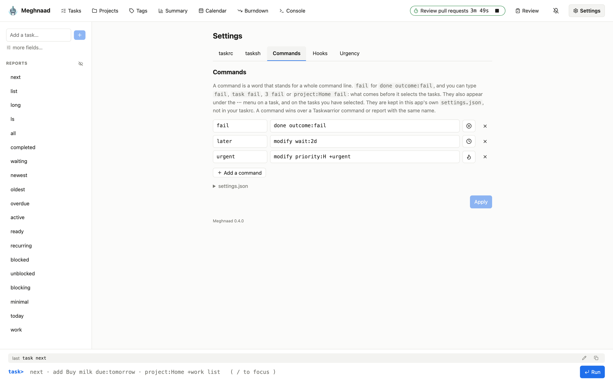</td>
    <td>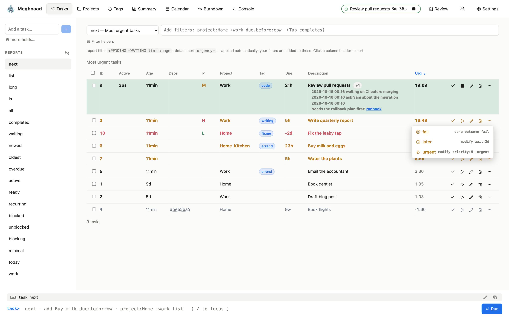</td>
  </tr>
  <tr>
    <td align="center"><sub>Settings: your own commands, with any Lucide icon</sub></td>
    <td align="center"><sub>They are on the ⋯ menu of a task, and of the selected tasks</sub></td>
  </tr>
  <tr>
    <td>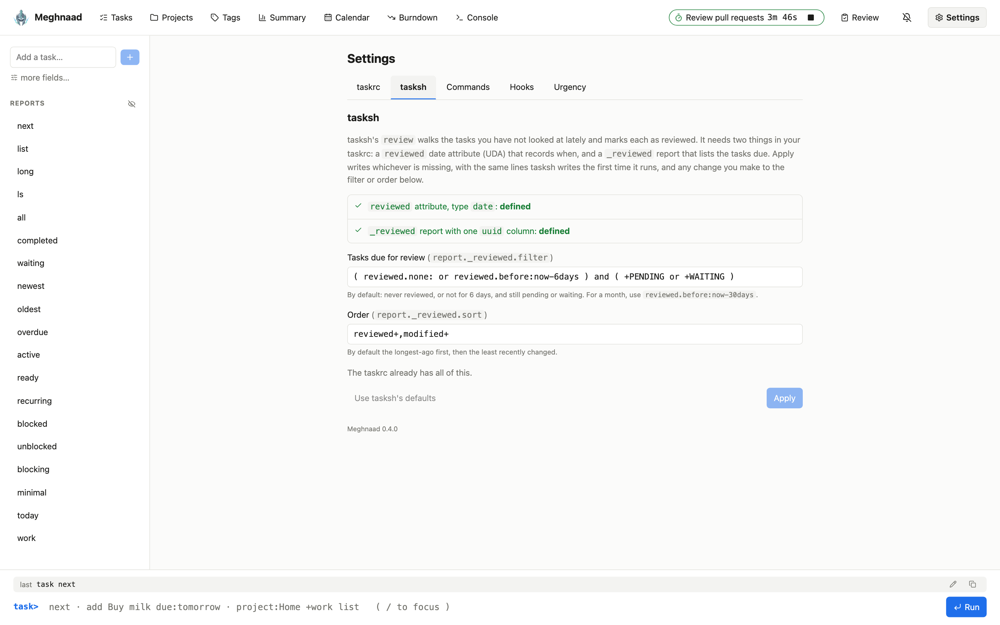</td>
    <td>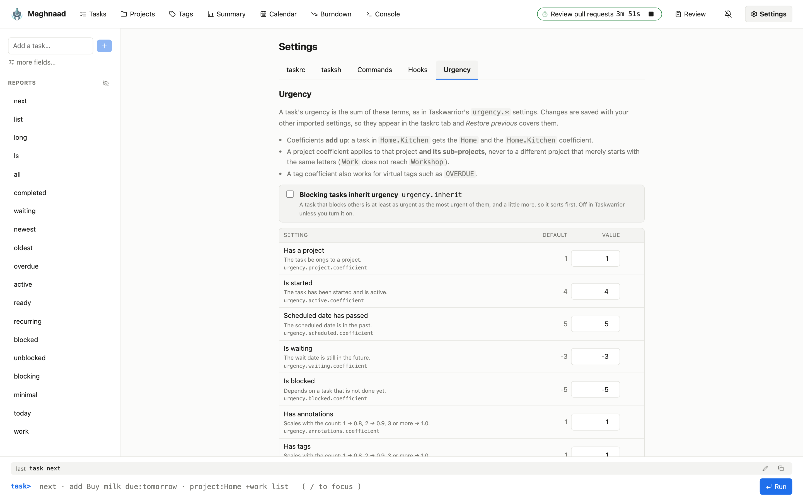</td>
  </tr>
  <tr>
    <td align="center"><sub>Settings: the tasksh setup, with the exact lines it writes</sub></td>
    <td align="center"><sub>Settings: urgency coefficients next to their defaults</sub></td>
  </tr>
  <tr>
    <td>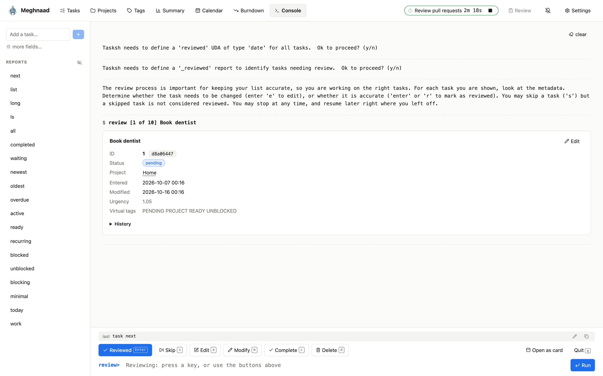</td>
    <td>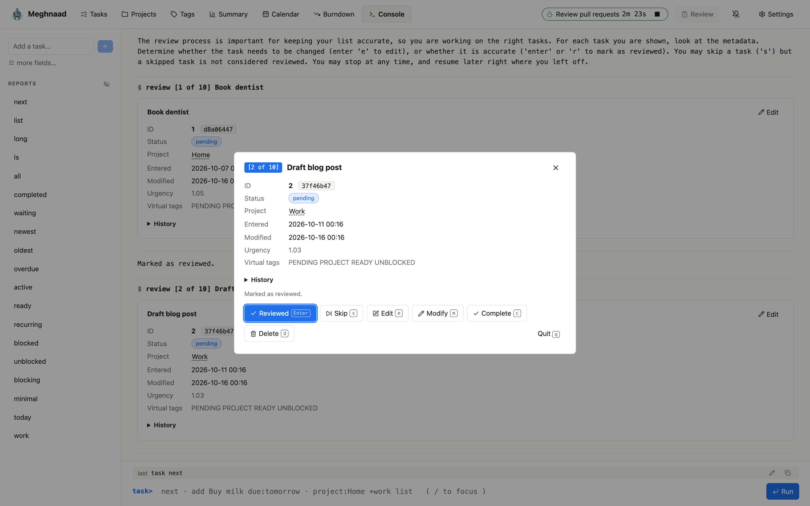</td>
  </tr>
  <tr>
    <td align="center"><sub>tasksh's review in the console: press a key, as in tasksh</sub></td>
    <td align="center"><sub>The same review as a card, with the same keys</sub></td>
  </tr>
</table>

## Documentation

The same pages are a searchable site at **[meghnaad.utsob.me](https://meghnaad.utsob.me)**.

| | |
| --- | --- |
| **[Introduction](docs/index.md)** | What it is, the four flavours, which one to pick |
| **[Where your tasks live](docs/stores.md)** | A git repository, an S3 or R2 bucket or a sync server: which flavour reaches which, pointing `task` at it |
| **[The web app](docs/deploy.md)** | [The static web app](docs/web-static.md) and [the web app on Cloudflare](docs/web-cloudflare.md): setup, Access, GitHub Actions, troubleshooting |
| **[The Android app](docs/android.md)** | Install, connect (a git repository, a bucket or a sync server, or none), updates, sharing settings and hooks |
| **[The terminal app](docs/terminal.md)** | Install, sync, where its settings are kept |
| **[Using Meghnaad](docs/using.md)** | Pages, console, tasks, boards, kanban, settings, recurrence, hooks, time tracking; [Android's own](docs/using/android.md) and [the terminal's](docs/using/terminal.md) |
| **[taskrc support](docs/taskrc-support.md)** | Every `taskrc` option: done, partial, not done |
| **[Architecture](docs/architecture.md)** | A diagram per platform, the engine, sync, hooks, platform limits, how correctness is kept |
| **[Building and releasing](docs/building.md)** | Releases, building and signing the Android app, how the apps fit together |

## How it works

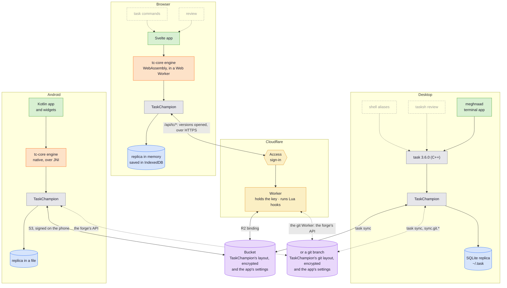

- **Colours** match across the diagrams: green is a front end, orange `tc-core`, grey Taskwarrior's own pieces, blue a
  replica, purple the store, yellow Cloudflare. **Dashed grey boxes** are not Taskwarrior: your own words for command
  lines (shell aliases on the desktop, task commands here) and tasksh's `review` (tasksh there, built in here). They only
  ever send ordinary commands.
- **The engine runs in your browser.** Taskwarrior's rules live in one place, `tc-core`, compiled to WebAssembly and run
  in a Web Worker in the page. It holds your tasks in memory, so a command costs no round trip and uses none of the
  Worker's CPU. Only your hooks run elsewhere, on the Worker (below). The Svelte app only draws.
- **The store** is a bucket holding TaskChampion's standard cloud layout, or a git branch holding its git layout, on
  GitHub, Gitea or Forgejo; either is encrypted client-side. The browser's replica and your CLI are interchangeable
  replicas of it. The Worker comes in two builds, one for each (`BACKEND=r2` or `git`;
  [deploying it](docs/web-cloudflare.md#a-git-repository-instead-of-r2)).
- **The Worker keeps the secret.** It checks Cloudflare Access, and opens and seals the versions that pass between the
  store and your browser (`/api/tc/*`), so the encryption secret never leaves it. It parses no tasks. It also runs your
  hooks: the engine sends it a task and gets the task back (`/api/run`).
- **The static site has no Worker.** The page reaches the git branch through the forge's API itself, holds the token and
  the secret once you unlock it, and runs hooks in the page ([the static app](docs/web-static.md)).
- **The browser keeps a copy** in IndexedDB, so a visit starts from where the last one ended and only pulls what is new.
  It pushes soon after every write, pulls when you come back to the tab and every 30 seconds while you look at it, and
  answers commands while it syncs; other tabs are told when one pushes.
- **Imported taskrc files** are kept in the store beside your tasks (as written, less sync and credential lines), so they
  survive restarts and follow you between devices. The app's own `settings.json` (task commands, boards, keys) is kept
  beside them; the Worker keeps its text as it is and only the browser reads it.

|                | Desktop Taskwarrior        | Meghnaad                                                                                                      |
| -------------- | -------------------------- | ------------------------------------------------------------------------------------------------------------- |
| Local state    | Persistent SQLite          | In the page, with a saved copy in the browser (IndexedDB)                                                     |
| Sync           | When you run `task sync`   | Soon after a write, when you return to the tab, every 30 s while you look at it                               |
| Offline        | Works                      | Changes work and are kept; they go up when the connection is back. The page itself needs a connection to load |
| Encryption key | Only on your machine       | In a Worker secret, and the Worker opens and seals what passes through it; on the static site, in the browser |
| Task ids       | Local to that replica      | Computed separately, so they differ                                                                           |
| Hooks | Scripts in `~/.task/hooks` | Lua functions in a script kept in the store, edited in Settings; they run on the Worker or in the page (or with `task`, through `meghnaad-hook`) |

More in [Architecture](docs/architecture.md).

## Security

- **Login** on the Worker is Cloudflare Access. The Worker validates the `Cf-Access-Jwt-Assertion` token on every `/api/*` request
  (RS256 signature, issuer, audience, expiry, not-before) and refuses forged, `alg: none` and cookie-only tokens.
  Misconfiguration means `403`, never open. `npm run test:auth` proves it against a mock Access.
- **Cross-site requests:** writes from another `Origin` are refused, responses are `no-store`, and the app has a strict
  Content-Security-Policy. It lets the page connect to two other hosts, `cdn.jsdelivr.net` to read icon files and `holidata.net` and `date.nager.at` to read
  holiday lists (below); scripts, images and styles still come from the app alone.
- **Icons from a CDN:** a task command can use any [Lucide](https://lucide.dev) icon. The few the app uses are bundled; any
  other is fetched as a small SVG file from jsdelivr at a pinned Lucide version, and only a short list of plain shapes
  is kept from it, so what arrives is drawn and never run. Fetching one tells that host your IP address and the icon's
  name, nothing else. Without the network those you have used are remembered by the browser, and the rest show a
  terminal icon.
- **Holidays from outside:** Add holidays in Settings reads one public file of dates per year from
  [holidata.net](https://holidata.net) or [date.nager.at](https://date.nager.at), or a public calendar (`.ics`) from a link
  you give (the Worker fetches that one, under the same rules as the taskrc link import; on the static site the browser
  does). Fetching tells that host your IP address (the Worker's, for a calendar on the Worker) and the country and years you asked for, nothing else; what arrives is text
  turned into `holiday.*` lines and checked like any other file of your taskrc.
- **Encryption** is TaskChampion's (PBKDF2-HMAC-SHA256, then ChaCha20-Poly1305). The Worker holds the secret and opens
  and seals what passes between the store and your browser, so whoever can read Worker secrets in your Cloudflare
  account can read your tasks. It is not end-to-end encrypted from Cloudflare. The Worker uses an R2 binding and holds
  no R2 token. Your browser keeps a copy of your tasks in plain form in its own storage (IndexedDB), like any app
  that works offline: whoever can read your browser profile can read it.
- **The static site** has no server: the repository token and the encryption secret are in the browser, sealed with the
  secret at rest and in memory while the page is unlocked, so what an unlocked page runs can read them (the site's own
  code, the browser and its extensions). The device's copy of the tasks is sealed too. The settings, taskrc files and
  hooks script are plain text on the branch, so keep the repository private.
- **The taskrc importer** never stores, logs or returns sync or credential values; tests feed it a file full of secrets
  and check none appear.

## Running it locally

Runs without a Cloudflare account; wrangler simulates R2. You need [Rust](https://rustup.rs) 1.94.1+ and Node.js 20+.

```bash
git clone <this repo> && cd Meghnaad
npm install
cp .dev.vars.example .dev.vars   # local-only secret + Access bypass
npm run dev                      # builds the engine, then serves the app (hot reload) and the Worker
```

The first build takes a few minutes (it installs the `wasm-bindgen` tool once). Open **http://127.0.0.1:5273**: the
app with hot reload, and the Worker behind it on 8787. The engine is rebuilt when the Rust under `crates/tc-core` or
`crates/browser` changes, and the Worker when its own does. For demo data run `./scripts/seed-dev.sh`. Local R2 data lives
in `.wrangler/state` (delete it to start over), or somewhere else with `npm run dev -- --persist-to DIR`; the ports
are `--api-port` and `--web-port`.

## Development

```
crates/tc-core/   the engine: protocol, crypto, filters, reports, commands, taskrc  (pure Rust)
crates/browser/   the engine as WebAssembly for the browser (tc-core + sync through the Worker, or with git on the static site)
crates/browser-hooks/  the static site's Lua hook runner, as WebAssembly loaded on first use
crates/worker/    the Cloudflare Worker: Access check, R2 or git store, opens and seals versions, settings
crates/android/   the engine for the Android app: tc-core natively, S3, git and sync-server sync, JNI
crates/tui/       the terminal app, meghnaad, around the real `task`
crates/hook-shim/ meghnaad-hook: the Lua hooks script as hooks for the real `task`
crates/native-net/ a hooks script's requests on a native host (the phone, meghnaad-hook): one timeout, redirect and size rule
app/              the Android app (Kotlin and Compose, home-screen widgets); crates/android is its engine
web/              the Svelte 5 app (Vite)
scripts/          setup / deploy / build / dev server · seed-dev.sh (demo data) · interop-local.sh (real-CLI regression)
docs/             the guides above
```

The common tasks are also recipes for [`just`](https://just.systems) (`just` lists them): `just check` runs every check
CI runs, `just tidy` lints and tests without fixing anything, `just release` bumps, tags and pushes a version (`just
release patch tidy` lints and tests first), `just deploy` starts the Deploy workflow and `just ship` does both. `just
cleanup` frees the disk old builds of our own crates take (as `just release` does after each bump; `just cleanup debug`:
the whole debug build, `just cleanup all`: every build).

```bash
npm run dev                   # the dev server: engine build and rebuild, Worker, app with hot reload
npm run build:engine          # the engine for the browser alone (web/src/engine/pkg)
npm run build:android         # the Android app (SDK, NDK and cargo-ndk needed): docs/android.md
npm test                      # cargo test + the web unit tests + the deploy-script tests
npm run check                 # svelte-check (types, accessibility)
npm run lint                  # rustfmt + clippy (warnings are errors) + Prettier + ESLint; `lint:rust`, `lint:js` for one half
npm run format                # clippy --fix, cargo fmt and Prettier, fixing in place
npm run test:auth             # Cloudflare Access: forged, expired, wrong-audience tokens... all refused
./scripts/interop-local.sh    # real `task` ⇄ the Worker against one local S3 bucket, both directions
```

`interop-local.sh` needs `task`, the `aws` CLI, `sqlite3`, a built Worker and a local S3-compatible server that enforces
conditional writes, for example `docker run -d --name tw-s3 -p 18333:8333 chrislusf/seaweedfs server -s3 -dir=/data`.
It does not touch a running dev server.

CI (`.github/workflows/ci.yml`) runs tests, formatting, linting and the type check on every push and pull request (and the
Android app's unit tests). Deploying is the separate manual workflow. A release is a version in `package.json` and a tag
`v<version>` (`just release`): the Release workflow publishes the web package and the signed Android APK together
([Making a release](docs/building.md#making-a-release)).

Taskwarrior's behaviour is ported from its source and checked against the real `task`: when changing filters, sorting,
urgency, dates or confirmations, read the C++ first and compare ([method](docs/architecture.md)).

## Known limitations

- **Icons beyond the bundled ones** are fetched from a CDN when first shown (see Security). Offline, the ones your
  commands use are remembered by the browser and the rest show a terminal icon.
- **Single user:** one set of settings, shared by every browser that signs in.
- **No offline start (web):** changes work offline and are kept, but the page itself is loaded from its host, so it
  needs a connection to open (there is no service worker yet). The Android app has no such limit: it opens offline.
- **Browser support:** the engine needs Web Workers and WebAssembly (every current browser has them); the first visit
  downloads it (about 670 KB compressed, then cached). If the page cannot start it, it says why and runs no command.
- **Old versions** (over 180 days old and covered by a snapshot) are cleaned up as the CLI does, after about one push in
  twenty. A device offline for longer may need a fresh `task sync` set-up.
- **`undo`** lives in the page's memory and is lost when the tab is closed or reloaded.
- **Dates you type** are read in your `dateformat`, then as ISO or words (`friday`, `3d`). ISO week and ordinal dates
  (`2026-W52`) aren't understood.
- **Hooks** are Lua with no files, and reach only the hosts a script declares; on the Worker each hook is a request to
  it. `undo` doesn't run them ([Hooks](docs/using/hooks.md#hooks)).
- **Not every `taskrc` option applies:** terminal and local-file options don't make sense here, `include` follows
  only the app's own folder of files, and `purge.on-sync` isn't supported ([taskrc support](docs/taskrc-support.md)).
- **The Android app** is for 64-bit ARM phones (not 32-bit ones), and importing a taskrc from a link is not there yet.

## About the name

<p align="center">
  
</p>

Meghnaad is the warrior of the Ramayana who fought from behind the clouds: Taskwarrior (the warrior) running on
Cloudflare (the cloud), with Access as the cover.

## License

[MIT](LICENSE) © 2026 Utsob Roy
