<p align="center">
  
</p>

<h1 align="center">Meghnaad</h1>

<p align="center">
  <a href="https://taskwarrior.org">Taskwarrior 3</a> in your browser. The Rust engine runs in the page, a small Worker on
  Cloudflare keeps the secret, your existing R2 bucket is the sync store, Cloudflare Access is the login.
</p>

---

Meghnaad is another **replica** of your Taskwarrior data. The `task` CLI keeps syncing to R2 as it does today; this app
reads and writes the same bucket. A task added here shows up on your laptop after `task sync`, and the other way round.
It is **console-first** (type `task` commands) with tables, forms and charts beside it. Both use the same command engine.

## Philosophy

- **It complements Taskwarrior, it does not replace it.** Same bucket, same data, same rules: your `task` CLI keeps
  working beside it.
- **It behaves exactly like `task`.** Where it doesn't, that is a bug: please
  [file an issue](https://github.com/uroybd/Meghnaad/issues).
- **Power tools for advanced users, usable by everyone.** A console as capable as the CLI, with tables, forms and buttons
  for anyone who would rather click.
- **Basic features run on Cloudflare's free tier.** Workers, R2 and Access each have a free plan that is enough
  ([limits](docs/architecture.md#limits-of-the-platform)).

## What you get

- **Uses your existing bucket.** Same R2 bucket, same encryption secret. No migration, no new server, nothing changes
  for the CLI.
- **Taskwarrior's behaviour, not an imitation.** Filters, virtual tags, urgency, reports, recurrence, regexes, the
  calendar, `summary`, `burndown`, `history`, `timesheet`, `stats`, `export`, `import`, `purge`, `duplicate`, `context`,
  `calc` and the confirmations are ported from the source and checked against the real `task` 3.5.0. Settings removed
  before 3.5.0 are not supported.
- **Your `taskrc`, safely.** Paste it, upload it or import it from a link (your dotfiles repository). UDAs, reports,
  contexts and settings are kept; sync settings and credentials are blocked ([what is read](docs/taskrc-support.md)).
- **tasksh's `review`.** Walk the tasks you have not looked at lately and mark each reviewed, skip, edit, change, finish or
  delete it, from the top bar's Review button (a card) or the Console (`review`), with keys as in tasksh. It sets up the
  `reviewed` attribute and `_reviewed` report itself.
- **Your own commands.** A word for a whole command line, such as `fail` for `done outcome:fail`, with an icon from
  Lucide. It works typed (`3 fail`, `project:Home fail`) and from a **⋯** menu on a task and on the selected tasks. Kept in
  the app's own `settings.json`.
- **Colours as on the desktop.** `color.*` rules, precedence and themes, drawn softly, plus a default theme of its own.
- **Hooks, as Lua.** `on-add`, `on-modify`, `on-launch` and `on-exit` become functions in a script you edit in Settings,
  kept in your bucket and run on the Worker ([Hooks](#hooks)).
- **Works on a phone**, with time tracking, reminders and a console with completion.

> **Status.** Verified against the released `task` 3.5.0 on a local S3-compatible server, in both directions (tasks,
> UDAs, reports, recurring series, snapshots, purge, import), and in use on a real R2 bucket.

<p align="center">
  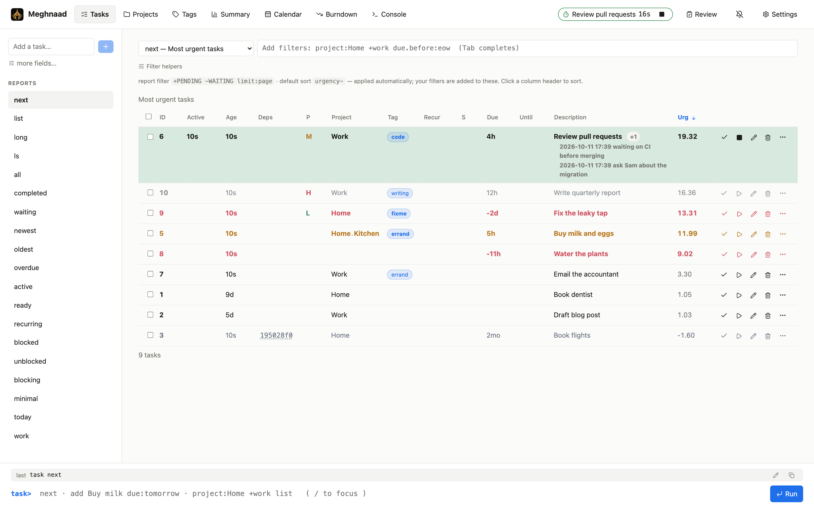
</p>

<table>
  <tr>
    <td width="50%">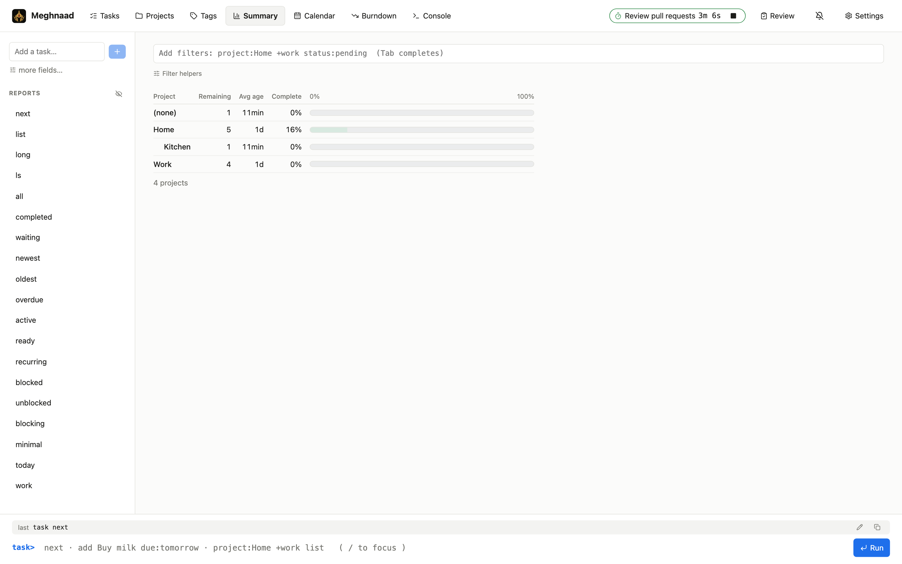</td>
    <td width="50%">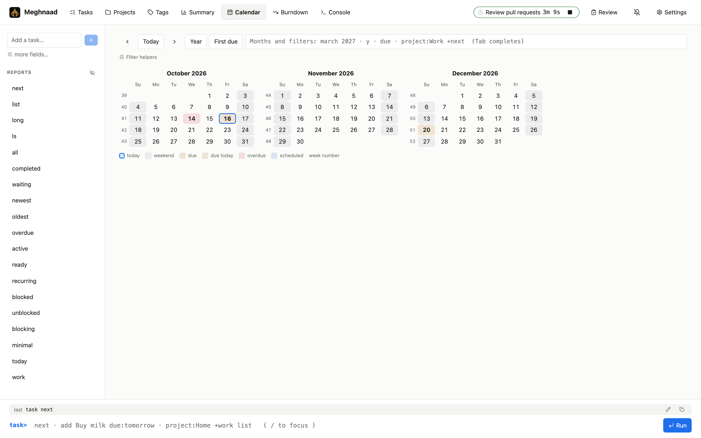</td>
  </tr>
  <tr>
    <td align="center"><sub>Summary: how far along each project is</sub></td>
    <td align="center"><sub>Calendar: click a day to see what is due</sub></td>
  </tr>
  <tr>
    <td>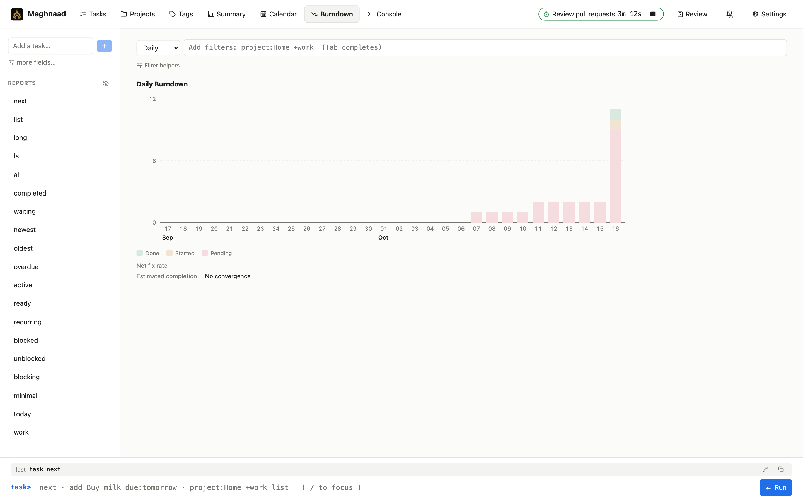</td>
    <td>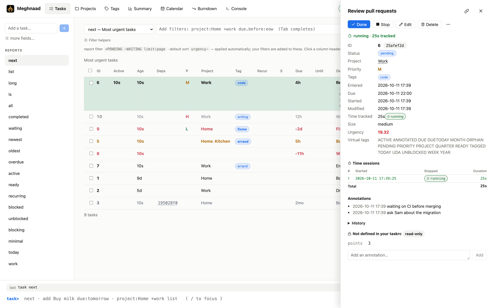</td>
  </tr>
  <tr>
    <td align="center"><sub>Burndown, drawn the way <code>task burndown</code> counts</sub></td>
    <td align="center"><sub>Task detail: time tracking, annotations, history</sub></td>
  </tr>
  <tr>
    <td>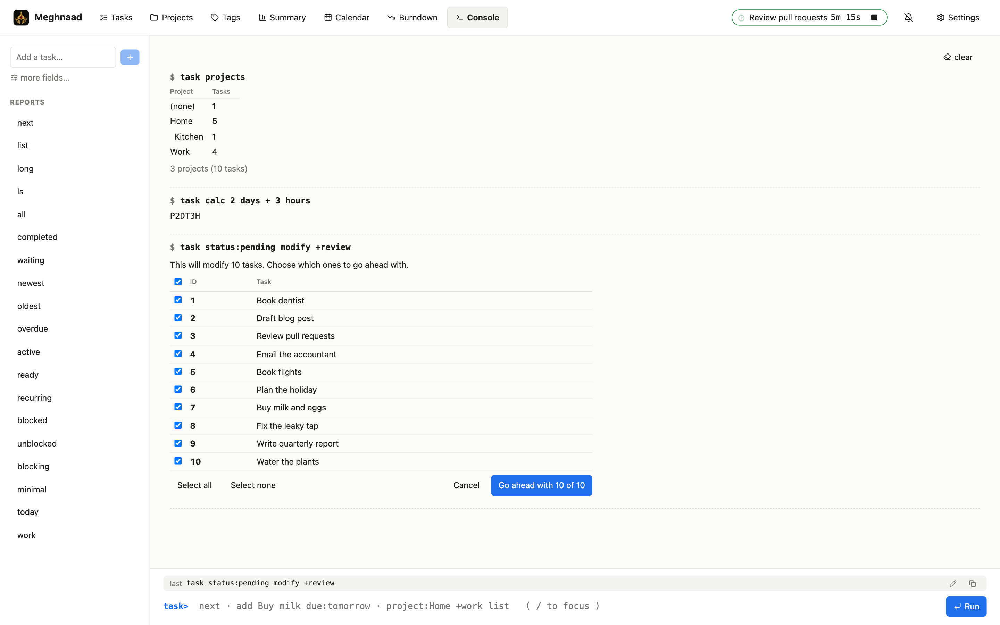</td>
    <td align="center">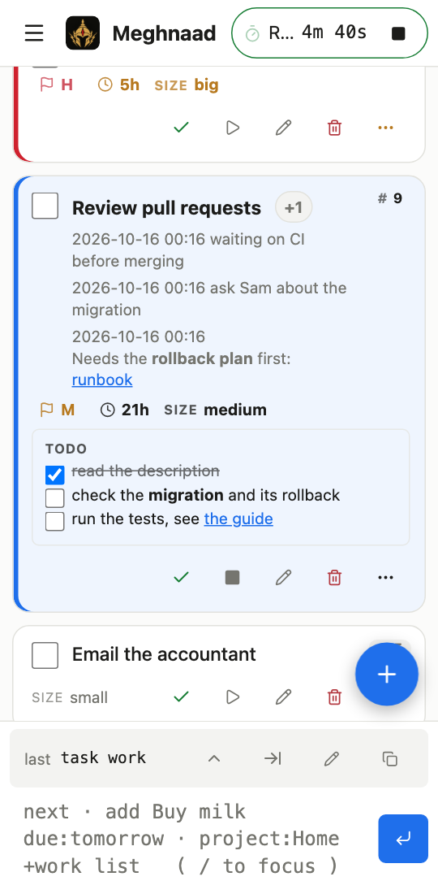</td>
  </tr>
  <tr>
    <td align="center"><sub>The console. Taskwarrior's yes/no/all/quit becomes a table of ticks</sub></td>
    <td align="center"><sub>On a phone</sub></td>
  </tr>
  <tr>
    <td>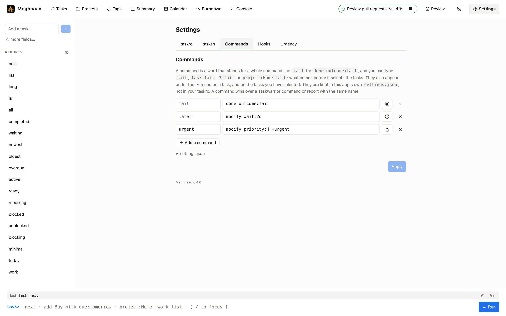</td>
    <td>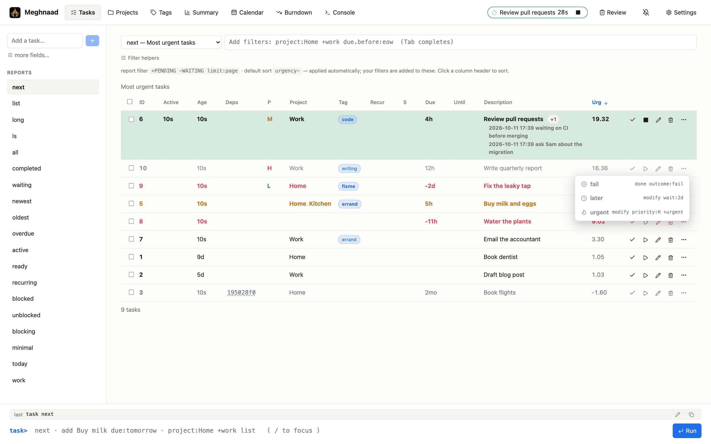</td>
  </tr>
  <tr>
    <td align="center"><sub>Settings: your own commands, with any Lucide icon</sub></td>
    <td align="center"><sub>They are on the ⋯ menu of a task, and of the selected tasks</sub></td>
  </tr>
  <tr>
    <td>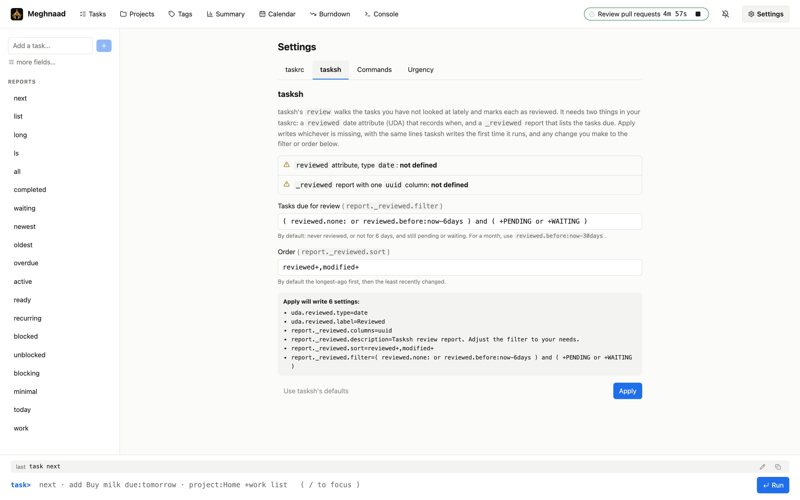</td>
    <td>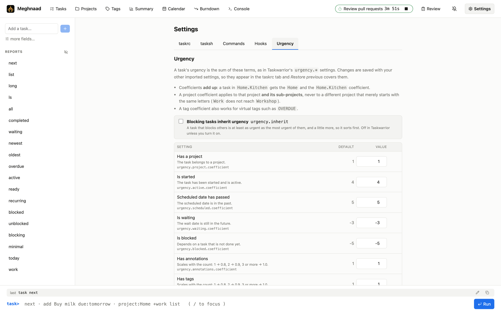</td>
  </tr>
  <tr>
    <td align="center"><sub>Settings: the tasksh setup, with the exact lines it writes</sub></td>
    <td align="center"><sub>Settings: urgency coefficients next to their defaults</sub></td>
  </tr>
  <tr>
    <td>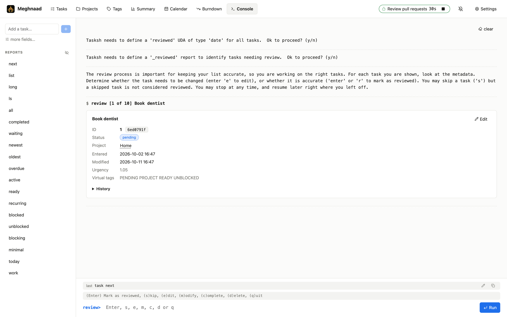</td>
    <td>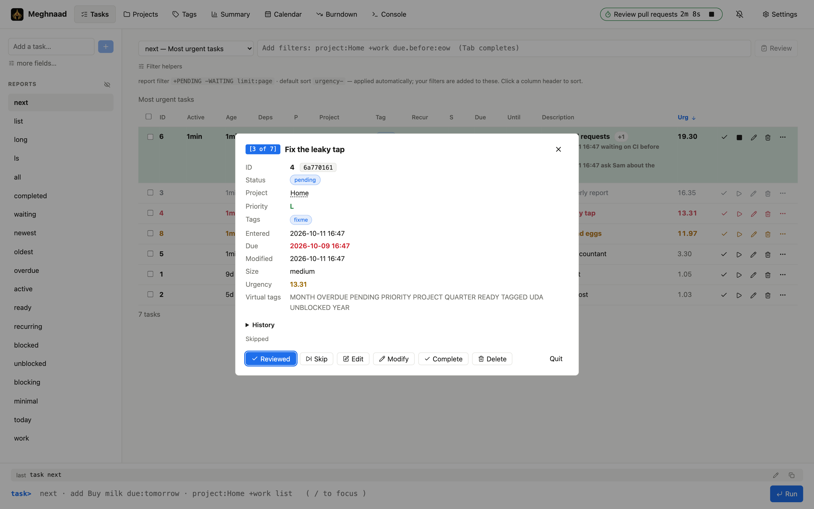</td>
  </tr>
  <tr>
    <td align="center"><sub>tasksh's review in the console: press a key, as in tasksh</sub></td>
    <td align="center"><sub>The same review as a card, with the same keys</sub></td>
  </tr>
</table>

## Documentation

| | |
| --- | --- |
| **[Using Meghnaad](docs/using.md)** | Pages, console, confirmations, hooks, recurrence, urgency, time tracking |
| **[Deploying](docs/deploy.md)** | Setup, GitHub Actions deploy, Access, connecting `task`, troubleshooting |
| **[Architecture](docs/architecture.md)** | The engine, sync, platform limits, how correctness is kept |
| **[taskrc support](docs/taskrc-support.md)** | Every `taskrc` option: done, partial, not done |

## How it works

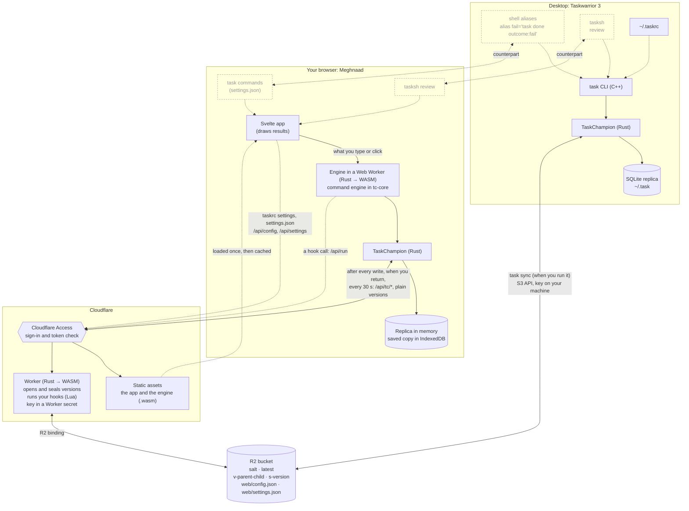

- **Dashed grey boxes** are not Taskwarrior: your own words for command lines (shell aliases on the desktop, task commands
  here) and tasksh's `review` (tasksh there, built in here). They only ever send ordinary
  commands.
- **The engine runs in your browser.** Taskwarrior's rules live in one place, `tc-core`, compiled to WebAssembly and run
  in a Web Worker in the page. It holds your tasks in memory, so a command costs no round trip and uses none of the
  Worker's CPU. Only your hooks run elsewhere, on the Worker (below). The Svelte app only draws.
- **The bucket** holds TaskChampion's standard cloud layout, encrypted client-side. The browser's replica and your CLI
  are interchangeable replicas of it.
- **The Worker keeps the secret.** It checks Cloudflare Access, and opens and seals the versions that pass between the
  bucket and your browser (`/api/tc/*`), so the encryption secret never leaves it. It parses no tasks. It also runs your
  hooks: the engine sends it a task and gets the task back (`/api/run`).
- **The browser keeps a copy** in IndexedDB, so a visit starts from where the last one ended and only pulls what is new.
  It syncs after every write, when you come back to the tab, and every 30 seconds while you look at it; other tabs are
  told when one pushes.
- **Imported taskrc settings** are stored in the bucket, so they survive restarts and follow you between devices.
  The app's own `settings.json` (task commands, so far) is stored beside them; the Worker keeps its text as it is and
  only the browser reads it.

|                | Desktop Taskwarrior        | Meghnaad                                                                                                      |
| -------------- | -------------------------- | ------------------------------------------------------------------------------------------------------------- |
| Local state    | Persistent SQLite          | In the page, with a saved copy in the browser (IndexedDB)                                                     |
| Sync           | When you run `task sync`   | After every write, when you return to the tab, every 30 s while you look at it                                |
| Offline        | Works                      | Changes work and are kept; they go up when the connection is back. The page itself needs a connection to load |
| Encryption key | Only on your machine       | In a Worker secret; the Worker opens and seals what passes through it                                         |
| Task ids       | Local to that replica      | Computed separately, so they differ                                                                           |
| Hooks | Scripts in `~/.task/hooks` | Lua functions in a script kept in the bucket, edited in Settings; they run on the Worker |

More in [Architecture](docs/architecture.md).

## Quick start (local)

Runs without a Cloudflare account; wrangler simulates R2. You need [Rust](https://rustup.rs) 1.91+ and Node.js 20+.

```bash
git clone <this repo> && cd Meghnaad
npm install
cp .dev.vars.example .dev.vars   # local-only secret + Access bypass
npm run dev                      # builds the engine, then serves the app (hot reload) and the Worker
```

The first build takes a few minutes (it installs the `wasm-bindgen` tool once). Open **http://127.0.0.1:5273**: the
app with hot reload, and the Worker behind it on 8787. The engine is rebuilt when the Rust under `crates/tc-core` or
`crates/browser` changes, and the Worker when its own does. For demo data run `./scripts/seed-dev.sh`. Local R2 data lives
in `.wrangler/state` (delete it to start over), or somewhere else with `npm run dev -- --persist-to DIR`; the ports
are `--api-port` and `--web-port`.

## Deploy to Cloudflare

You need Workers, R2 and Access; each has a free plan.

```bash
npm install
npm run setup        # guided: bucket, domain, secret, Access; safe to repeat
npm run deploy       # whenever you update the code
```

Setup asks for your sync bucket and encryption secret, deploys, and tells you what to click to connect Access. Until
then the app shows a setup page and nothing is reachable. Pointing your `task` CLI at R2 is in
**[Deploying](docs/deploy.md)**. To deploy from GitHub instead, run the manual **Deploy** workflow
([setup](docs/deploy.md#d-from-github-actions-manual)).

## Using it

The header has **Tasks**, **Projects**, **Tags**, **Summary**, **Calendar**, **Burndown** and **Console**, and **Settings**
(the taskrc, tasksh, your own commands, hooks and urgency). Anything you can click
you can type:

```
project:Home +errand due.before:eow list
add Pay rent project:Home due:eom +bills
3 modify due:2026-12-25T08:30 priority:H
3 done            3 delete            undo
calc 2 days + 3 hours
history.monthly   ghistory.monthly   timesheet   export   (Console only; export downloads a file)
show weekstart     config weekstart monday   (Console only)
```

A report typed in the Console prints there; elsewhere it opens in Tasks. Taskwarrior's confirmations arrive as a table of
ticks. More in **[Using Meghnaad](docs/using.md)**.

## Hooks

Taskwarrior's four hooks are functions in a **Lua script** you edit in **Settings → Hooks**, with highlighting and errors
marked as you type. A hook gets the task (tags as a set, dates you can calculate with), returns it changed or refuses the
command, and what it prints appears in the Console. The script is kept in your bucket and runs on the Worker, so changing
it needs no rebuild or deploy and a script can hold secrets that never reach the page. See
[Hooks](docs/using.md#hooks).

```lua
function on_add(task)
  if task:in_project("Work") then
    task.tags:add("office")
    say("Tagged +office.")
  end
end
```

The Lua runs in a sandbox (`string`, `table` and `math` only; no files) and is stopped if it runs too long. Because it runs
on the Worker, a script can call other services (`http.post(...)`, to hosts it declares, over https) and read named secrets
(`secret("jira")`) that are kept apart from the script and never reach the page. The Lua adds about 305 KB (compressed) to
the Worker; the engine in the browser is unaffected.

## Security

- **Login** is Cloudflare Access. The Worker validates the `Cf-Access-Jwt-Assertion` token on every `/api/*` request
  (RS256 signature, issuer, audience, expiry, not-before) and refuses forged, `alg: none` and cookie-only tokens.
  Misconfiguration means `403`, never open. `npm run test:auth` proves it against a mock Access.
- **Cross-site requests:** writes from another `Origin` are refused, responses are `no-store`, and the app has a strict
  Content-Security-Policy. It lets the page connect to one other host, `cdn.jsdelivr.net`, and only to read icon files
  (below); scripts, images and styles still come from the app alone.
- **Icons from a CDN:** a task command can use any [Lucide](https://lucide.dev) icon. The few the app uses are bundled; any
  other is fetched as a small SVG file from jsdelivr at a pinned Lucide version, and only a short list of plain shapes
  is kept from it, so what arrives is drawn and never run. Fetching one tells that host your IP address and the icon's
  name, nothing else. Without the network those you have used are remembered by the browser, and the rest show a
  terminal icon.
- **Encryption** is TaskChampion's (PBKDF2-HMAC-SHA256, then ChaCha20-Poly1305). The Worker holds the secret and opens
  and seals what passes between the bucket and your browser, so whoever can read Worker secrets in your Cloudflare
  account can read your tasks. It is not end-to-end encrypted from Cloudflare. The Worker uses an R2 binding and holds
  no R2 token. Your browser keeps a copy of your tasks in plain form in its own storage (IndexedDB), like any app
  that works offline: whoever can read your browser profile can read it.
- **The taskrc importer** never stores, logs or returns sync or credential values; tests feed it a file full of secrets
  and check none appear.

## Development

```
crates/tc-core/   the engine: protocol, crypto, filters, reports, commands, taskrc  (pure Rust)
crates/browser/   the engine as WebAssembly for the browser (tc-core + sync through the Worker)
crates/worker/    the Cloudflare Worker: Access check, R2 store, opens and seals versions, settings
web/              the Svelte 5 app (Vite)
scripts/          setup / deploy / build / dev server · seed-dev.sh (demo data) · interop-local.sh (real-CLI regression)
docs/             the guides above
```

```bash
npm run dev                   # the dev server: engine build and rebuild, Worker, app with hot reload
npm run build:engine          # the engine for the browser alone (web/src/engine/pkg)
npm test                      # cargo test + the web unit tests + the deploy-script tests
npm run check                 # svelte-check (types, accessibility)
npm run lint                  # rustfmt + clippy (warnings are errors) + Prettier + ESLint; `lint:rust`, `lint:js` for one half
npm run format                # cargo fmt and Prettier, fixing in place
npm run test:auth             # Cloudflare Access: forged, expired, wrong-audience tokens... all refused
./scripts/interop-local.sh    # real `task` ⇄ the Worker against one local S3 bucket, both directions
```

`interop-local.sh` needs `task`, the `aws` CLI, `sqlite3`, a built Worker and a local S3-compatible server that enforces
conditional writes, for example `docker run -d --name tw-s3 -p 18333:8333 chrislusf/seaweedfs server -s3 -dir=/data`.
It does not touch a running dev server.

CI (`.github/workflows/ci.yml`) runs tests, formatting, linting and the type check on every push and pull request.
Deploying is the separate manual workflow.

Taskwarrior's behaviour is ported from its source and checked against the real `task`: when changing filters, sorting,
urgency, dates or confirmations, read the C++ first and compare ([method](docs/architecture.md)).

## Troubleshooting

See [Deploying](docs/deploy.md#troubleshooting-a-deployment). One to know: **Cloudflare error 1102** ("Worker exceeded
resource limits"), usually on the first request after a quiet spell, is the CPU limit of the free plan. It is uncommon,
since the engine runs in your browser and the Worker only passes versions through; the app retries and Workers Paid
lifts the limit if it ever bothers you. If the page shows *Couldn't sync with the server*, what you changed is kept in
the browser and goes up when it works again.

## Known limitations

- **Icons beyond the bundled ones** are fetched from a CDN when first shown (see Security). Offline, the ones your
  commands use are remembered by the browser and the rest show a terminal icon.
- **Single user:** one set of settings, shared by every browser that signs in.
- **No offline start:** changes work offline and are kept, but the page itself is loaded from the Worker, so it needs a
  connection to open (there is no service worker yet).
- **Browser support:** the engine needs Web Workers and WebAssembly (every current browser has them); the first visit
  downloads it (about 600 KB compressed, then cached). If the page cannot start it, it says why and runs no command.
- **Old versions** (over 180 days old and covered by a snapshot) are cleaned up as the CLI does, after about one push in
  twenty. A device offline for longer may need a fresh `task sync` set-up.
- **`undo`** lives in the page's memory and is lost when the tab is closed or reloaded.
- **Dates you type** are read in your `dateformat`, then as ISO or words (`friday`, `3d`). ISO week and ordinal dates
  (`2026-W52`) aren't understood.
- **Hooks** are Lua with no network or files, and each is a request to the server. `undo` doesn't run them
  ([Hooks](docs/using.md#hooks)).
- **Not every `taskrc` option applies:** terminal, colour and local-file options don't make sense here, and `include`
  and `purge.on-sync` aren't supported ([taskrc support](docs/taskrc-support.md)).
- **Phone layout** was checked in an emulated browser; try it on your device.

## About the name

<p align="center">
  
</p>

Meghnaad is the warrior of the Ramayana who fought from behind the clouds: Taskwarrior (the warrior) running on
Cloudflare (the cloud), with Access as the cover.

## License

[MIT](LICENSE) © 2026 Utsob Roy
