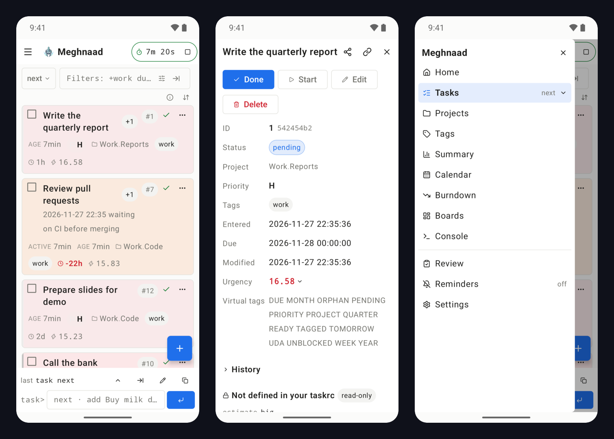

# The Android app

A native app in Kotlin and Compose, with the engine as a native library and widgets on the home screen. It keeps your
tasks on the phone and syncs them directly with your store: a branch of a git repository on GitHub, Gitea or Forgejo, an
S3-compatible bucket, or a TaskChampion sync server. No Worker and no Cloudflare Access are involved, and your keys stay
on the phone. It does what the web app does, with a layout made for a
phone, plus two things a browser tab can't: reminders that come with the app closed, and widgets.

This page is setting it up. What the app does beyond the shared guide (the widgets, reminders, tablets and
keyboards, links) is in [The Android app's own](using/android.md).

## Install

Download `meghnaad-<version>.apk` from the [latest release](https://github.com/uroybd/Meghnaad/releases/latest) and
open it on the phone (Android asks once to let the browser or the file manager install apps). It needs no Worker, no
Cloudflare Access and no static site: it syncs with your store directly. Later versions come through the app itself
([Updates](#updates)). To build it yourself, see [Building the Android app](building.md#building-the-android-app).

## First run

The app asks where your tasks sync, the same store your `task` CLI uses ([Where your tasks live](stores.md)): **S3
bucket**, **Sync server** or **Git**. Each asks for the encryption secret too (the same as `sync.encryption_secret` in
your taskrc), and tries what you entered with a first sync, saying what is wrong if it fails. The keys and tokens are kept
encrypted with a key in the Android Keystore. No screen can read them: the engine takes them to sync and nothing else
does.

### A git repository

Choose **Git** to sync with a branch of a git repository: the same branch `task` 3.5.0 syncs to with `sync.git.*`, and
the one the web app's static site and git Worker use, so they all share the tasks. The phone has no `git`; it uses the
forge's API.

| Field | What to put | In your taskrc |
| --- | --- | --- |
| Repository | `owner/name`, such as `alice/tasks` | the repository of `sync.git.remote` |
| Branch | `taskchampion` unless you chose another | `sync.git.branch` |
| API address | `https://api.github.com` for GitHub, `https://<host>/api/v1` for Gitea or Forgejo, `https://<host>/api/v3` for GitHub Enterprise | |
| Token | a token that may read and write the repository's contents | |
| Encryption secret | the same as `sync.encryption_secret` | `sync.encryption_secret` |

- **The token.** On GitHub, a fine-grained personal access token for that one repository with **Contents: Read and
  write**. On Gitea and Forgejo, an access token with the **repository** scope (read and write). It is kept in the
  Keystore with the other keys and never shown.
- **Keep the repository private.** The tasks are encrypted, but the app's settings and the hooks script go on the same
  branch, under `web/`, as plain text. `task` leaves them alone.
- **On GitHub the repository needs one commit** (a README will do) before the branch can be made; Gitea and Forgejo make
  it from nothing. A branch that isn't there yet is made on the first sync.
- The API address must be `https://` (`http://` only for `localhost` and `127.0.0.1`).

The settings and hooks go to the branch, so no bucket is needed for them: the two switches under **Settings → Sync** keep
them in step with the branch, as they would with a bucket.

### A bucket

Choose **S3 bucket** for any S3-compatible bucket. It asks for the S3 endpoint
(`https://<account>.r2.cloudflarestorage.com` for R2), the bucket, the region (`auto` for R2, the real one for AWS), and
an access key and its secret. For R2, the key is an R2 API token with **Object Read & Write**, scoped to the bucket
([an S3 or R2 bucket](stores.md#an-s3-or-r2-bucket)).

#### An example

| Field | Cloudflare R2 | AWS S3 | MinIO behind HTTPS |
| --- | --- | --- | --- |
| S3 endpoint | `https://0123456789abcdef.r2.cloudflarestorage.com` | `https://s3.eu-west-1.amazonaws.com` | `https://minio.example.com` |
| Bucket | `taskwarrior-sync` | `my-task-sync` | `tasks` |
| Region | `auto` | `eu-west-1` | `us-east-1` |
| Access key ID (the client ID) | `4f1c…` (32 characters) | `AKIA…` | your MinIO user |
| Secret access key (the client secret) | shown once when the token is made | shown once | your MinIO password |
| Encryption secret | the same as `sync.encryption_secret` in your taskrc | same | same |

These are the values your `task` CLI already has: `sync.aws.region`, `sync.aws.bucket`, `sync.aws.access_key_id`,
`sync.aws.secret_access_key`, `sync.encryption_secret` and `sync.aws.endpoint_url` (with `task` 3.5, the endpoint is in
`AWS_ENDPOINT_URL`). The app always puts the bucket in the path, so `sync.aws.force_path_style` has no field. For R2 the account
id in the endpoint is in the dashboard's right-hand column.

The endpoint must be `https://`; plain `http://` is accepted only for `localhost` and `127.0.0.1` (for trying it out).

### A sync server

Choose **Sync server** to use a TaskChampion sync server (`taskchampion-sync-server`, or anything speaking its
protocol). It takes three things, the values your `task` CLI already has:

| Field | In your taskrc |
| --- | --- |
| Server address, such as `https://tasks.example.com` | `sync.server.url` |
| Client ID, a UUID the same on every device that shares the tasks (**Generate** makes one for a new set) | `sync.server.client_id` |
| Encryption secret | `sync.encryption_secret` |

The address must be `https://` (`http://` only for `localhost` and `127.0.0.1`). Tasks are sealed on the phone before they
are sent, so the server holds only what it can't read, and the client ID is kept in the Keystore like the keys.

The web app can't reach a sync server, so tasks that sync to one don't reach the web app. A sync server doesn't hold the
app's settings and hooks either. **A bucket for those files is optional**: tick *Also keep settings and hooks in a
bucket* and give it a bucket (a different one from the web app's tasks is fine), and the two switches under **Settings →
Sync** keep them in step, as below. Without one they stay on the phone.

### Syncing somewhere else

A phone remembers where its tasks were last synced. If you point it at a different place (another repository, bucket or
server, or another kind of store), the new place doesn't have the version the phone stands on, so the app **asks first**:

- **Keep them and add them there**: the phone's tasks are added to what the new place holds (the same tasks aren't
  duplicated), and everything is then in both.
- **Start from what is there**: the phone's tasks are let go, and only what the new place holds is kept.
- **Cancel** changes nothing.

Nothing on the phone changes until the new place has answered, so a wrong address or secret leaves it as it was. A phone
with no tasks moves without asking.

## Updates

The app checks for a newer version itself: when it opens (at most once a day) it asks GitHub for the latest release of the
repository that built it, and says **"Meghnaad 0.6.36 is out"** once per new version. **Settings** has an **Updates**
section at the bottom of every tab:

- **Check for updates** works any time.
- **Download the APK** appears when a newer one is out. It opens the release's APK in the phone's browser, which downloads
  it and offers to install it over this app (Android asks once to let the browser install apps).
- **What's new** opens the release page.

Your tasks and connection stay, as long as the APK is signed with the same key. Only `https` addresses from the release are
opened, and nothing is sent to GitHub but the request for the release.

A build knows where its releases are only if it was told: the Release workflow passes `ANDROID_UPDATE_REPO` (its own
repository, so a fork's APK looks at the fork's releases). A hand-made build leaves it empty and shows no **Updates**
section; set `ANDROID_UPDATE_REPO=owner/name` when building to try it.

## Different from the web app

### Settings live on the phone

Unless you turn sharing on, the taskrc subset, the app's settings, the hooks script and the hook secrets are in the
app's private storage. Under **Settings → Sync** (when connected) you can keep **the
settings** (the taskrc files under `web/rc/`, `web/config.json`, `web/settings.json`) and/or **the hooks**
(`web/hooks.lua`) in step with the bucket or the git branch. They are the files the web app keeps there, so an edit on
either side reaches the other at the next sync.

- What changed since the last sync wins. When both changed, the newer wins and the other is kept as the web app's restore
  point (`config.prev.json`, `hooks.prev.lua`; for the taskrc files, `rc.prev.json`, all together).
- A taskrc file deleted on one side and untouched on the other is deleted on both.
- A file that won't load, or a settings or taskrc file holding a credential, is not taken from the bucket or the branch.
- **The hook secrets are never synced.** The two switches are this phone's own choice, kept on the phone and not synced.

### Without sharing

Import your taskrc again in **Settings → taskrc**: paste it, or use **+ New** to upload files or a whole folder or
to import from a link (a bottom sheet). The tab is laid out as on the web, with the list of files folded away and opened
over the editor ([Your taskrc](using/settings.md#your-taskrc)). **Download** (in the **⋯** menu by the file's name)
and **Download all (.zip)** keep a file or the whole folder through the save dialog. **Add holidays** (under **+ New**,
in a bottom sheet) fetches a country's holidays from holidata.net or
date.nager.at, or a calendar (`.ics`) from a link, with a plain HTTPS request from the phone (a calendar's link and every
redirect are held to the rules the Worker applies to a taskrc link), and saves them as a file in the taskrc folder.

### Settings → Sync

This shows where the phone syncs (the repository, branch and API address; the endpoint, bucket, region and a hint of the
access key's name; or the sync server and a hint of the client ID; never a secret or a token) and changes it. Blank
fields keep their value, so you can correct the address without typing the keys again. The change is tried with a sync first, and one that doesn't work
isn't kept.

### Hooks run on the phone

They run in the same Lua sandbox with the same `http` and `secret()` (each secret going only to the hosts you saved it
with, so a script that arrives from the bucket or the branch can't send the phone's secrets anywhere else), from the
script you edit in **Settings → Hooks**. The phone makes their network calls, and the secrets are sealed with the Keystore key.

### No Cloudflare Access, no Worker

Anyone with the phone unlocked has the app: lock the phone.
