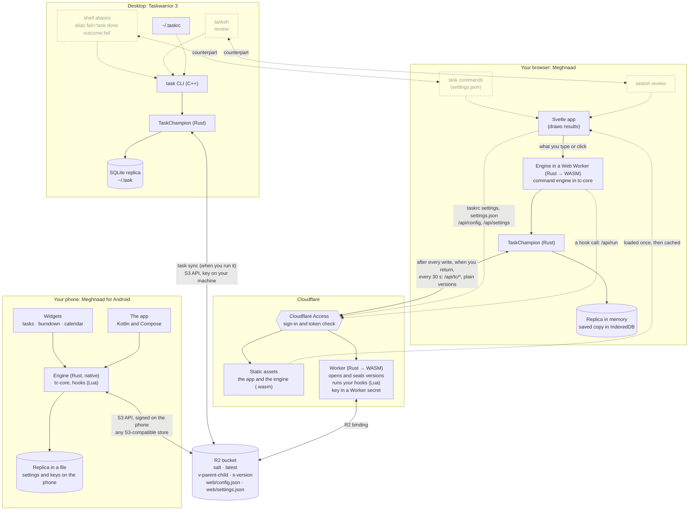

# Architecture

How Meghnaad is put together, and why. For what it does, see [Using Meghnaad](using.md); for the
settings it reads, [taskrc support](taskrc-support.md).

## The idea

Taskwarrior 3 keeps its data in **TaskChampion**, which syncs through a *server*: a place where every client
pushes its changes (as numbered "versions") and pulls everyone else's. With `sync.server.type=aws` that place is a
bucket, and the clients agree on its layout. Meghnaad is one more client of that bucket, written for the browser:

- It is a **replica** like your laptop's, not a copy of the database. It reads and writes the same bucket, speaking
  TaskChampion's own format and encryption, so `task sync` and the web app see each other's changes.
- The **replica lives in your browser**. The engine (Rust compiled to WebAssembly, in a Web Worker in the page) holds
  your tasks in memory, runs Taskwarrior commands against them, and keeps a saved copy in IndexedDB. A small
  Cloudflare **Worker** sits between the page and the bucket: it checks Cloudflare Access, holds the encryption secret,
  and opens and seals the versions that pass through. It never parses a task.
- Everything that is *Taskwarrior behaviour* (filters, reports, urgency, recurrence, confirmations, dates) lives in
  one Rust library, `tc-core`. The Svelte app draws what the engine returns; it has no logic of its own.
- It started the other way round: the Worker held the replica and ran every command, so every request spent the free
  plan's 10 ms of CPU. Moving the engine to the page took that cost off the Worker, and made reads and writes
  instantaneous. Every current browser has the two things it needs (Web Workers and WebAssembly), so the Worker does not
  run the engine any more.

The dashed grey boxes are not Taskwarrior itself. They are what people add around it: shell aliases and `tasksh` on the
desktop, and their counterparts here, **task commands** (`settings.json`, expanded in the browser) and **tasksh's
`review`** (see below; the Settings page sets up the `reviewed` attribute and `_reviewed` report it needs). Both
only ever send ordinary commands to the engine, so it knows nothing about them.

## Where things run

**In the page** (`web/src/engine/`, `crates/browser`): the engine, in a dedicated Web Worker so that a big report never
blocks the page. The Svelte app sends it what you typed or clicked (`{ "line": "…" }` or `{ "args": […] }`, with your
time zone and the time) and gets back the JSON the app reads. One entry point means one place
where Taskwarrior semantics live. A file to import goes the same way, as its text; `tc-core`'s `import` module parses
and checks it. The engine answers one message at a time, in the order they arrive.

**On the Worker** (`crates/worker`), behind Cloudflare Access:

1. **Static files** (the app shell and the engine's `.wasm`) are served by Cloudflare without running the Worker. Only
   `/api/*` runs it.
2. **`auth.rs`** checks the Cloudflare Access token on every `/api/*` request: RS256 signature against your team's
   published keys, issuer, audience, expiry. Misconfiguration means `403`, never open.
3. **`/api/tc/*`** is the sync protocol between the page's replica and the bucket, in plain form over HTTPS (see
   [Sync](#sync)): `GET pull`, `POST push`, `GET`/`POST snapshot`. The Worker opens and seals each version with the
   key it derives from the secret (`session.rs` keeps that key between requests), so the secret never leaves it.
4. **Settings** have routes of their own, because they live in the bucket and not in a replica: `/api/config` and
   `/api/config/*` for the taskrc and urgency, `GET`/`PUT /api/settings` for `settings.json`, and
   `PUT /api/config/engine`, which saves what a `config` command changed (the engine worked it out in the page; the
   Worker refuses anything sync- or credential-like and keeps the previous version for a restore).
5. **Hooks.** The user's Lua script is its own object in the bucket (`web/hooks.lua`, with the previous one beside it),
   not part of `settings.json`, since the page reads that in full and a script may hold secrets. `POST /api/run` calls
   one hook (`{ fn, args, now, tz, … }`; the answer is `{ ok, value, say }`, or `{ ok: false, error, say }` for a refusal
   or a failure); `GET /api/hooks/defined` says which of the four the script defines, so the engine asks only for those;
   `GET`/`PUT /api/hooks` read and save the script (for the editor alone; a script that does not load is refused);
   `POST /api/hooks/check` says what is wrong with a script and where, as you type. The VM is built once per Worker
   instance and reused, and again when the script changes (or is busy waiting on the network for another request, when a
   call gets a VM of its own). The Worker is the host that gives a script the network and secrets (`hooknet.rs`: `fetch`
   with a timeout, no automatic redirect, a 1 MB cap on the answer, a log line per call). Secrets are looked up as a Worker
   secret `HOOK_SECRET_<NAME>` first, then in `web/hook-secrets.enc`, a map sealed with the key the Worker derives from
   `TC_ENCRYPTION_SECRET`; `GET`/`PUT`/`DELETE /api/secrets[/<name>]` manage that one (names only ever come back).
6. **`GET /api/health`** says whether the Worker can reach the bucket and open it with the secret (it derives the key);
   it holds no tasks.

There is no engine on the Worker, so nothing there runs a command; only your hooks run there (a hook call is a task in and a task
out, never the replica). If the page cannot start the engine (it needs Web Workers and WebAssembly, and a
Content-Security-Policy that allows `'wasm-unsafe-eval'`), it says so, instead of asking the server.

**Hooks, in order.** For a command the engine runs `on_launch` (if the script defines it) before anything; `on_add` and
`on_modify` for each task as the command builds the change, just before it is committed, each a request that returns the
task, which `diff` turns into changes in the same batch (a refusal ends the command and writes nothing); and `on_exit`
last. A hook that cannot be reached is skipped with a warning that says so, and the command goes on. The engine's
`HookHost` is `async` for this; `RemoteHooks` (`crates/browser`) is the one that calls the Worker, and `LuaHooks` runs a
script in-process, which is how a host with no Worker (the Android app, later) uses the same script and the same runner.
A script's cold start is 3-10 ms and a warm call under a millisecond (measured under Node's V8, not on a Worker): that is
why the VM is kept, and why a script is bounded by an instruction budget (5 million) and 32 MB.

`http` and `secret` are `async` functions of the Lua runtime (omnilua's `async` feature: a script's coroutine is suspended
while the Rust future runs), supplied by a `Net` the host passes to `LuaRunner::load_with`; a host with none (a test, a
bare runner) gives a script an error. The runner enforces the rules, whichever host it is: the script declares the hosts
it may call with `allow_hosts` while it loads (and cannot widen them later), only `https://` (or `http://` to this
machine), at most five requests and 256 KB of body per call, a timeout of at most 10 seconds, and the value of every
secret it read is replaced by `***` in what it printed, failed with or returned. A request that fails comes back to the
script as `nil` and a reason, because an error from an async function ends the call and cannot be caught with `pcall`.

**On Android** (`crates/android`, `app/`) there is no Worker: the engine is `tc-core` as a native library, called from
Kotlin over JNI, and it syncs straight with the bucket, signing S3 requests itself (`CloudServer` over an `S3Store`, the
same server code the Worker runs over R2). See [the Android app](android.md).

**The app** (`app/`, Kotlin and Compose) draws that engine natively, not in a WebView: `shared` holds the
engine's JSON types and API (mirroring `web/src/lib/types.ts` and `api.ts`), a `Store` that mirrors the web's store, and the
screens; `androidApp` holds the activity, the reminder alarm's receiver and the widgets. Taskwarrior behaviour stays in
`tc-core`, reached through the same JNI library (`crates/android/src/helpers.rs` for the few pure helpers a screen needs);
only the web app's own view logic is ported. Reminders are the web's rules (`Notify.kt` mirrors `notify.ts`) plus an alarm:
after every change the next moment something is worth saying is worked out and `AlarmManager` wakes the app then, so they
work with the app closed. See `app/README.md`.

## `tc-core`: the engine

Pure Rust, no I/O of its own, tested natively. The browser engine, the Node harness (`scripts/engine-cli.mjs`) and the tests are its hosts; the Worker uses its settings, report and protocol code but runs no commands.

| Area | Modules | What they do |
| --- | --- | --- |
| **Protocol** | `cloud`, `crypto`, `names`, `store`, `wire` | TaskChampion's cloud server over an object store; PBKDF2 → ChaCha20-Poly1305; object names; the storage trait the Worker implements over R2; and `wire`, the plain protocol between the page's replica and the Worker (a batched pull, a push, snapshots), with both halves, so a test can run a whole sync through them |
| **Replica storage** | `live` | The replica's in-memory database. TaskChampion's own copies every task on the first write of each transaction, so every sync and every write cost a full copy (and twice the memory for a moment); this one changes its data in place and keeps a short journal to undo a transaction that is dropped without commit. A test runs random transactions against both and compares them. It can also be saved to bytes and loaded again (`save`, `load`, `save_replica`), which is what the browser keeps in IndexedDB; a test saves and restores a replica during random runs and checks it carries on and syncs the same |
| **Tasks** | `model`, `filter`, `modify`, `dates`, `rx`, `recur` | A plain view of a task; filter expressions; planning `modify`/`add`; Taskwarrior's date and duration parsing; Taskwarrior's regular expressions; recurring tasks |
| **Commands** | `cli` | Parsing a command line (aliases, abbreviations, contexts, `rc.` overrides), the write path with its confirmations (`add`, `log`, `duplicate`, `modify`, …), undo, the `commands` listing, and dispatch to everything below |
| **Reports** | `report`, `run`, `urgency`, `history` | Built-in and custom reports, running one (filter, sort, limit, columns), urgency, and the change history of a task |
| **Colour** | `color` | Taskwarrior's colour specifications and how they blend, the rules that colour a task (with precedence and merge), the `colors` command and the history graph's colours; checked against the escape codes of the real `task` |
| **Views** | `summary`, `calendar`, `burndown`, `activity`, `stats`, `calc`, `export`, `import` | The `summary`, `calendar`, `burndown.*`, `history.*`/`ghistory.*`/`timesheet` (`activity`), `stats`, `calc` (and `_get`, which reads the same DOM) and `export` commands, each a port of its Taskwarrior counterpart. `export` writes Taskwarrior's own JSON from the stored properties; `import` reads it back (a port of `CmdImport`, checking the whole file before it writes anything); the app's pages use a separate, hidden `_rows`, and the detail view's History a hidden `_history <uuid>` that reads one task's operations without loading the rest |
| **Hooks** | `hooks`, `lua_hooks` (+ `lua/prelude.lua`) | `hooks` runs a user's code at Taskwarrior's four hook points (`on_launch`, `on_add`, `on_modify`, `on_exit`): any `HookHost` (async, so a hook may be a request) or plain `Hooks`, with what they print returned to the Console, the task as JSON (`task_to_json` / `task_from_json`) and `diff` turning what came back into changes. `lua_hooks` (the `lua` feature) runs a Lua script in a sandbox (`LuaRunner`: JSON in, JSON out) and as in-process hooks (`LuaHooks`); the prelude is the Lua library a script gets: a task, tags as a set, dates and durations with arithmetic |
| **Settings** | `taskrc`, `rc_url`, `settings`, `appsettings` | The allowlisted subset of a taskrc: what is accepted, what is refused, and the typed `Config` the rest reads; `rc_url` is which links the Worker may fetch a taskrc from (HTTPS to a public host name only, redirects included) and the GitHub/GitLab page-to-raw rewrite; and the `show` / `config` / `context` commands that list and edit it under the same rules (`context` is a few `context.<name>.*` settings, edited through `config`); `appsettings` checks that the app's own `settings.json` is a JSON object of a sensible size before the Worker stores it |

### How a command runs

`execute` does the same things in the same order every time:

1. Apply the command line's `rc.<key>:<value>` overrides to a copy of the config, then the active context's own
   settings (which win, as in Taskwarrior).
2. Read the first day of the week, `date.iso` and `dateformat` into the clock, and expand aliases (typed lines only).
3. Parse into a filter, a command and modifications. A word shorter than `abbreviation.minimum` is just a word.
4. Run the `on_launch` hook, which can refuse the command (`show`, `config` and `context` skip it: they are about settings).
5. Do Taskwarrior's housekeeping first: create the recurring instances that are due, expire tasks past `until`.
6. Load the tasks as plain "facts", number the pending ones, and run the command. `on_add` and `on_modify` fire inside
   it, just before a write is committed.
7. Run the `on_exit` hook, and return what the hooks printed with the result (`feedback`), for the Console to show.

Writes go through one path (`write_selected`) so the safety rules are in one place:

- **Questions are data, not prompts.** A write that needs an answer returns a `Confirm` result and changes
  nothing. There are three kinds: `plain` (yes/no: undo, a command with no filter), `permission` (one row per task
  the command would change: Taskwarrior's yes/no/all/quit becomes ticks in a table) and `extras` (follow-ups that
  only arise once those are answered: repair a dependency chain, carry a change to a recurring series). The client
  re-sends the command with the answers (`Options { confirmed, approved, extras }`).
- **Hooks** run inside this path, before the commit: `on_add` and `on_modify` see the task as the command leaves it, and what they hand back is diffed and applied into the same batch, or the command is refused and nothing is saved.
- Everything the command changes is built as one batch of operations and committed once, so it is one undo step.
- Undo can't use TaskChampion's own (it only covers unsynced changes, and the page syncs after every write), so
  the inverse operations are committed as new changes. The stack lives in the page's memory.

### Sync

`CloudServer` is TaskChampion's server interface over the bucket, wire-compatible with the CLI's own AWS/GCP
backends (`salt`, `latest`, `v-<parent>-<child>`, `s-<version>`; encrypted with a key from your secret and the
bucket's salt). The Worker runs it. Because the page's engine is a *replica*, it never needs the CLI's cooperation.

- **Cheap when idle.** One `GET latest`. Catching up lists the versions once and fetches them in batches of 32,
  rather than one at a time.
- **Conditional writes.** `latest` is swapped with its ETag, so two clients pushing at once can't both win; the loser
  re-syncs and retries.
- **Snapshots, like the CLI.** After a push the Worker occasionally (about one push in ten) writes a snapshot and
  removes the ones it supersedes, so a cold start restores one snapshot plus a few versions instead of replaying
  history. A failed snapshot is ignored on purpose: failing the sync would make the replica send an already-sent
  version again.
- **Tidying up, like the CLI.** About one push in twenty is followed by a cleanup, as in TaskChampion's own server:
  it deletes versions that lost a race (but not one a writer may be about to make `latest`), every snapshot but the
  newest, and versions older than about 180 days that the newest snapshot covers. It uses each object's upload time from
  R2's listing and deletes up to 1,000 objects per cleanup in a single request (R2 takes that many at once), so a
  cleanup costs a handful of requests however much it removes; the next one carries on. The oldest versions go first,
  so what is left is always one unbroken chain up to `latest` (a replica that is behind finds the next version or none,
  never a gap). A failure is ignored, since the push it follows has already happened. A replica that was last synced
  before the oldest surviving version can no longer catch up from the versions alone, which is the same for the CLI's
  own server.

### Between the browser and the Worker

The page's replica syncs through `RemoteServer`, a TaskChampion `Server` that speaks `tc_core::wire` to the Worker
instead of touching the bucket: the Worker runs `CloudServer` and answers from it, so everything above (conditional
writes, snapshots, cleanup) happens there, and the page never holds the key.

- **Pull in batches.** TaskChampion asks for the version after the one it has, one at a time. `GET /api/tc/pull?since=`
  answers with a run of up to 24 versions in one body (each 16 bytes of id, 16 of parent, a length and the version), and
  `RemoteServer` hands them out as they are asked for, so a replica 80 versions behind costs about four requests. The
  limit is the 50 subrequests a request may make on the free plan: each version is a read from R2.
- **Push** is `POST /api/tc/push?parent=`, answered with the new version and how much the server would like a snapshot,
  or with `behind` and the newest version when somebody else got there first, which makes TaskChampion pull and push
  again. Snapshots go the same way (`GET`/`POST /api/tc/snapshot`) and are what a new device starts from.
- **When.** The page syncs after every write (to push it), when you come back to the tab, every 30 seconds while it is
  visible, and when another tab of the same browser says it pushed (over a `BroadcastChannel`; only a write is
  announced, so tabs do not answer each other for ever). Before the first command there is nothing to answer from
  unless a saved copy was found, so the first pull is waited for.
- **Failing.** A sync that cannot reach the Worker (offline, or Access has signed you out) changes nothing: the writes
  are in the replica and in the saved copy, and go up with the next sync that works. The page says so and offers a
  retry, and, as a last resort, to throw the saved copy away and start from the bucket.
- **The saved copy** is `LiveStorage::save`: the tasks, the working set, the version it is based on and the changes that
  have not been pushed, as JSON, in one IndexedDB record, written soon after a change and after every sync. A copy that
  cannot be read (another format) is dropped and fetched again.

## Limits of the platform

A Worker request has hard limits, and this app is shaped by them. Cloudflare's numbers (checked at their limits page):

(They bind the Worker, and since the engine moved into the page the Worker does very little: it checks a token, opens or
seals a few objects and, on a cold instance, derives the key. The measurements below are of the engine from when it ran
in the Worker; they show what the engine costs, now in the browser, where there is no such limit, and what it took to
keep it under 10 ms.)

| | Workers Free | Workers Paid |
| --- | --- | --- |
| CPU time per request | **10 ms** | 30 s (up to 5 min) |
| Memory per isolate | 128 MB | 128 MB |
| Subrequests per request (R2 calls count) | 50 | 10,000 |

What this app costs, measured (`crates/tc-core/tests/memory.rs`, and a local `workerd`):

- **The key.** Deriving it (PBKDF2, 600,000 rounds) is the heaviest thing a *cold* instance does. The Worker asks the
  runtime's native Web Crypto for it, which takes about 40 ms; the same in WebAssembly took about 250 ms. A warm
  instance reuses it.
- **A warm request** is a few milliseconds of CPU for a hundred tasks and, before the cache below, tens for thousands
  (filtering, sorting, urgency, serialising).
- **Memory** is small: restoring a snapshot of 3,000 tasks peaks near 6 MB, replaying 1,200 versions from nothing near
  6 MB, and a request over 3,000 tasks 8 MB (19 MB for a full `export`). An `import` of the most one takes (5,000
  tasks, a 2 MB file) peaks near 51 MB, and its `undo` step keeps about 8 MB while the instance lives, which is why the
  request is capped. The test fails if a change makes any of these much worse.

**It runs on Workers Free**, as does its author's own deployment, with R2 and Access on their free plans too. With the
engine in the page, what is left for the Worker is small: a token check, a read or two from R2 and, on the first request
after an idle spell, deriving the key (about 40 ms of native CPU; one such request on a real deployment, back when the
Worker also restored the snapshot and ran the command, used about 550 ms and still completed, because Cloudflare
tolerates a Worker that only *infrequently* runs over and ends requests with error 1102 only when it keeps doing so).
The app retries a read-only request once, because the retry meets a warm instance, and Workers Paid ($5/month) lifts the
limit if that ever bothers you. R2 calls count toward the 50 subrequests per request, which is why a pull carries at most
24 versions (see [Sync](#sync)).

**What is done about CPU.** Turning every stored task into the engine's form (`Facts`) took about 2 µs a task, and every
command began with it, which at 3,000 tasks was most of a read. The engine now keeps that list between
commands (`tc_core::warm`, next to the replica) and rebuilds it only when the storage's change counter
(`LiveStorage::generation`, bumped when a transaction that changed anything commits or is taken back) has moved. Most
requests change nothing, so they skip it. `tests/warm.rs` checks, after every step of a long random run of commands,
direct writes and pulls from the bucket, that the cached list equals a fresh read. The page's own requests were trimmed
to match: `_names` is `_tags` and `_projects` in one request, and the reminder poll asks `_remind` (seven fields) instead
of `_rows` (a full row, with every virtual tag, for each task). Measured natively at 3,000 tasks (WebAssembly is somewhat
slower, but the proportions hold):

| Request | Before | After |
| --- | --- | --- |
| `next`, `list`, `count` | about 8 ms | about 2 ms |
| the name lists (`_tags` and `_projects`) | 2 × 6.2 ms | one request, 0.5 ms |
| the reminder poll | 13.3 ms (`_rows`) | 0.9 ms (`_remind`) |
| a write (`modify` on one task) | about 8 ms | about 1.7 ms |

A write does not rebuild the list either. The storage keeps which tasks each of its last 32 transactions touched
(`Generation::touched_since`), and a list that is a few changes behind is brought up to date by reading just those tasks
and moving them into place (`warm::patch`). That is only done when no touched task depends on another, or has another
depending on it, since a dependency changes whether tasks are blocked or blocking, which is worked out for the whole
list; then the list is built again, as it is after a long pull from the bucket or an import. The same random run checks
the patched list against a fresh read after every step, including the steps that add and remove dependencies.

For scale, one personal deployment over its first nine days of a billing cycle used about 1,100 requests a day (1% of the
free plan's 100,000), about 460 R2 writes and listings and 1,100 R2 reads a day (projecting to roughly 1.4% and 0.35% of
R2's free 1 million and 10 million a month) and next to no storage, and was billed $0.00.

## The web app

A Svelte 5 single-page app (`web/`), built with Vite and served as static assets.

- **The engine in the page** (`web/src/engine/`). `engine.worker.ts` is the Web Worker that loads the engine's `.wasm`
  (`crates/browser`, built by `scripts/build-engine.mjs` into `src/engine/pkg`, typed by hand in `tc-engine.d.ts` so that
  type-checking and the tests do not need it built), restores the saved replica from IndexedDB (`persist.ts`), and answers
  `protocol.ts` messages one at a time. `client.svelte.ts` is the page's side: it starts the worker once, sends commands,
  runs the syncs described above, and exposes `status` / `error` for the banner that appears when a sync fails.
  `api.ts` is where the choice is made: `runCli` and `importTasks` go to the engine in the page when it is available
  and to the Worker's endpoints when it is not; `getConfig` starts it (the engine needs the settings first) and gives it
  the settings again whenever they are read again; and a `config` command's new settings are saved on the Worker
  (`PUT /api/config/engine`) before the engine takes them up. The engine's CSP allowance is `'wasm-unsafe-eval'`, which
  lets the page compile WebAssembly and nothing else.
- `store.svelte.ts` is the one store: the current page, the config, the console's entries, the live report, the
  answers to questions in flight, and the toast.
- **Pages** (`TasksView`, `ProjectsView`, `TagsView`, `SummaryPage`, `CalendarPage`, `BurndownPage`, `ConsoleView`, `SettingsPage`) are thin. Each
  asks the engine for a result and hands it to a shared component, so the console and the pages draw the same thing.
- **Settings** is one page, `SettingsPage`, with a tab per panel: `TaskrcPanel` (the taskrc text, themes, import),
  `TaskshPanel`, `CommandsPanel`, `HooksPanel` and `UrgencyPanel`. Each has its own Apply and tells the page when it has edits, and all three stay
  mounted so edits survive a change of tab. `tasksh.ts` decides what the `reviewed` UDA and the `_reviewed` report need
  and which `config` lines write them; the panel sends those to the engine like any other command, so nothing
  about tasksh is in the Worker.
- **Review** (tasksh's `review`) is the browser's too, and only a client of the engine. `review.svelte.ts` is the
  session: it asks for the `_reviewed` report (the uuids), shows each task with `info`, and carries out the menu with
  ordinary commands (`modify reviewed:now`, `done`, `delete`, with `rc.confirmation:no`), so undo, hooks and the settings
  work as for any other command. A question Taskwarrior asks mid-step (the recurring series) comes back as a `confirm`
  result and is put to the person (`asking`), then the same command is sent again with the answer. Two surfaces drive
  it, with one `ReviewBar` of buttons between them: `ConsoleInput` (tasksh's menu is keybindings, so while
  `review.captures` a key is the answer, the prompt is off, and only what to change is typed; `store.addEntry` prints the
  banner, the `info` and the messages into the scrollback) and `ReviewCard` (buttons and the same keys, opened from the
  top bar or by **Open as card**, which moves a console review there). `tasksh.ts` has what is pure: reading `review N`,
  the menu keys, tasksh's wording and the setup's questions (the setup is the tasksh tab's `config` lines, asked one part
  at a time). The editor the `e` choice opens reports its closing through `App.svelte` (`review.editClosed`).
- **The hooks editor** (`HooksPanel`, `hookEditor.ts`) is CodeMirror with Lua highlighting, loaded only when the tab opens (about
  107 KB compressed, its own chunk). The panel asks the Worker whether the script is all right a moment after typing
  (`POST /api/hooks/check`, the same Lua that will run it) and marks the line; a script that does not load cannot be
  saved, an empty one removes the hooks. `api.ts` tells the engine which hooks the saved script defines (`refreshHooks`).
- **Task commands** are the browser's. `appsettings.ts` reads and writes `settings.json` (`{ "taskCommands": [{ name,
  command, icon? }] }`, other keys kept), which the Worker only stores (`GET`/`PUT /api/settings`; `tc-core`'s
  `appsettings` checks that it is a JSON object under 64 KB and nothing more). `taskCommands.ts` writes a command out on
  the line you typed: the first word that is not part of the filter, as the engine reads a line, is the command word,
  and only that word can be one, so `add fail the test` is untouched. A name is written out once per line, so a command
  can extend the Taskwarrior command of the same name. `ConsoleInput` expands before it decides where the result goes and
  hands `store.run` what was typed for the history. The same commands are the **⋯** menu (`MoreMenu`) in a table row,
  the task drawer and the bulk bar, which send `<tasks> <the command's words>` like any other button. Icons are
  Lucide's, picked in `IconPicker`. The app's own are bundled and found by name (`bundledIcons` in `lucide.ts`); any other
  is fetched as one SVG file from jsdelivr at the Lucide version pinned there (`LUCIDE_VERSION`), then read into a short
  list of plain shapes (`svgToShapes`: only `path`, `circle`, `rect`, `line`, `polyline`, `polygon` and `ellipse`, with
  numeric or path attributes; anything else refuses the whole file) and drawn inline by `NodeIcon` in the page's colour.
  So the CDN supplies data and never code, and the CSP needs only `connect-src` for that one host. `lucideLib.svelte.ts`
  keeps what was fetched (in memory, and the last 150 in `localStorage`) and the picker's list of names and search words
  (`tags.json`, about 50 KB compressed, fetched when the picker opens).
- Colours: the engine sends each row's colour as palette indexes (`Row.style`) and the chart colours with the config;
  `colors.ts` draws them (the soft basic sixteen per light/dark page, exact xterm colours otherwise, a contrast guard),
  `scheme.svelte.ts` says which page it is, and `themes.ts` and the taskrc tab's picker put a bundled theme's lines
  into the taskrc (the theme files are static assets).
- `ResultView` turns any `CliResult` into UI: `ReportTable`, `SummaryView`, `CalendarView`, `BurndownView`,
  `TaskInfo`, `ConfirmView`, and the lines hooks printed under the result (a toast when a button, not the console, ran the command). A report's cells are formatted in `format.ts`, the one place that knows `dateformat`,
  indicators and urgency colours.
- **Bulk actions** (`BulkBar`, `BulkModify`, `selection.svelte.ts`, `bulk.ts`): the table's checkboxes feed one selection; the bar sends ordinary commands (the whole uuids of the ticked tasks side by side, which Taskwarrior reads as one group, then `done`, `delete` or `modify` with the words the editor made), so the engine needs nothing of its own. **Command** hands the prompt a line through `store.requestPrompt`.
- **Task addresses**: `route.ts` maps a task to `/task/<8 characters of its uuid>` and back; `App.svelte` keeps the address bar and the drawer in step (opening pushes an address, closing or Back leaves it), and `store.openFromAddress` finds the task with `uuid.startswith:<prefix> uuids`. `DepLink` is the id of another task (a dependency, a parent) with a hover, focus or tap card; in the drawer `DepItem` is a line that expands to the same `TaskCard`, and the tasks that wait on this one are looked up with `depends.has:<uuid>` only when asked. A project part or a tag chip jumps to its entry on the Projects or Tags page (`store.showProject` / `showTag`).
- The filter box (`FilterInput`, `FilterChips`) and the prompt share `completion.ts`; both feed the same engine.
- The browser stores the replica (one IndexedDB record, see [Sync](#sync)) and small conveniences (command history,
  reminder settings). Settings live in the bucket (`web/config.json`, with one backup; the app's own
  `web/settings.json`, which has none).

## How correctness is kept

The goal is Taskwarrior's behaviour, not a lookalike, so the method is to **read the C++, port it, and check it
against the real `task` 3.5.0**: run both on a scratch data directory and compare. Examples: calendar layouts and week
numbers, burndown charts bar by bar, `summary`/`projects`/`tags` output, `calc` results, confirmation prompts, the
dates each `date.iso`/`dateformat` combination accepts.

| Layer | What it proves |
| --- | --- |
| `cargo test` (unit) | Each port against fixtures taken from the real `task` |
| `tests/cli_exec.rs` | Real command lines against a real replica: writes, reports, confirmations, recurrence, calc, `show`/`config`, hooks (injected through `Options.hooks`) |
| `tests/sync_cost.rs`, `replica_sync.rs` | R2 call counts per sync; two replicas converging |
| `tests/memory.rs` | Peak memory of a cold start and of requests |
| `tests/lua_net.rs` | `http` and `secret()` against a fake host: the allowlist (exact, wildcard, no user-info tricks), https only, request limits, a failed request as `nil` and a reason, a secret's value kept out of everything, and a second call while one waits on the network |
| `tests/lua_hooks.rs` | Lua hooks through the real `execute`: each hook point, the tag set, dates and durations, UDAs, refusing, what a script may not change, `hooks=off`, syntax errors with their line, and the sandbox (no files or loading, an endless loop is stopped) |
| `tests/saved.rs` | A replica saved to bytes and loaded again is the same replica, carries on the same way and syncs; unreadable copies are refused |
| `tests/remote.rs`, `wire` unit tests | A replica syncing through the plain protocol (both halves, bytes encoded and decoded) ends where a direct one does: batches longer than one pull, pushing, losing a race, snapshots both ways, an empty bucket |
| `npm --prefix web test` | The browser-side logic: formatting, completion, the store, the API client, and the engine client (with a stand-in Web Worker: one sync at a time, the other tabs are told of a write and never answer each other, a failed sync shows and clears) |
| `scripts/interop-local.sh` | The real `task` CLI and the Worker against one local S3 bucket, both directions: tasks, UDAs, recurring series, snapshots |
| `scripts/auth-check.mjs` | Forged, expired and wrong-audience Access tokens are all refused |
| `scripts/*.test.mjs` | The build and deploy scripts, including `package-release.mjs`: the prebuilt release has the built Worker and app, the scripts, and a config with no build step, and none of the sources |
