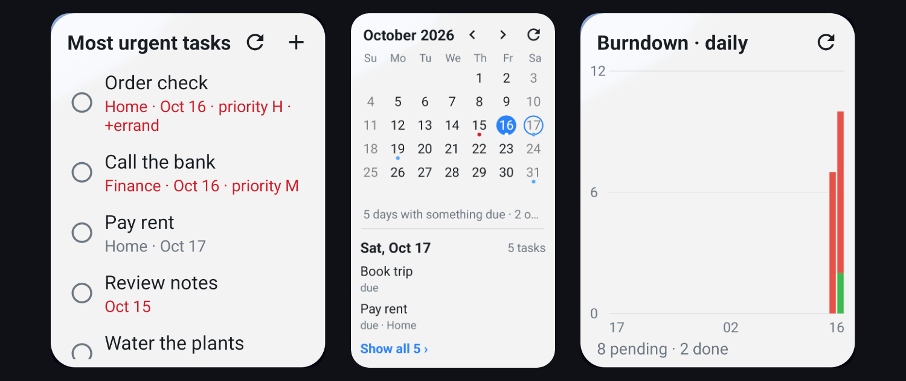

# Meghnaad

[Taskwarrior 3](https://taskwarrior.org) in your browser and on your phone. Meghnaad is another **replica** of your
Taskwarrior data: the `task` CLI keeps syncing to your bucket as it does today, and Meghnaad reads and writes the same
bucket. A task added here shows up on your laptop after `task sync`, and the other way round. Behaviour follows
Taskwarrior **3.5.0**, command for command, and where it does not, that is a bug.

It is **console-first**: type `task` commands, with tables, forms, boards and charts beside them. Both ways of using it
run the same Rust command engine, so anything you can click you can type.

## Two ways to use it

### The web app

The engine runs **in the page**, as WebAssembly in a Web Worker, with your tasks saved in the browser. A small Worker on
Cloudflare sits between the page and your bucket: it checks Cloudflare Access (the login), holds the encryption secret,
and opens and seals the versions that pass through; it never parses a task. Your existing S3 or R2 bucket is the sync
store. You deploy it to your own Cloudflare account, and the basic features run on Cloudflare's free tier.

Start with **[Deploying](./deploy.md)**, which has a Deploy to Cloudflare button, then read
**[Using Meghnaad](./using.md)**. It adapts to a phone's screen too, with a menu for the pages and tasks as cards.

### The Android app

A native app in Kotlin and Compose, with the same engine running **on the phone**. It works offline, keeps your keys in
the Android Keystore, and syncs straight with your bucket over S3 (R2, AWS S3, MinIO, ...) or with a TaskChampion sync
server, so it needs no Worker and no Cloudflare Access. It does what the web app does, with a layout made for a phone,
and two things a browser tab cannot: **reminders** that come with the app closed, and **home-screen widgets** (a task
list for any report, a burndown, a calendar and a card of a board).

Download the APK from the [latest release](https://github.com/uroybd/Meghnaad/releases/latest) and read
**[The Android app](./android.md)**.

### Both together

They are two replicas of the same bucket, so they stay in step with each other and with your `task` CLI. Settings and
hooks can be kept in step through the bucket as well (never the secrets).

## Where to start

| | |
| --- | --- |
| **[Using Meghnaad](./using.md)** | Pages, console, confirmations, boards, hooks, recurrence, urgency, time tracking |
| **[Deploying](./deploy.md)** | Setup, GitHub Actions deploy, Access, connecting `task`, troubleshooting |
| **[The Android app](./android.md)** | Install, connect, the widgets, sharing settings and hooks, building it |
| **[taskrc support](./taskrc-support.md)** | Every `taskrc` option: done, partial, not done |
| **[Architecture](./architecture.md)** | The engine, sync, platform limits, how correctness is kept |

The source, issues and releases are on [GitHub](https://github.com/uroybd/Meghnaad).
