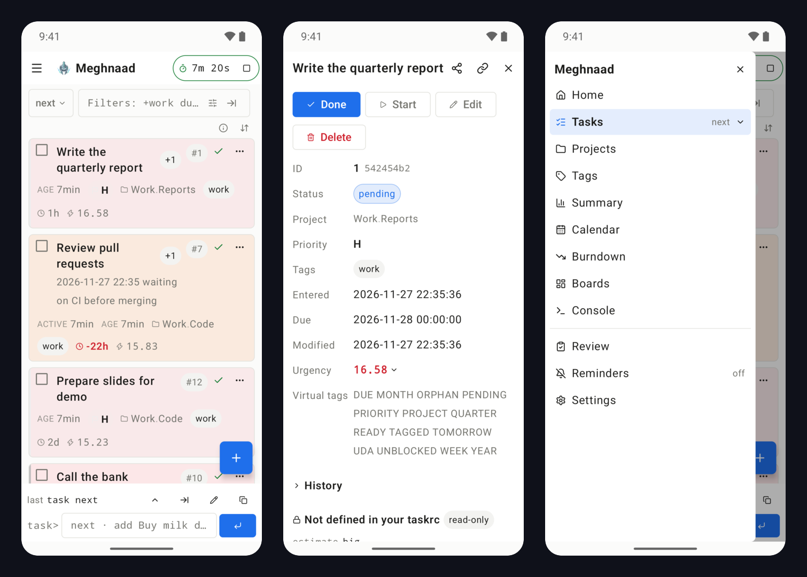

# Meghnaad

  

Meghnaad is [Taskwarrior 3](https://taskwarrior.org) in your browser, on your phone and around `task` in your terminal.
It is another **replica** of your Taskwarrior data: your `task` CLI keeps syncing as it does today, to a git repository,
an S3 or R2 bucket or a TaskChampion sync server, and Meghnaad reads and writes the same store. A task added in any of
them shows up on your laptop after `task sync`, and the other way round.

- **It is `task`.** Behaviour follows Taskwarrior **3.6.0**, command for command: filters, reports, dates, urgency,
  recurrence, confirmations, `calc`. Where it does not, that is a bug.
- **It is console-first.** You type `task` commands, with tables, forms, boards, kanbans and charts beside them, and
  anything you can click you can type.
- **Your tasks stay yours.** They are encrypted before they leave a device, with your own `sync.encryption_secret`,
  and the store never sees them in plain form. You host it, or it runs on your own devices.

## Get it

  <a href="https://mn.utsob.me"><strong>Open the web app</strong></a> ·
  <a href="web-static.md">host it yourself</a> ·
  <a href="web-cloudflare.md">run it on Cloudflare</a>

  
  &nbsp;
  
  &nbsp;
  

- **In a browser, with nothing to install:** [mn.utsob.me](https://mn.utsob.me) is the static web app, for tasks that
  sync with a git repository. Your token, secret and tasks stay in your browser and your repository.
- **Your own web app:** [on any static host](web-static.md), or [on Cloudflare](web-cloudflare.md) with Access and an R2
  bucket or a git repository. The button above deploys the R2 one.
- **On Android:** the APK from the [latest release](https://github.com/uroybd/Meghnaad/releases/latest), then
  [connect it](android.md#first-run) to your store.
- **In a terminal:** `brew install uroybd/tap/meghnaad`, or a [prebuilt download](terminal.md#install).

Not sure which? [Four flavours](#four-flavours) below compares them.

## Features

- **Your store, as it is.** The same git repository, bucket or sync server and the same encryption secret your `task`
  CLI uses. No migration, and nothing changes for the CLI.
- **Taskwarrior's behaviour, not an imitation.** Filters, virtual tags, urgency, reports, recurrence, regexes,
  contexts, `calendar`, `summary`, `burndown`, `history`, `timesheet`, `stats`, `export`, `import`, `purge`, `calc` and
  the confirmations, ported from the source and checked against the real `task`.
- **A console with everything around it.** Tab completion, a preview of the task an `add` will make, chains with `&&`
  `||` `;`, and Taskwarrior's yes/no/all/quit as a table of ticks ([The console](using/console.md)).
- **Pages for what you look at most.** Any report as a table or as cards, Projects, Tags, Summary, Calendar, Burndown,
  and a detail for each task with its annotations, history and tracked time ([The pages](using/pages.md)).
- **Iterative tasks**, Taskwarrior 3.6.0's new way to repeat: the next one made when you complete this one, from a rule
  such as `monthly` or `"every other day"` ([Iterative tasks](using/iterative.md)).
- **Boards.** Pages of your own made of numbers, tables and charts, each with its own filter, laid out on a grid, with
  controls (a date range, a pick of projects) that feed every filter on them ([Boards](using/boards.md)).
- **Kanban.** Your tasks as columns of cards; moving a card runs that column's command line ([Kanban](using/kanban.md)).
- **Your own commands.** A word for a whole command line, such as `fail` for `done outcome:fail`, typed or picked from a
  task's menu, with an icon ([Settings](using/settings.md)).
- **Your `taskrc`.** Paste it, upload a folder or import it from your dotfiles; UDAs, reports, contexts, holidays,
  urgency and colours are read ([taskrc support](taskrc-support.md)).
- **tasksh's `review`**, with tasksh's keys, as a card or in the console.
- **Time tracking and reminders.** `start` and `stop` become sessions with a running total, and due tasks remind you
  ([Time tracking and reminders](using/time-tracking.md)).
- **Hooks, as Lua.** `on-add`, `on-modify`, `on-launch` and `on-exit` as functions in one script, sandboxed, with
  network calls and secrets you allow; the same script runs with the real `task` ([Hooks](using/hooks.md)).
- **Keys, as in a terminal app**, the same across the web, the phone and the terminal, and yours to change
  ([Keys](using/settings.md#keys)).
- **On Android**, home-screen widgets (a report, a calendar, a burndown, a card of a board) and reminders with the app
  closed ([The Android app's own](using/android.md)).

## A look at it

**In the browser:** the Tasks page, a report as a table with the console underneath.

**On Android:** the same report as cards with the console underneath, a task's detail, and the menu of pages; and on
the home screen, widgets for a report, the calendar and a burndown.

**In the terminal:** the same pages around your own `task`, with its colours and your keys.

## Four flavours

The same app comes in four flavours. The first three run Meghnaad's own engine, written in Rust; the terminal app runs
your real `task`.

| | Static web app | Web app on Cloudflare | Android app | Terminal app |
| --- | --- | --- | --- | --- |
| **Runs** | in any browser, from any static host | in any browser, behind a Cloudflare Worker | on your phone or tablet | in your desktop's terminal |
| **The engine** | in the page, as WebAssembly | in the page, as WebAssembly | on the phone, natively | your own `task` 3.6.0 (or 3.5) |
| **Your tasks live in** | a git repository | an R2 bucket or a git repository | a git repository, any S3-compatible bucket or a sync server | wherever `task sync` reaches |
| **Sign-in** | the encryption secret unlocks the page | Cloudflare Access | none: it is your phone | none: it is your desktop |
| **The secret is held by** | your browser, sealed at rest | the Worker, as a Cloudflare secret | the Android Keystore | your taskrc |
| **Offline** | keeps working once open; starts only online | keeps working once open; starts only online | yes | yes |
| **Hooks** | your Lua script, in the page | your Lua script, on the Worker | your Lua script, on the phone | `task`'s own hooks, and the same Lua script through `meghnaad-hook` |
| **What only it has** | nothing to run: use [mn.utsob.me](https://mn.utsob.me) or any free static host | one sign-in for every browser, no secret on any device | reminders with the app closed, home-screen widgets | your own data and taskrc, as they are |
| **Get it** | [The static web app](web-static.md) | [The web app on Cloudflare](web-cloudflare.md) | [The Android app](android.md) | [The terminal app](terminal.md) |

### Which one?

- **You sync `task` with a git repository and want it in a browser:** the static web app. There is nothing to deploy if
  you use the public copy, and the page talks to your repository from your browser alone.
- **You sync with R2, or want a sign-in rather than a secret on each device:** the web app on Cloudflare. It runs on
  Cloudflare's free plans.
- **You want it on your phone:** the Android app, whatever your store. It needs no server of its own.
- **You live in a terminal:** the terminal app, beside the `task` you already use.

They are not exclusive. On the same store they are replicas of the same tasks, so any mix of them stays in step with
each other and with your `task` CLI. The web app and the Android app can share their settings and hooks through the
store as well (never the secrets); the terminal app keeps its own in `~/.config/meghnaad`.

## Where to start

| | |
| --- | --- |
| **[Where your tasks live](./stores.md)** | A git repository, an S3 or R2 bucket or a sync server: which flavour reaches which, and pointing `task` at it |
| **[Running the web app](./deploy.md)** | The static web app and the web app on Cloudflare, Access, GitHub Actions, troubleshooting |
| **[The Android app](./android.md)** | Install, connect, the widgets, sharing settings and hooks |
| **[The terminal app](./terminal.md)** | Install, the pages and keys, the command line, review, sync |
| **[Using Meghnaad](./using.md)** | Pages, console, tasks, boards, kanban, settings, recurrence, hooks, time tracking |
| **[Reference](./commands.md)** | The `:` commands, every `taskrc` option, the settings map, the architecture |

The source, issues and releases are on [GitHub](https://github.com/uroybd/Meghnaad).
