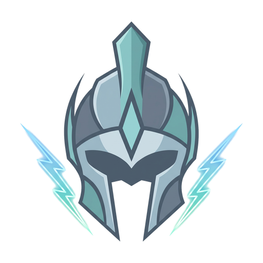
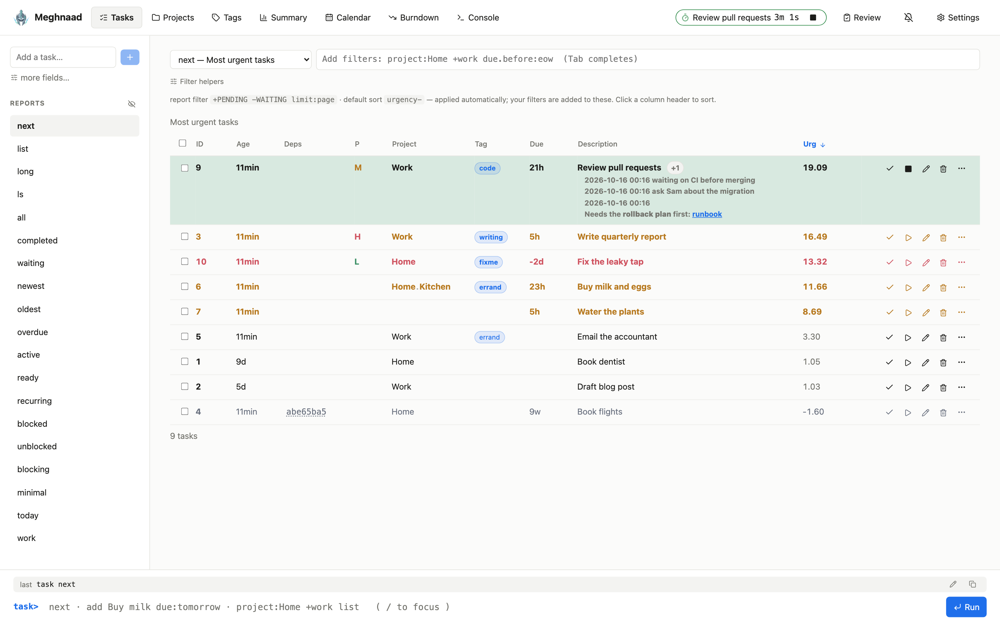
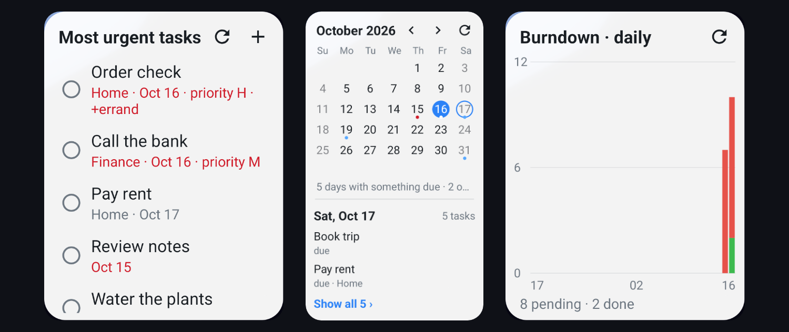

# Meghnaad

  

[Taskwarrior 3](https://taskwarrior.org) in your browser and on your phone, and [around `task` in your
terminal](terminal.md). Meghnaad is another **replica** of your Taskwarrior data: the `task` CLI keeps syncing as it
does today, to a git repository, an S3 or R2 bucket or a TaskChampion sync server, and Meghnaad reads and writes the same
store. A task added here shows up on your laptop after `task sync`, and the other way round. Behaviour follows
Taskwarrior **3.6.0**, command for command, and where it does not, that is a bug.

It is **console-first**: type `task` commands, with tables, forms, boards and charts beside them. Both ways of using it
run the same Rust command engine, so anything you can click you can type.

## Where your tasks live

You choose once, and every app uses the same place. Not every app reaches every store:

| | Git repository | S3 / R2 bucket | Sync server |
| --- | --- | --- | --- |
| Web app, static site | yes | no | no |
| Web app, Cloudflare Worker | yes | R2 only | no |
| Android app | yes | yes | yes |
| Terminal app (`task`'s own sync) | yes | yes | yes |

**[Where your tasks live](./stores.md)** has each store, how to point `task` at it, and what must stay private.

## Two ways to use it

### The web app

The engine runs **in the page**, as WebAssembly in a Web Worker, with your tasks saved in the browser. You host it
yourself, in one of three ways:

| | Static site | Cloudflare Worker with R2 | Cloudflare Worker with git |
| --- | --- | --- | --- |
| **Your tasks** | a git repository | an R2 bucket | a git repository |
| **You need** | any static host (GitHub Pages, Cloudflare Pages, Netlify) and a repository token | Cloudflare Workers, R2 and Access | Cloudflare Workers and Access, and a repository token |
| **Sign-in** | the encryption secret unlocks the page | Cloudflare Access | Cloudflare Access |
| **The secret and token are held by** | your browser: sealed at rest, in memory while unlocked | the Worker, as Cloudflare secrets | the Worker, as Cloudflare secrets |
| **You trust** | the site's code, your browser and its extensions; the forge sees your settings, never your tasks | Cloudflare, and whoever can read your account's Worker secrets | the same; the forge sees your settings, never your tasks |
| **Hooks run** | in the page | on the Worker | on the Worker |

On the static site the page talks to the repository through the forge's API itself. With a Worker, a small Worker on
Cloudflare sits between the page and your store: it checks Cloudflare Access (the login), holds the encryption secret,
and opens and seals the versions that pass through; it never parses a task. Each runs on free plans.

Start with **[Running the web app](./deploy.md)**, then read **[Using Meghnaad](./using.md)**. The app adapts to a
phone's screen too, with a menu for the pages and tasks as cards.

### The Android app

A native app in Kotlin and Compose, with the same engine running **on the phone**. It works offline, keeps your keys in
the Android Keystore, and syncs directly with a git repository, an S3-compatible bucket (R2, AWS S3, MinIO, ...) or a
TaskChampion sync server, so it needs no Worker and no Cloudflare Access. It does what the web app does, with a layout
made for a phone, and two things a browser tab cannot: **reminders** that come with the app closed, and **home-screen
widgets** (a task list for any report, a burndown, a calendar and a card of a board).

Download the APK from the [latest release](https://github.com/uroybd/Meghnaad/releases/latest) and read
**[The Android app](./android.md)**.

### Both together

On the same store they are two replicas of the same tasks, so they stay in step with each other and with your `task`
CLI. Settings and hooks can be kept in step through a bucket or a git branch as well (never the secrets).

## Where to start

| | |
| --- | --- |
| **[Using Meghnaad](./using.md)** | Pages, console, confirmations, boards, hooks, recurrence, urgency, time tracking |
| **[Where your tasks live](./stores.md)** | A git repository, an S3 or R2 bucket or a sync server: which app reaches which, pointing `task` at it |
| **[Running the web app](./deploy.md)** | The static site, the Worker with R2 or with git, Access, GitHub Actions, troubleshooting |
| **[The Android app](./android.md)** | Install, connect, the widgets, sharing settings and hooks, building it |
| **[The terminal app](./terminal.md)** | Install, the pages and keys, the command line, review, where its settings are kept |
| **[taskrc support](./taskrc-support.md)** | Every `taskrc` option: done, partial, not done |
| **[Architecture](./architecture.md)** | The engine, sync, platform limits, how correctness is kept |

The source, issues and releases are on [GitHub](https://github.com/uroybd/Meghnaad).
