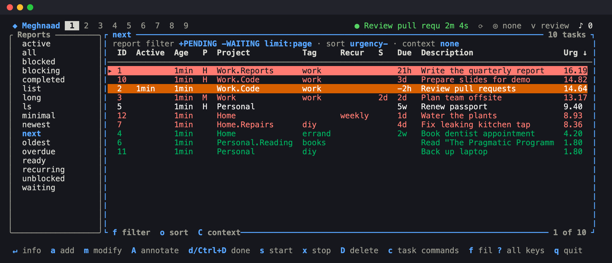

# The terminal app

`meghnaad` is Meghnaad on the desktop, beside its web app and Android app: a full-screen terminal app around the
real `task` 3.6.0, laid out as the web app is. It has no engine, replica or sync of its own. Every report it shows is
`task <filter> export <report>` and every change it makes is a `task` command line, so it works on whatever data and
taskrc your `task` uses (`~/.task` and `~/.taskrc`, or `TASKDATA`, `TASKRC` and `rc.data.location`), and your hooks run
as they always do. What it adds is the web app's pages, a command line with Tab completion, `&&` `||` `;` chains and your
own task commands, an add line that shows the task it will make, tasksh's review, a timer and reminders.

This page is installing it, syncing and where its settings are kept. Its screen, keys, command line, review, boards
and export are in [In the terminal](using/terminal.md).

## Install

It runs on macOS and Linux, around Taskwarrior's `task` 3.6.0 (3.5 works too, without [iterative tasks](using/iterative.md)). Pick one of the three ways below; each ends with
`meghnaad` on your `PATH`.

### With Homebrew (macOS and Linux)

The easiest: it brings `task` with it.

```sh
brew install uroybd/tap/meghnaad
meghnaad
```

`brew upgrade meghnaad` gets a newer one.

### Prebuilt, no Rust needed

1. Install `task` 3.6.0 (from your package manager or [taskwarrior.org](https://taskwarrior.org/download/)), and check
   it with `task --version`. If it isn't on your `PATH`, set `MEGHNAAD_TASK` to the binary instead.
2. Download `meghnaad-<version>-<platform>.tar.gz` for your system (Linux or macOS, x86_64 or arm64) from the
   [latest release](https://github.com/uroybd/Meghnaad/releases/latest).
3. Unpack it and put `meghnaad`, which is in a folder of the same name, where you keep programs, for example
   `~/.local/bin` (with your version and platform in the names, as in the file you downloaded):

   ```sh
   tar -xzf meghnaad-<version>-<platform>.tar.gz
   mkdir -p ~/.local/bin && mv meghnaad-<version>-<platform>/meghnaad ~/.local/bin/
   ```

4. On macOS, if it is blocked for coming from the internet:

   ```sh
   xattr -d com.apple.quarantine ~/.local/bin/meghnaad
   ```

5. Run `meghnaad`.

### From source, with Rust 1.94.1 or later

With `task` 3.6.0 installed as in step 1 above:

```sh
cargo install --git https://github.com/uroybd/Meghnaad meghnaad-tui --locked
meghnaad
```

It puts `meghnaad` in `~/.cargo/bin`. Add `--tag v<version>` for a release instead of the latest commit;
`cargo uninstall meghnaad-tui` removes it. The crate keeps its old name; the program it installs is `meghnaad`.

**It was called `meghnaad-tui`.** Up to 0.6.71 the program was `meghnaad-tui`. With Homebrew there is nothing to do:
`brew update` moves the old formula to `meghnaad`, and it keeps a `meghnaad-tui` link to the program for a while, so
scripts that run it still work. A prebuilt you put in place yourself is replaced by hand: delete `meghnaad-tui` and put
`meghnaad` there. With Cargo, install again as above; if `meghnaad-tui` is still in `~/.cargo/bin` afterwards, delete it.
Its settings stay where they were (`~/.config/meghnaad`).

`meghnaad --help` says where it keeps its settings, and `meghnaad --version` which release it is. It also starts with another version of `task`, says in the status line which
one it found, and then behaves as that version does.



## Sync

Syncing is `task sync`, with Taskwarrior's own sync settings (`sync.*` in the taskrc, and with `task` 3.5 `AWS_ENDPOINT_URL` and the like in
the environment; [Where your tasks live](stores.md) has them for each store). It runs in the background: the screen stays yours, the top bar shows `⟳ syncing`, then how long ago it
worked or `⟳ failed`, and how it went is said in the status line and kept on the Console page, with what `task` wrote
when it failed. The pages are read again when it ends. While it runs, a command you give waits for it, so the two never
use the data at once.

When it runs is the `tui.sync` setting, chosen on the Settings page's Sync (`y`):

| `"sync"` | Syncs |
| --- | --- |
| `"manual"` (or none) | Only when asked: `S`, or `sync` at the command line |
| `"startAndClose"` | Also when the app opens and when it closes |
| `"everyChange"` | Also after every command that changes tasks (`add`, `modify`, `done`, `start`, `delete`, `undo`, …, from a key, the form, the command line or the terminal), and once when a review ends |

Closing never waits for a sync. When set to sync at close, the app quits at once and hands the sync to a process of its
own, which waits for a sync the app left running and then runs `task sync`, so a slow store (a git branch, say) does not
hold the terminal. A sync left running when closing goes on by itself either way. If the sync at close fails, what it
said is kept in `close-sync.json` in the app's state folder (`$XDG_STATE_HOME/meghnaad`, else
`~/.local/state/meghnaad`), and the next start reports it: after its own sync, when that fails too (one that works has
put things right), or at once when the app no longer syncs at start.

## Settings

The app's own `settings.json` is kept on this machine only, in the first of:

1. `$MEGHNAAD_CONFIG_DIR`, when it is set;
2. `$XDG_CONFIG_HOME/meghnaad`;
3. `~/.config/meghnaad`.

The file is optional; without it there are no task commands or boards, syncing is by hand and the theme is the
default. The terminal app uses what it shares with the web app and the phone: `taskCommands` (words that stand for a
command line, which you can also add, change and delete on the Settings page), `boards` ([Boards](using/terminal.md#boards)),
`homepage` (the report or board it opens on, chosen on General), `appearance.idFallback` (a task with no ID
shown by its short uuid rather than `-`, chosen on Appearance), `appearance.cardIcons` (a kanban's cards with their
fields as symbols, chosen there too), `appearance.progress` (numeric UDAs drawn
in a report and on a kanban's cards as a bar with the number beside it, a line through the middle of the row, as on
the web: [Progress bars](using/settings.md#progress-bars)),
`appearance.transformations` (find and replace in a description, a note or a string UDA, drawn as Markdown in report
rows: [Transformations](using/settings.md#transformations); a link is an OSC 8 hyperlink, which most terminals open with
a click or Cmd/Ctrl+click and the rest show as its words; `task info` is shown as `task` prints it) and
`keys` ([Keys](using/settings.md#keys)). Its own settings are all under `tui`: `sync` ([Sync](#sync)), `theme` and
`shading` ([Colours](using/terminal.md#colours)), `nerdFont` (`true` when the terminal's font is a Nerd Font: icons from it for the cards' fields, the pages in the top
bar and the pages of Settings, chosen on Appearance), and `keys`, which apply here only.

```json
{
  "taskCommands": [{ "name": "fail", "command": "done outcome:fail" }, { "name": "late", "command": "+OVERDUE list" }],
  "tui": {
    "sync": "startAndClose",
    "theme": { "base": "auto", "accent": "#1f6feb", "selected": "reverse" },
    "shading": "none"
  }
}
```

It is the same JSON as the web app's (**Settings → Commands**, or `web/settings.json` in the bucket or on the git branch), so copying that
file here gives you the same task commands and boards; the web app and the phone keep `tui` as it is and have no use
for it. What the terminal app has no use for is kept as it is when it saves, at any depth: a key it doesn't know inside
a task command stays when you change that command, and a task command it can't use (a bad name, no command) is listed
on General and stays in the file. A `sync` at the top of the file, where 0.6.53 kept it, is still read, and moved into
`tui` the next time the app saves. A file that is not a JSON object, or has a known key in the wrong shape (the errors
the web app's [settings.json box](using/settings.md) lists), is reported on General and the status line and read as
none, and the app will not save over it until it is put right.

The app reads and writes `settings.json` in that folder and touches nothing else there. Its one other file, `close-sync.json`, is in its state
folder ([Sync](#sync)). It writes the file in place, so
a symlink stays a symlink and a dotfiles manager (stow and the like) can own the folder. It never reaches the store itself: syncing is `task sync`, and its settings (`sync.*`
in the taskrc, and with `task` 3.5 `AWS_ENDPOINT_URL` and the like in the environment) are Taskwarrior's.
