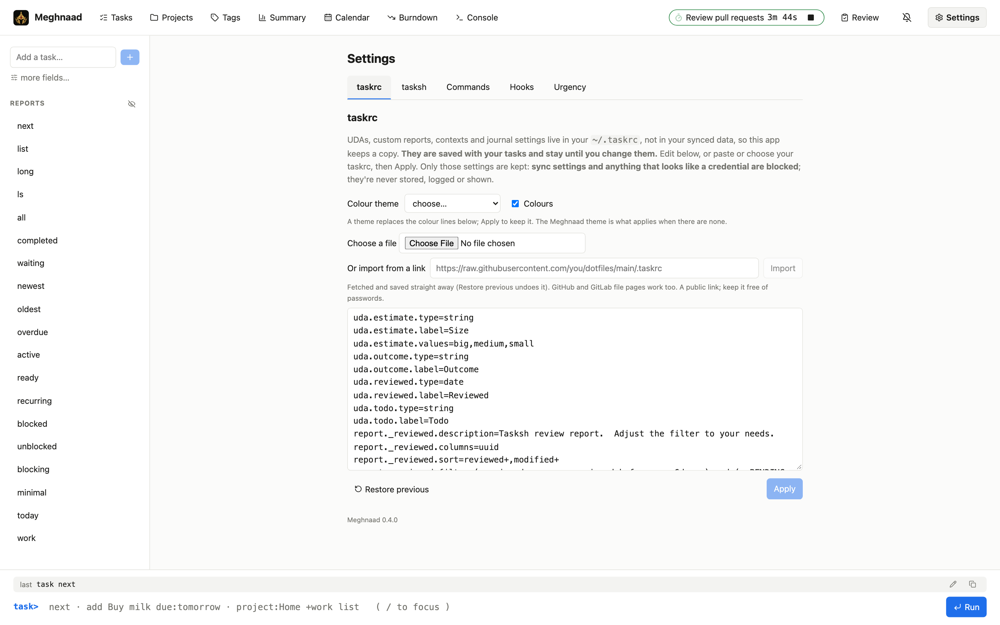
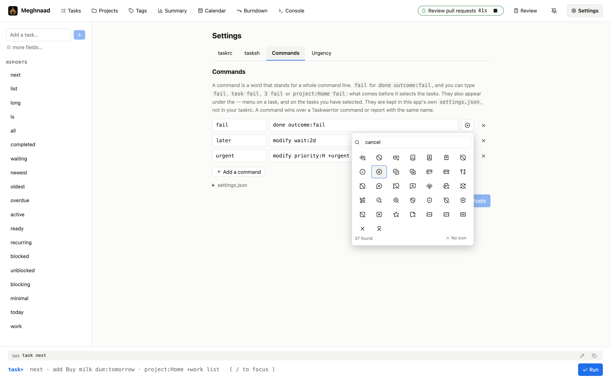

# Using Meghnaad

The app has a normal interface and a console, and both talk to the same command engine, so anything you can click
you can type, and the other way round. Behaviour follows Taskwarrior **3.5.0**; where it differs from the desktop,
this guide says so. How the engine works is in [Architecture](architecture.md); every supported `taskrc` setting is in
[taskrc support](taskrc-support.md).

**Contents:** [The pages](#the-pages) · [The console](#the-console) · [Questions](#questions-taskwarrior-asks) ·
[Tasks](#tasks) · [Boards](#boards) · [Your taskrc](#your-taskrc) · [Urgency](#urgency) · [Recurring tasks](#recurring-tasks) ·
[Hooks](#hooks) · [Time tracking and reminders](#time-tracking-and-reminders) · [On a phone](#on-a-phone) · [Different from the
desktop](#different-from-the-desktop)

## The pages

| Page | What it shows |
| --- | --- |
| **Tasks** | Any report as a table, with filters. Click a row for the task's detail |
| **Projects** | Projects and sub-projects, with their tasks underneath, and a filter box |
| **Tags** | Every tag with its tasks and how many are overdue, expandable, and a filter box |
| **Summary** | How far along each project is |
| **Calendar** | Months, with what is due or scheduled on which day |
| **Burndown** | Pending, started and done over time |
| **Boards** | Pages of your own: numbers, tables and charts, each with its own filter, laid out on a grid |
| **Console** | Type commands; reports and answers print here |

**Every page has an address**, so a link to it can be shared with anyone who can sign in to the same deployment, opened in
a new tab, and the browser's back button goes where you were:

| Address | Page |
| --- | --- |
| `/` | Your **home page** (Settings → General): a report or a board, `next` when you have not chosen |
| `/report/<name>` | Tasks, as that report: `/report/next`, `/report/list`, `/report/_reviewed`, and every report of your own is its name |
| `/projects` `/tags` `/summary` `/calendar` `/burndown` `/console` | those pages |
| `/boards`, `/board/<slug>` | the list of boards, and one board (its slug is its address; see [Boards](#boards)) |
| `/settings`, `/settings/<tab>` | Settings, and one of its tabs: `general` `taskrc` `tasksh` `commands` `hooks` `urgency` |
| `/settings/taskrc/<path>` | one file of the taskrc folder, in the taskrc tab (`/settings/taskrc/holidays/en-US.rc`) |
| `/task/<8 characters>` | a task's detail, over the page behind it (the first 8 characters of its uuid) |

An address for a report or a board that is not there says so and opens your home page. A filter you typed is not in the address.

Summary, Calendar, Burndown, Projects and Tags have the same filter box as Tasks (Tab completes, filters become chips, the filter
helpers are below it) and it is focused when you open the page (not on a phone, where that would raise the keyboard).
The header also has the running **timer**, the **bell** (reminders) and **Settings** (the taskrc, tasksh, commands, hooks and urgency, below). Every page except Console has the prompt in a bar at the bottom; the Console has it inside.

**Projects and Tags start as your open tasks**, waiting ones included (three chips in their filter box: `status.not:completed`,
`status.not:deleted` and `status.not:recurring`, which leaves out finished tasks and recurring templates). That is a filter like any
other: take the `completed` or `deleted` chip away and those tasks come in too, tinted green (completed) or red (deleted), so a project or tag stays listed after
its last task is done. Any other filter works as well (`project:Home`, `due.before:eow`, `+work`).

**A long report draws in steps.** A report of hundreds of tasks takes a while to lay out, so the table draws the first 200
at once and more (300 at a time) as you scroll towards the end, or when you press **Show more** or **Show all** under it.
It is still the whole report: the select-all box, the count and the sort are about every task, drawn or not.

**Tag chips are buttons.** In the table on the Tasks page, clicking a tag chip toggles `+tag` in that report's filter (a
pressed chip means it is in the filter; click it again to take it out), as typing `+tag` would. Clicking a second tag joins it to the first with `or` (`( +a or +b )`, the tasks with either), and a third goes into the same parentheses; click one again to take it out. Tags you typed side by side, which all have to be there, get the next one added the same way. Anywhere else (a
report printed in the Console, the task detail, the Projects page, a task on the Tags page itself) it opens that tag's entry
on the **Tags** page, expanded and highlighted. A tag no pending task has still gets its entry, so a chip from a report of
finished tasks works too. **Open in Tasks** on an entry filters the Tasks page by that tag.

The **last command** is shown above the prompt, including what a click ran: pick a report or sort a column and you can
see the exact command, then press **↑** to edit and re-run it.

## The console

Commands follow Taskwarrior: `[filter] command [modifications]`, and the leading `task` is optional.

```
next                                   # a report (built-in, or defined in your taskrc)
project:Home +errand due.before:eow list
add Pay rent project:Home due:eom +bills
3 modify due:2026-12-25T08:30 priority:H
3 start        3 stop        3 done        3 delete        undo
3 annotate called the landlord
estimate:big count                     # UDAs work like any attribute
rc.report.next.sort:due-,project+ next # per-command overrides, as in Taskwarrior
calc 2 days + 3 hours
help
```

| | |
| --- | --- |
| **Write** | `add` `log` `duplicate` `import` `purge` `modify` `done` `delete` `start` `stop` `annotate` `denotate` `append` `prepend` `undo` |
| **Read** | `info` (or `information`) `count` `projects` `tags` `summary` `calendar` `burndown.daily` `.weekly` `.monthly` `.annual` `history.daily` `.weekly` `.monthly` `.annual` `ghistory.daily` `.weekly` `.monthly` `.annual` `timesheet` `stats` `udas` `columns` `reports` `context` `show` `config` `export` `ids` `uuids` `calc` `commands` `_get` `_projects` `_tags`, and the other lists Taskwarrior makes for shell completion: `_commands` `_aliases` `_columns` `_config` `_context` `_ids` `_show` `_udas` `_unique <attribute>` `_urgency` `_uuids` `_version` `_zshids` `_zshuuids` `_zshcommands` `_zshattributes`. `ids` squeezes runs into ranges (`1 3-5`) and `uuids` is one line |
| **Filters** | `attr:value` with modifiers (`.is .not .has .startswith .before .after .by .none .any …`), or compared as `due < eom`, `urgency>5`, `project != Home`, `description ~ Pay` (`= == != !== < <= > >= ~ !~`, with or without spaces, and a value that begins with `^`, `*` or `%` is an arithmetic operator to Taskwarrior's lexer, so `description ~ ^Pay` fails as it does there: anchor with `description.startswith:Pay`; `priority` goes H, M, L and a task with none is below them all, or as the taskrc's `uda.priority.values` has them: with `H,M,,L` a task with none is between M and L, and with a list that has no blank one with none is above them all); `+tag` / `-tag`; virtual tags (`+OVERDUE +DUETODAY +READY +ACTIVE +BLOCKED …`); plain words and `/pattern/`; ids (`3`, `1-4,7`) and uuid prefixes (several side by side, `1 3` or two uuids, pick all of them, and the rest of the filter narrows that group); `and` `or` `xor` and parentheses, `!(…)` to reverse a group. As in Taskwarrior, `tags` is one string (sorted, joined by commas: `tags:a` is the start of it and `tags.is:a,b` all of it; ask for a tag with `+a`), `not` is a word to find, and a `!` with no parenthesis takes only the value next to it: before it (`! project:Work` is false for every task) or after it (`project:Work !` is `project:false`, `+a !` the tag `false`, `project !` the tasks with no project; after a group or a task number it reverses it). A word is broken at every parenthesis (`not(+a)` is `not` and `(+a)`). A comparison may have arithmetic and attributes on either side, worked out by `calc`'s evaluator for each task (`due < now + 3d`, `urgency * 2 > 10`, `now - entry < 1h`, `( urgency + 1 ) * 2 > 5`; glued, `urgency*2>10`): an attribute name stands for what the task holds, a task with no date is on neither side of a comparison with one, and what cannot be worked out (`due - now` on a task with no due) stops the command with Taskwarrior's message. `=~` is no operator there, as in Taskwarrior |
| **Dates** | `today tomorrow eow som eoy monday 3d 2w`, `2026-12-25`, `2026-12-25T08:30`, `now+2h`, and anything your `dateformat` describes (`12/25/2026` with `m/d/Y`). Also as Taskwarrior reads them: the start and end of the previous, this and next day, week, work week, month, quarter and year (`sopw eonm soq eoww`), `later` and `someday`, month names (`jan`) and any three letters of a day, `22nd`, `10am` or `14:30`, ISO weeks (`2026-W44`) and days of the year (`2026-300`), `easter` `goodfriday` `eastermonday` `ascension` `pentecost` `midsommar` |

**History and the timesheet** answer in the Console, and typed in the bar under another page they switch to it.
`history.monthly` (also `.daily`, `.weekly`, `.annual`) counts the tasks added, completed and deleted in each period, with
the net change and the averages; `ghistory.*` draws the same as a bar of `+` (added), `X` (completed) and `-` (deleted),
80 columns wide. A recurring template is not counted as added, and a filter narrows them (`project:Home history.monthly`).
`timesheet` lists what was completed and started, by week and day; with no filter it covers the last four weeks, and
`report.timesheet.filter` changes that. `information` is `info` under its full name.

**`export` gives you a file.** It prints a summary and a **Download** button; the file is Taskwarrior's own JSON, the
same as `task export` (ids and urgency included), so `task import` reads it. It takes a filter (`project:Home export`) and
a report's name (`export next` uses that report's filter and sort), and `json.array=off` makes it one task per line.

**`modify` and `add` take `tags:` and `status:` too.** `tags:a,b` makes those the task's tags and no others (`tags:` none), and
`status:completed` or `status:deleted` finishes the task, with an `end` of now, and `status:pending` takes it back. An `end:`
on a task that is still pending is refused (`modify`) or left out (`add`), as in Taskwarrior; `rtype:`, `mask:`, `imask:`,
`uuid:`, `id:` and `urgency:` are refused with "The 'rtype' attribute does not allow a value of 'periodic'". A dependency that is
taken away (`depends:-3`) has to be one the task has. A tag is kept under any name, as in Taskwarrior (`+URGENT`, `+a:b`, `+Mixed`;
names are case-sensitive, and a name that is also a virtual tag, such as `+PENDING`, is stored but a filter reads the virtual one).
Not done: an empty description is refused.

**Changes beside a command.** What follows `done`, `delete`, `start`, `stop`, `annotate`, `append` and `prepend` can carry
changes, as in Taskwarrior: `3 done end:-2h` (finished two hours ago), `3 start due:eow +urgent`,
`3 annotate called her due:friday`. Attributes, tags and substitutions are applied to the task; the plain words left over
are the annotation (or, for `annotate`, `append` and `prepend`, the text). The buttons send their text literally, so a
note that starts with `due:` stays a note.

**`purge`** removes deleted tasks for good: `purge status:deleted`, or `purge project:Old` (a task has to be deleted
first; anything else is skipped with a hint). It always asks about each task ("Permanently remove task 3 'x'?"),
like `delete`, and with no filter it asks as every other command does, or refuses under `allow.empty.filter=off`.
Tasks that waited on a purged task stop waiting on it. A recurring template can only be purged once its instances are
deleted, and it takes them with it, after a question that follows `recurrence.confirmation` (`no` refuses). `undo`
brings a purged task back with all it had; the Console remembers only the last few commands, and not across a restart.

**`log` and `duplicate`.** `log Paid the invoice project:Home` records a task that is already finished: its `end` is
the moment you enter it, and it refuses `recur:` and `wait:`, which a finished task has no use for. `3 duplicate` makes
a copy of task 3 as a new pending task: it keeps everything but its identity, `start`, `end` and `entry`. What follows
`duplicate` is applied to the copy (`3 duplicate due:eow +again`), and plain words become a note on it. Copying a
recurring instance gives an ordinary task; copying a template gives another template. Both write like any other command,
so they ask first at `bulk` tasks, and a `duplicate` with no filter asks as the others do.

**`commands`** lists every command and report in a table (its category, whether it writes, and what it takes: a
filter, modifications, other words), so it shows what this app understands, which is a little less than `task`. A
report you define in the taskrc is there too. **`_get`** prints the value of each DOM reference it is given, separated
by spaces: `_get 1.due 1.project rc.bulk tw.version`. A reference with no value prints as nothing; a word that is not a
reference is an error. It reads the same references as `calc` (see below), and credentials are never among them.

**`import`** brings tasks in from a file, such as one `export` wrote (or `task export` on your desktop). Typing it
shows a **Choose a file…** button; the file is read in the browser and checked by the server, which then says how many
tasks are new, how many would change and how many are already there, and lists them. Nothing is written until you press
**Import**, and then all of it is or none, as one `undo` step. A task is matched by its `uuid`: new ones are added, one
that differs takes the file's attributes whole (what the file leaves out is removed, as in Taskwarrior), and one that is
the same is left alone, so importing the same file twice changes nothing. A file with a bad task (an invalid date or uuid,
an unknown status, malformed annotations) is refused with the task's number and the reason. A file may be one task, an
array, or a task to a line; the most is about 3 MB (a few thousand tasks) or 5,000 tasks at a time, so split a bigger one.
Missing `entry`, `end` and `modified` are filled in, `default.project` and the UDA defaults apply to what lacks them, and
hooks (`on_add`, `on_modify`) run for each task. `import-v2` (Taskwarrior 2's data files) is not in the app.

**`stats`** counts the tasks that match a filter (all of them, with none): by status, annotations, tags, projects,
blocked and blocking, how old the oldest is and how often tasks are added and finished. The two rows about undo and the
sync backlog describe this page: `undo` is what it remembers, and the backlog is normally 0, since every write is pushed at once (it is more while you are offline).

**Contexts.** `context define work +work or project:Work` saves a context, `context work` makes it the active one,
`context none` turns it off, `context delete work` removes it, and `context` (or `context list`) lists them and
`context show` says which one is in force (the filter bar above a table names it too). They edit the saved settings,
the same ones the taskrc tab and `config` do, so the pages follow at once. Defining asks first, as in Taskwarrior, when its filter
matches no pending task, and deleting asks when `confirmation` is on. Tab completes `context` too: what it can do (`list`, `show`, `none`, `define`, `delete`) and the contexts you have defined, and
`rc.context:` the same way. A filter that can't also be what new tasks get
(one with `or`, a `-tag` or a modifier such as `.before`) makes a read-only context, and says so.
Put the whole filter in quotes (`context define this_week "+WEEK or (due.after:sow and due.before:eow)"`) and it is read as
one filter, as Taskwarrior reads it, unless it starts with a `name:value`, which takes all of it.

The active context is the console's: it sits above the prompt (`context work`, with a ✕ that runs `context none`), and every
command you type runs in it. While a context is active the pill in the top bar, the Run button and the prompt are amber,
and they turn back when it is cleared. With room the prompt names the context (`task[work]>`); on a phone it stays
`task>` and the context is in a tooltip (a long press). The pages follow it unless told otherwise. The Tasks page, Summary, Calendar, Burndown,
Projects and Tags have a **Context** menu of their own: *same as console* (the default), *none*, or any context. A page's
choice is only for that page (it is remembered on this device, not synced), so `context work` in the console does not
change a page that chose *none*. The choice is sent with the page's commands as Taskwarrior's own `rc.context=<name>`.
A board has no menu: it follows the console's context unless its filter names one. Put `rc.context=this_week` in the board's
filter (in its settings) to make that its default (a card that ignores the board's filter ignores that too), or in a card's
filter to give that card its own; a card's
**Information** names the context it ran in. The **Filter** above a board (collapsed until you open it) holds the board's own
filter; what you type there replaces it while you look at the board, and nothing is saved (**Reset** brings the board's own
back). New tasks (the **+** and the console's `add`) still take the *active* context's write rule.

**Where a report prints.** Typed in the Console, a report (`list`, `next`, …) prints there. Typed in the bar under any
other page, it opens in the Tasks view, where it can be sorted and filtered.

**Keys:** `/` focuses the prompt · `Tab` completes (and cycles a menu; `Shift+Tab` goes back) · `↑`/`↓` the last 20
commands · `Esc` closes a menu · `Ctrl+L` clears the console.

**The prompt shows what it is reading.** The command is bold, `name:value` attributes are purple, `+tag` green, ids orange,
`and` / `or` and brackets red, `rc.` settings grey and italic, and quoted text its own colour. After `add` and `log` the rest is
a description, so `and` there is only a word. A command that is longer than the line wraps, so all of it can be read.
Suggestions open as you type, under the filter boxes and above the prompt; Tab or a tap takes one.
They know where the word is: a command is said once, so with `add`, `modify` or a report already in the line (before the word or after it) only attributes are offered,
not `calendar`, `summary` or another report; and a bare number is a task id only in front of the command, not in a
description that follows it.

**Abbreviations and aliases.** A command, report or attribute name may be shortened to `abbreviation.minimum`
characters (default 2): `proj:Home`, `ann 3 text`. `alias.<name>=<words>` in the taskrc makes a typed word stand for
others; Taskwarrior's own `rm` (delete) and `burndown` (burndown.weekly) work without one. Only what you type is
expanded, never what the buttons send.

**Several commands on one line.** Like a shell, the console runs `a && b` (`b` only if `a` worked), `a || b` (`b`
only if `a` failed) and `a ; b` (always), left to right with no precedence, so `a && b || c` is `(a && b) || c`. Each
command draws its answer in the console under one heading, the line as you typed it, and the prompt is back after the
last one. A command that asks a question
(a delete, say) waits for the answer before the line goes on; "no" counts as a failure. Clearing the console ends the line.
An error is a failure, and so is a command that could not be reached. This is the page's, as it is a shell's: the engine
is sent one command at a time, so these are not Taskwarrior syntax. An operator that is not quoted always separates
commands, in a filter too, so write `or` and `and` there (as Taskwarrior documents them), or quote it (`'||'`, `\|\|`).
`add 'Fish & chips; or pizza'` keeps its `;`. `review` has to be on a line of its own. Task commands (below) may use
them too.

**Text is matched as regular expressions**, as in Taskwarrior (`regex=1`): plain words, `/pattern/`, `.has`,
`.startswith`, `.endswith`, `.word`, and the `/from/to/` substitution in `modify`. A pattern is searched for anywhere in
the text, and for the description the annotations are searched too. Quote one that has spaces (`'/buy.*milk/'`).
Taskwarrior reads these with C++ `std::regex` (ECMAScript, byte by byte) and so does this app: `\w`, `\d` and
case-insensitive matching are ASCII only. Lookahead and backreferences are refused with a message, as is syntax
ECMAScript doesn't have (`(?i)`). `regex=off` goes back to plain text.

**`calc`** is Taskwarrior's calculator: numbers, durations, dates, strings, `and`/`or`, comparisons, and references
such as `1.due - now`, `1.tags.x`, `rc.bulk` or `system.version`. `expressions=postfix` makes it read `2 days 3 hours +`.
Numbers and dates are read as Taskwarrior's lexer reads them (`1e3`, `5.`, `2023-W01-3`, `2023-100`, `2023-10`; a whole
number from 315532800 to the year 9999 is an epoch time), and anything else that starts like a number (`3x`, `1,5`) is a
word, printed as typed (so are integers joined by `-` or `,` with nothing between them, `5-3` and `1,2`, and `/ 10 /`). `rc.<setting>` and `_get rc.<setting>` answer with Taskwarrior's default when the taskrc is silent.
A date in a filter may be an expression too: `due.before:(now+2d)`, `due.after:eow-1d+1h`.

**`projects` and `tags`** list what is pending, with a project's count including its sub-projects.
`list.all.projects` and `list.all.tags` add finished tasks; `complete.all.tags` does the same for tag completion.

**`show` and `config`** read and change the settings the app keeps, and work **only in the Console** (typed in the
bar under another page, they switch you to it). `show` lists every setting, defaults included, with the ones you
changed highlighted and their default beneath; `show weekstart` narrows it to names containing that text. `config
weekstart monday` sets one (several words become one value, `config name ""` blanks it), and `config weekstart` with no
value removes it, putting the default back. With `confirmation` on it asks first, as Taskwarrior does. The change is saved
in your bucket just like an imported taskrc, and is the same list the **taskrc** tab shows. Both follow the
[same rules as an import](#your-taskrc): sync and credential-like names are refused, never echoed or shown, and a name the
app doesn't read, or a value it can't accept (`weekstart someday`), is refused with the reason instead of being kept.

**Your own commands.** A word you defined under Settings, then Commands (`fail` for `done outcome:fail`) works at this
prompt too, with or without `task` and after a filter: see [Commands](#commands).

## Questions Taskwarrior asks

The same questions as on the desktop, from the same settings, but answered on the page.

- **`delete` and `undo` ask** (`confirmation`, on by default).
- **A change to `bulk` tasks or more asks** (default 3), whatever the command.
- **A command with no filter asks** before it changes every task, finished and deleted ones included
  (`allow.empty.filter`).
- **Finishing or deleting a task in the middle of a dependency chain** offers to repair the chain
  (`dependency.confirmation`): what waited on it then waits on what it waited on.
- **Editing, appending to, prepending to, annotating or deleting a task of a recurring series** asks whether to do the
  same to the rest of the series (`recurrence.confirmation`).

Taskwarrior asks yes / no / all / quit about each task in turn. Here the questions arrive together as a **table with a
tick for each task the command would change**: tick all, none, or the ones you want, then go ahead. Only tasks the
command would actually change are listed. A single task is a plain yes/no. The delete buttons ask by turning into
"sure?" on the first click.

## Tasks

- **Reports.** Pick any report, including your own, and add filters by typing (Tab completes) or from the helpers.
  Filters show as removable chips. A report's own filter and default sort are shown above the table.
  Reports whose names start with `_` (such as `_reviewed`, which the tasksh tab defines) are Taskwarrior's hidden helpers,
  so the sidebar and the report box leave them out. When there are any, an eye button beside **Reports** in the sidebar
  shows them all, and your choice is remembered. A hidden report you opened by name stays in the lists while you are on
  it, and typing its name at the prompt always works.
- **Empty columns are left out**, as Taskwarrior leaves them out: a column with nothing in it for any row of the report
  is not drawn (in the web app's table and the Android app's table). `print.empty.columns=yes` keeps them, and
  `rc.print.empty.columns:yes` does it for one command.
- **Sorting.** Click a column header (again to reverse, a third time to reset, Shift-click to add a tie-breaker). It is
  applied as `rc.report.<name>.sort:…`, so it matches what you would type.
- **Grouping.** A `/` on a sort key (`project+/`) puts a gap in the table wherever that column's value changes, as in
  Taskwarrior; here each group also gets a header saying what it has in common (`Project: Home`, or `Project: Home ·
  Outcome: fail` when two columns break the table). The column the table is grouped by shows a small group icon in its
  header. To choose it, hover a column's header and click its **Group** button (again to stop), or on a phone use the
  **Group** picker beside **Sort**. It is the same command underneath: grouping by `project` adds
  `rc.report.next.sort:project+/,urgency-` to the filter, and stopping removes it again. Works with UDAs, and
  `minimal` is grouped by project to begin with.
- **Reading the table.** Finished tasks are tinted instead of struck through: green for completed, red for deleted. IDs are bold, and hovering one shows the task's uuid with a Copy button. Project names are
  split at the dots, each part in its own colour. Tags are pills. Urgency is coloured by level (under 5, to 10, to 15,
  from 15). The `start.active`, `tags.indicator` and `depends.indicator` columns follow `active.indicator`,
  `tag.indicator` and `dependency.indicator`.
- **The detail view** (click a row): all fields, annotations, dependencies you can follow, a coloured status pill, the
  work sessions table (with `journal.time`) and a collapsed **History** of what changed and when (`journal.info`, on by
  default, worded like `task info`). History comes from the task's operation log, so changes made before the last
  snapshot are not in it. It is fetched when you open the section (the hidden `_history <uuid>`), not with the task,
  so `info`, the pages and exports never carry it. Buttons: done, start/stop, edit, delete.
- **Bulk actions.** In the Tasks table, tick the box on a row (the box in the header ticks them all) and, once two or
  more are ticked, a bar appears with **Complete**, **Delete**, **Modify…**, **CLI** and **Clear**. Complete and
  Delete act on every ticked task (Delete asks once, as the row's own button does, unless `confirmation` is off).
  **Modify…** opens an editor of lines, each a field and a value (project, priority, due, wait, scheduled, until,
  repeat, depends, your UDAs, and tags to add or remove): it says what it will do, and applies all the lines to every
  ticked task as one `modify`. An empty value clears the field. **CLI** puts the ticked tasks at the prompt (their
  numbers as a list, `1,3-5`, and the whole uuid of any without a number) and leaves you there to type the rest, for
  example `annotate called them`. A selection only lasts while it is in the table: another filter, or leaving the page,
  ends it. A long selection goes in several commands of 120 tasks, so `undo` takes it back a batch at a time.
- **Links between tasks.** Another task named in a task's *Deps* (or as the parent of a recurring instance) is drawn
  as its short id. Point at it, or focus it with the keyboard, and a small card shows its status, description, project,
  priority, due date and tags, with **Open task**. Where a pointer can hover, clicking the id opens the task at once;
  on a touch screen the first tap shows the card and **Open task** opens it.
- **Around a task, in the detail view.** *Depends on* lists the tasks this one waits for, one line each. Tap a line to
  open a card of that task, fetched then if the page does not already have it, with **Open task**. A task that others
  wait on shows a *Blocking* line; **Show the tasks waiting on this** looks them up (`( status:pending or status:waiting ) depends.has:<uuid>`)
  when you ask, so the detail does not search for them every time. The project there is clickable too, each part of it
  (`Home`, then `Kitchen`): it opens that project on the **Projects** page, with the projects above it expanded and the
  entry highlighted, as a tag chip does on the Tags page.
- **Every task has an address**, `/task/<first 8 characters of its uuid>`, which opens its drawer: the address bar
  follows the drawer, Back closes it, and a reload or a pasted link opens it again. The link button in the drawer
  copies it. Whoever you send it to needs to be able to sign in to the same deployment (it is one person's replica,
  so this is for sharing between your own devices, or with people your Cloudflare Access policy lets in). The 8
  characters are the uuid, not the task number `task 3` uses, because numbers differ between replicas and change as
  tasks finish; a longer prefix works too, and one that matches no task, or several, says so.
- **Add tasks** with the round **+** button that floats at the bottom right of every page, on a desktop as on a phone and in
  the Android app. It opens a box with one line, typed as in the console: `Buy milk due:tomorrow +home project:Home
  priority:H`. The words are the description; `project:`, `due:`, `priority:`, `recur:`, a UDA and `+tag` set the rest. Under
  the line a card shows the task as it will be made, as you type: the description, priority, project, dates, repeat, UDAs,
  dependencies and tags, read by the engine's own `add`, so what the card shows is what is added. A part that is wrong (a
  date that is not one, a priority that is not allowed, a repeat with no due date) is named under the card and Add waits
  until it is fixed. Enter adds. Put a word in quotes to keep it out of the fields (`'read project:x'`). *More fields* opens
  the full form with the line already broken into its fields: project, priority, due/wait/scheduled/until, tags,
  dependencies, UDAs, "start now" and a first note. Project and priority share a row, the four dates (due, wait, scheduled,
  until) share as many as the width allows, and so do repeat and tags. Every date field is a button that opens a panel: type a
  date as Taskwarrior reads one (`tomorrow`, `eow`, `eow-2d`, `2026-10-01`; the date words complete, Tab or a tap takes one), pick
  a keyword, or choose a day and an optional time from the calendar.
  The project and tags fields suggest names as you type (every project and tag you have, not only those on screen): ↑/↓
  to pick, Enter or Tab to take it, Esc to put the list away, or a tap. A tag is suggested on its own, and not again if
  it is already there. You can always type something else: a name nobody has used yet is how a new project or tag is
  made, and the field says so.
- **Annotations and string UDAs can span several lines.** In an annotation box Enter saves and Shift+Enter starts a
  new line; in a UDA field Enter starts a new line and Ctrl/Cmd+Enter saves. How a table shows annotations is up to
  the report's `description` column, as in Taskwarrior 3 (`description`, `description.oneline`, `description.count`,
  `description.desc`).
- **Notes and string UDAs are drawn as Markdown** in the detail view and in the reports (tables and, in the Android app,
  cards): paragraphs (a line break stays a line break), `#` headings, `**bold**`, `*italic*`, `~~strike~~`, `` `code` ``
  and fenced code, `[links](https://…)` and bare web addresses, bullet and numbered lists (nested), `>` quotes and `---`.
  Not tables, images, footnotes or HTML: those are shown as typed, and a link is only made to `http`, `https` or
  `mailto`. Text with none of it is shown as it always was, and the stored text is never changed by being shown.
  **Checklists** (`- [ ] milk`, `- [x] eggs`) have boxes you can click in a string UDA: the app changes that one box in
  the text and saves the whole new text with an ordinary `modify <uda>:<text>`, so the CLI, a hook and the history see
  a normal edit. The boxes in a note are only shown, because Taskwarrior has no way to change a note in place.
- **Dates are shown the way your taskrc says**: `dateformat`, `dateformat.report` (tables), `dateformat.info` (detail
  view), `dateformat.annotation` (notes) and a report's own `dateformat`, with Taskwarrior's tokens (`Y y M m D d H h N
  n S s A a B b V v J j w`). Without one, dates show as `2026-12-25`, plus the time when there is one.

**Summary** lists each project's tasks remaining, their average age, how much is complete and a bar, sub-projects
indented. A project's name opens its tasks in the Tasks view. `summary.all.projects=1` includes finished projects.

**Calendar** draws the months with week numbers, today, weekends, the days that have something due (green; due today
in purple; overdue in red) or scheduled, and holidays. It takes Taskwarrior's arguments (`calendar y`, `calendar due`,
`calendar 3 2027`, `calendar march 2027`) in the page's box, and has buttons for earlier, later, today, a year and
"from the first due date". A filter-shaped word (`project:Work`) narrows which tasks colour the days. Click a day to see
what is due in the `list` report. Holidays are defined in the taskrc as `holiday.<id>.name` and `.date` (or `.start`
and `.end`), in the taskrc itself or in a file it includes (`include holidays/en-US.rc`). **Settings → taskrc → Add
holidays** makes that file for you (below). With `calendar.holidays=full` (what Add holidays turns on), the holidays are
also listed under the months, hovering over one shows its name (several, if there are several), and on a phone a tap shows
it under the months (tap again to hide it). `sparse` only colours the days, as `task calendar` does. On a holiday that is also
due or scheduled, the first tap says which holiday it is and the second opens those tasks (a day with only tasks opens them
at once).

**A due or scheduled date on a holiday is flagged**, wherever you set it, as long as the taskrc defines holidays (whatever
`calendar.holidays` says, since that only chooses how the calendar draws them). The date is worked out first, so `eod`,
`som` or `eow-2d` are checked as the day they come to. In the task form the **Due** or **Scheduled** field gets a yellow
outline and a warning icon; hover it for the reason, or tap it: the panel it opens says it too ("due (eod) is 2026-12-25, a
holiday: Christmas Day"). In the console (and the Android prompt) the date word itself turns yellow when a command that sets
it (`add`, `log`, `modify`, `duplicate`) has it; hover it, or put the cursor in it (a tap does), and the reason shows above
the line. A filter such as `list due:2026-12-25` is not flagged, since it only asks which tasks are due then. The quick add's
preview card flags a date the same way. It is only a warning: nothing is changed or refused.

**Burndown** charts pending, started and done over time with the net fix rate and an estimated completion date, by day,
week, month or year. It counts as Taskwarrior does, quirks included (checked bar by bar). `burndown.cumulative=0`
stops carrying finished tasks forward.

## Boards

A **board** is a page of your own made of **sections**, each a number, a table or a chart over the tasks its filter picks.
Open **Boards**, type a name and press **New board**; **Edit** turns the layout and the sections into something you can change,
and **Save** keeps it. Every board has a **slug**, the last part of its address (`/board/week`): one lower case word of
letters, digits, `-` and `_`, made from the name when the board is created and yours to change under **Edit** → **Address**.
It cannot be the same as another board's, and if the board is your home page, changing it moves the home page with it.
**Save as a copy** (under **Edit**, in the board's settings, so it is not pressed by accident) saves what is on the page as a new
board named "<name> copy", at an address made from that name, and shows it; the board you opened stays as it was last saved, and
the home page stays where it was. A board is kept in the app's own `settings.json` (key `boards`), not in your taskrc, so it follows you
to every device that signs in to the same deployment. A board is not a Taskwarrior report: it is built from what
`<filter> export` prints, so it sees every attribute of a task, your UDAs included, and runs nothing of its own.

**A section** has a title, a filter, and one of these to show. The charts are drawn by [Chart.js](https://www.chartjs.org/)
(loaded the first time a board draws one), with the page's colours; hovering a bar, point or slice shows its figure. On the phone they are drawn by Koala Plot, and a tap on a bar or a point shows its
label in full and its figure; the labels along an axis are thinned so none is cut off. The table is the app's own:

| Shows | What it is |
| --- | --- |
| **Number** | One figure: the count of the tasks, or a **sum**, **average**, **smallest** or **largest** of a field |
| **Bar chart** | The same figure for each value of an attribute (`project`, `tags`, `priority`, a UDA), or for each period of a date. Bars of a category lie down; bars of a date stand up |
| **Line chart** | The same, drawn as a line; it is meant for a date (`end` per week shows what you finish) |
| **Area chart** | A line with the area under it filled |
| **Pie chart**, **Donut chart** | The share of each value in the whole. One series, and its slices are the values; hover a slice for its share |
| **Radar chart** | The values around a circle, a shape for each series: good for comparing two or three series over a handful of values |
| **Polar area chart** | A pie whose slices differ in how far they reach, not in their angle |
| **Heatmap** | A grid: a row for each series and a column for each label (each week, say, or each project), a cell as strong as its value is large. It starts as two rows, what is pending and what is done, by the week the tasks were added; give it your own series to change the rows. Hover or tap a cell for its row, column and value; a cell with nothing to measure is faint. It does not stack |
| **Table** | Any report (`next`, `list`, one of yours) over the section's filter, drawn as on the Tasks page |

- **The filter** is the same one the Tasks page takes (Tab completes). A board can have a filter of its own, which every section
  adds to: `( board filter ) ( section filter )`, so an `or` in one cannot spill into the other. A section that should ask about
  its own tasks only has **Ignore the board's filter** ticked in its settings (off by default), and then the board's filter is
  not added to it.
- **Date ranges.** A board can have any number of named ranges, each a **start** and an **end** (both needed), in the board's
  settings. They sit above the board next to its filter, and a filter on the board (the board's, a section's or a series')
  uses them as `$name.start` and `$name.end`, so one change moves every card:
  `(end.after:$daterange.start and end.before:$daterange.end) or (scheduled.after:$daterange.start and scheduled.before:$daterange.end)`
  for a range named `daterange` (`sow` to `eow`). A date is anything Taskwarrior reads: `sow`, `eod`, `som`, `2026-10-01`,
  `2026-10-01T09:00`, `eow-2d`, in your time zone and with weeks starting on the day `weekstart` says; a bare date is the start
  of that day, as in `due.before:2026-10-07`. Each is a button that opens a panel with a field to type it in (the date words
  complete as you type, Tab or a tap takes one), buttons for the common words and a calendar day and time. The dates are written
  into the filter as the moment they mean, so a value with a space cannot break it. A name that is not one of the board's ranges,
  or a date that cannot be read (or an end before its start), is an error on the cards that use it, and nothing is run. The dates
  typed above a board are only for as long as the page is open (nothing is saved, **Reset** brings the board's own back); the
  board's own are changed in its settings. A name is lower case letters, digits and `_`, starting with a letter, and is shown as a
  label (`sprint_week` is "Sprint week").
  A range also says how long it is: `$name.minute_count`, `.hour_count`, `.day_count`, `.week_count`, `.month_count`,
  `.quarter_count` and `.year_count` are how many of that period it touches (the singular, as in "day count"). They are for a
  chart's **Keep**: a chart per day over `sow` to `eow` with **Keep** `$daterange.day_count` keeps 7 days. A period is counted as
  a chart cuts them, in your time zone and with weeks starting on the day `weekstart` says, and the end is not in the range
  (a range ending at midnight stops before it), so Monday 5 to Sunday 11 October is 7 days and 1 week, and Wednesday 7 to
  Tuesday 13 is 7 days and 2 weeks. **Keep** takes only a number or one of these counts; the editor names a range that is not
  the board's. The variables are also read in the series' filters, as in any other filter of the board.
  `$name.lg_group.name` is the **largest group** of the range: the step (`day`, `week`, `month` or `year`) a chart over it is best
  cut into, the largest that still gives at least two whole periods (a week is days, two weeks or a month are weeks, two months or a
  year are months, two years are years, and anything shorter than two days is days), and `$name.lg_group.count` is how many of those
  the range touches (a week is 7 days; a month is usually 5 weeks). A chart's **Per** has it as **Largest group (currently week)**,
  one for each range (with the range's name when there are several), so the chart regroups as the range changes, and **Keep** takes
  `$name.lg_group.count` to show exactly the range. The keyword buttons in the date panel say in a tooltip what each means and what
  it is now.
- **A date range as the axis.** A chart grouped by a date goes, by default, from the first period any task falls in to the last.
  **Over** makes the axis a range instead: **the board's date range** (by its name) or **dates of its own** (a **From** and a **To**,
  written as a range's dates are). The axis is then every period of the range, **Per** day, week, month and so on, whether or not
  a task falls in it, and a task outside the range has no place on it (the section's filter need not repeat the range). A burndown
  over a week per day has its seven days; and a series that counts what is open at the end of each period (**Counts**) stops at
  today, leaving the periods still to come empty, as `task burndown` stops. The periods are the range's (the same as its counts
  above, so a range ending at midnight stops before it), the range moves with the dates typed above the board, and a chart of the
  largest group (**Per**) of the same range gives exactly its whole periods.
- **Measuring** a field works on numbers (`urgency`, a numeric UDA) and durations (a duration UDA, as `2h` or `PT2H`). A
  figure over a duration is shown the way Taskwarrior writes one (`2h`, `3d`). A task with no value for the field is left out of
  a sum, average or comparison, and a group in which no task has one shows `–` (not zero). Anything else is refused, saying so.
- **Grouping** by an attribute makes a bar for each value; a task with none is counted under `(none)`. A task with several
  tags is counted once under each, so the bars can add up to more than the tasks (the figure above them does not). A date is
  cut into **days, weeks, months, quarters or years** in your time zone, with weeks starting on the day `weekstart` says, and a
  period with nothing in it is still drawn, so a line runs on and a chart has no gaps. A date is cut into at most 2000 periods.
- **Series.** A chart can have several, as Chart.js has datasets: each is a label and a filter (added to the board's and the
  section's), drawn as its own line or its own bars on the same axis, with a legend. **Stacked** piles the bars on each other
  or adds the lines up. A pie, donut or polar chart has one series (its slices are the values). A series can have a colour of its own, chosen
  from Taskwarrior's basic colours by name (`red`, `bright blue`, … drawn in the page's palette, so a choice follows a light and a
  dark page and your theme's look) or any other `#rrggbb` from the system's picker; with none, the series take the palette's
  blue, red, green, yellow, magenta and cyan in turn. A series can also have a measure of its own (in the file; it is the section's
  otherwise). **The colours of a UDA's values.** A chart grouped by the value of a UDA (`priority`, or your own) draws each value in
  the colour your taskrc gives it, `color.uda.<name>.<value>` (`color.uda.priority.H=red`; `color.uda.<name>.none` for tasks
  with no value): the slices of a pie, donut or polar chart, and the bars of a bar chart of one series. A value with no colour keeps
  the chart's own (the palette in turn; for bars, the series'), and a colour too faint for the page is darkened or lightened until it
  shows. It is the same on the phone, in the app and in a card's widget. A rule for every value (`color.uda.<name>`), and the colours
  of projects and tags, are not used; several series and charts over time keep their series' colours. They share the grouping, so a period in which one series has nothing still has a place for it (zero, or `–`
  for an average). Unlike `task burndown`, which counts what is pending at each moment, a chart counts per period by the date
  you choose (`end`, `entry`, `due`), so "finished per week, by outcome" is a stacked bar chart with series
  `Succeeded` (`outcome:success or outcome:`, which takes a task with no outcome as a success) and `Failed`
  (`outcome:failed`). Every series of a chart must measure the same kind of thing (numbers or durations).
  Each series has its own **Remove series** button in the card's settings; **Add series** puts a new one at the end.
- **Burndown-style series.** A series can count **what is open at the end of each period** instead of what happened in it,
  which is how `task burndown` counts: **Pending** (entered, not yet finished, and not started), **Started** (started, not yet
  finished) and **Done** (finished by then, so it adds up). Pick it in the series' **Counts** menu, or give it a `span` in the
  file: `{ "from": "entry", "to": "end", "unless": "start" }` is pending, `{ "from": "start", "to": "end" }` started and
  `{ "from": "end" }` done, and any other dates work (open from `scheduled` until `end`). The chart must be grouped by a date,
  and the periods run from the first task to the current one. Stack them to get Taskwarrior's burndown, and split any of them
  with its filter: Done into `outcome:success or outcome:` (a task with no outcome is a success) and `outcome:failed`. It counts
  the same as `burndown.weekly` for tasks that were started after they were entered (checked week by week), except that
  Taskwarrior counts only a task that is still pending as started, and a task started and then finished is started between the
  two here.
- **The info button.** Every card has an **ⓘ** in its corner. It opens a panel with what the card asks (its measure and grouping,
  or its report), the filter each series ran (with **Open in Tasks** to look at those tasks on the Tasks page), the figure or, for
  a chart, each value on its axis with the number of tasks behind it and the total over all the tasks, and the tasks the filter
  got (the first 200, with the columns it measures and groups by). It is the way to check where a number came from.
- **Order and number.** A chart of values puts the largest first; **Order** changes that (smallest first, or by name), and
  **Keep** shows only the first few. A date is in time order, and there **Keep** shows the latest periods:
  `per day` with **Keep** 7 is the last week, ending today. **Keep** is a number, or the count of one of the board's date ranges
  (below), so the chart follows the range.

**Laying out the board.** The page is 12 columns wide. In **Edit**, drag a section by its move handle (top right) to put it
elsewhere, and its bottom right corner to make it wider or taller; it snaps to the grid. What it lands on is pushed down and
everything floats up to the first free row, so there are never gaps or overlaps. No section is narrower than two columns.
A card too narrow for its tools (about 280 px) shows one **⋯** instead of them, with Information, Move, Settings, Duplicate and Remove
in the menu. **Duplicate** (two overlapping squares) puts a copy of a section, with its settings and the title "<title> copy", in the
first free place, and picks it. Without a mouse, each handle takes the arrow keys (move, or resize) and says where the section is now. **Add** puts a new
section in the first free place; **Settings** (the pencil) slides a panel in from the side with its filter, measure and
grouping (a full-width one on a phone); the bin removes it. **Cancel** drops everything since **Edit**.

**On a phone** the sections keep their reading order (top to bottom, left to right) on a grid of 6 columns, or 4 on a small
phone. A number is as wide as its share of the row: four numbers of three columns each sit side by side on 4 columns, three
to a row on 6. A table or a chart is too cramped in a quarter of a phone, so it stacks as Bootstrap's columns do: a whole row
if it is half the grid or wider, half a row if it is narrower. Two columns of the 12 is the narrowest, which is one column
of the phone's. A table or chart has these two sizes on a phone, so its corner drag there jumps between them. **Edit** there shows the same
board with the corner to drag to resize a section by the phone's columns (the width is saved in the 12, so it holds on a
wide screen too), up and down buttons to move it earlier or later in the order, and the same side panel for its settings.

You never have to write the file by hand, but you can: the format is below. A board or section that is not valid is named at
the top of the page and left out (the rest of `settings.json` is read as usual); saving a board writes the valid ones, so fix the
file first if you want to keep what was left out.

```json
{
  "boardsVersion": 1,
  "boards": [
    {
      "id": "week",
      "name": "My week",
      "description": "What I got done",
      "filter": "project.not:Someday",
      "ranges": [{ "name": "daterange", "start": "sow", "end": "eow" }],
      "sections": [
        { "id": "open", "title": "Open", "x": 0, "y": 0, "w": 3, "h": 2, "type": "number",
          "filter": "status:pending" },
        { "id": "done", "title": "Done per week", "x": 3, "y": 0, "w": 9, "h": 4, "type": "line",
          "filter": "status:completed", "by": { "time": { "field": "end", "step": "week" } } },
        { "id": "outcome", "title": "Finished per week, by outcome", "x": 0, "y": 4, "w": 12, "h": 4, "type": "bar",
          "stacked": true, "filter": "status:completed", "by": { "time": { "field": "end", "step": "week" } },
          "series": [
            { "label": "Succeeded", "filter": "outcome:success or outcome:", "color": "green" },
            { "label": "Failed", "filter": "outcome:failed", "color": "red" }
          ] },
        { "id": "effort", "title": "Estimate by project", "x": 0, "y": 8, "w": 12, "h": 4, "type": "bar",
          "measure": { "fn": "sum", "field": "estimate" }, "by": { "field": "project" }, "limit": 10 },
        { "id": "days", "title": "Done per day, this range", "x": 0, "y": 12, "w": 12, "h": 4, "type": "bar",
          "filter": "status:completed",
          "by": { "time": { "field": "end", "step": "$daterange.lg_group.name", "range": "daterange" } } },
        { "id": "own", "title": "Done in October, per week", "x": 0, "y": 16, "w": 12, "h": 4, "type": "bar",
          "filter": "status:completed",
          "by": { "time": { "field": "end", "step": "week", "range": { "start": "2026-10-01", "end": "2026-10-31T23:59" } } } }
      ]
    }
  ]
}
```

`x` and `w` are columns (0 to 11, and 2 to 12); `y` and `h` are rows. `measure` is `{ "fn": "count" }` unless it says
otherwise, and `estimate` above is a duration UDA of yours.

## Settings

**Settings** in the header opens one page with a tab each for **General**, the **taskrc**, **tasksh**, **Commands**, **Hooks** and **Urgency**. Every tab has
its own **Apply** (**Save**, on Hooks), and applying one does not touch the others. A tab with edits that are not applied yet has a dot, and
the edits stay while you look at another tab or another page. If the saved settings change from somewhere else (the
Console's `config`, another tab), a tab with no edits of its own follows them.

**General** chooses the **home page**: the page the app opens on. It can be any report (including your own) or any of your
boards; left alone it is `next`. It is kept in the app's own `settings.json` (`"homepage": { "report": "list" }` or
`{ "board": "week" }`), not in your taskrc, so it is the same on every device that signs in to the same deployment. A link
to a task still opens that task, and a report or board that is gone opens `next`. (The taskrc's `default.command` is
different: it is the command a line runs when it names none.)



(The screenshot predates the list of files beside the text, described under [Your taskrc](#your-taskrc).)

## Your taskrc

UDAs, custom reports, contexts, holidays and your other settings live in `~/.taskrc`, not in your synced data, so the app
keeps its own copy: **a folder of files**, kept as you wrote them. Open **Settings**, then its **taskrc** tab. On the left
are the files (the main one, `taskrc`, first); choose one to edit it on the right, then **Apply**. Only an allowlist of
settings is read (the full list, with what each does, is [taskrc support](taskrc-support.md)).

- **The editor** numbers the lines and colours what each one is: a setting's name, its value, a comment, `include` and the
  file it names, the `[unsupported]` the app writes where it commented a line out. A line that is no setting at all is
  underlined (it is commented out when you Apply), and a credential-like name is struck through (it is removed). A line the
  engine has a warning for (an `include` that points nowhere) is marked in the line numbers. On the web it is CodeMirror
  (loaded with this tab; Tab indents, Ctrl+Z undoes within one file), on the phone a text box with the same colours and
  numbers; the engine says what each piece is, so both agree.
- **Text is kept as written**: comments, blank lines, order and spacing stay. Two things change on the way in. **A line the
  app can't use is commented out** (`# [unsupported] some.key=1`) instead of being dropped, and the result says which lines
  and why. **Sync settings and anything credential-like are removed** (`sync.*`, `taskd.*`, names containing `secret`,
  `password`, `token`, …), a commented-out one included: they are never stored, logged, shown or synced, and only the
  *names* of what was removed are reported.
- **`include` works as in Taskwarrior**: `include holidays/en-US.rc` reads that file where the line stands, so later lines
  win, with the path written from the file that has the line (`include ../taskrc` from inside a folder), nested up to ten
  levels. An include that points nowhere, outside the folder or at an absolute path is reported with its file and line,
  and the rest is still read. `include dark-256.theme` (Taskwarrior's own themes) becomes that theme's lines when you
  apply. A file no include reaches is kept but marked *unused*.
- **Add a file** by typing its name (`holidays/en-US.rc`) and **Add**, or **Add files** to upload several. **Import
  folder** uploads a whole folder (your dotfiles checkout): `.taskrc` or `taskrc` at its top becomes the main taskrc, hidden
  files and folders (`.git`), binary files and anything over 256 KB are left out and listed, and up to 64 files or 1 MB are
  taken. It adds to what is here; tick **Replace what is here** to make the folder the whole of it (it needs a `taskrc`).
  One import is one step, so **Restore previous** undoes all of it.
- **Download** keeps the file shown (under its own name, `en-US.rc`) and **Download all (.zip)** every file in one zip that
  keeps the folders (`taskrc`, `holidays/en-US.rc`). They hold what is *saved*, not edits in a box you haven't applied, so
  they never carry a credential (those were removed on the way in). Unzip it and **Import folder** takes it back. On the
  phone, the system's save dialog asks where to keep it.
- **Add holidays** makes a file of a country's public holidays, from one of three places, and shows the list it found before
  anything is saved:
  - **Holidata** ([holidata.net](https://holidata.net), the data behind Taskwarrior's own holiday files): 42 locales in 34
    countries, the language too where a country has several. Saved as `holidays/<locale>.rc` (`holidays/en-US.rc`).
  - **Nager.Date** ([date.nager.at](https://date.nager.at)): 200 or so countries, saved as `holidays/nager-<code>.rc`
    (`holidays/nager-BD.rc`). For some countries it lists only the holidays that fall on the same date every year, so the
    ones that follow the moon (Eid) can be missing: look the list over.
  - **Calendar link (.ics)**: a public calendar feed, such as Google's holiday calendars (their addresses look like
    `https://calendar.google.com/calendar/ical/en.bd%23holiday%40group.v.calendar.google.com/public/basic.ics`; `webcal://`
    works too). The Worker fetches it for the page, under the rules the taskrc link import has (https, a public host, up to
    1 MB). All-day events become holidays, one that lasts several days a stretch (`.start` and `.end`), and a plain yearly
    repeat is carried over the years. A calendar's **Keep** list has every name in it; what the calendar calls an
    observance (Valentine's Day) is unticked to begin with. The file is named after the calendar unless you give a name.
  Pick the country (or paste the link), the years (last year to two years ahead to begin with) and **Find holidays**.
  Holidays that belong to one region only (Massachusetts' Patriots' Day, a Swiss canton's) are left out unless you tick the
  region. **Save** writes the file and, unless they are there already, adds `include holidays/<file>.rc` and
  `calendar.holidays=full` to the main taskrc, which you can untick. If the main taskrc has edits you have not applied,
  the lines go into its box instead and **Apply** keeps them. A file made this way says where it came from, so **Update
  holidays**, on that file, fetches it again for the years now with the same regions and names (a year the source has no
  data for is named; a calendar's link is remembered only when it has no `?` in it, since such a link can hold a secret).
  Saving again replaces that file; **Restore previous** undoes it. Holidata and Nager.Date are asked from your browser (or
  phone), and learn your IP address and the country and years you asked for, nothing else; the calendar's host learns the
  Worker's (or the phone's) address and the link.
- **Include this file in…** (on any file but the main one) adds `include <path>` to the file you choose, written from that
  file, and shows it; **Apply** keeps it. **Delete file** removes one (the main taskrc can't be deleted, only emptied).
- **`config` and the settings pages write to the main taskrc**, as `task config` does: a line that starts with `name=`
  changes in place and keeps its comment, a new setting goes on the end, removing one deletes those lines. A setting an
  included file defines is not edited there: the new line overrides it, or, to remove it, you edit that file.
- **Restore previous** undoes the last save, import or delete (all the files together).
- **Import from a link** keeps your dotfiles repository as the source: paste the address of the file (a GitHub or GitLab
  file page works, as does a raw link or a gist's) and choose **Import**. It brings the main taskrc only; files it
  includes are not fetched, so add them (they show as *not found* until you do). The Worker fetches it, so the site's CORS
  rules don't matter, and keeps what a pasted file would keep; the file itself never reaches the browser. It saves
  straight away (**Restore previous** undoes it) and does not remember the link, so import again to refresh. Only
  `https://` links to public web sites are followed (no addresses, ports or user names in the link; the same for any
  redirect), up to 256 KB. The request carries no login, so the link must work without one (a secret gist's does). A
  web page rather than the file is refused.
- **A context** (`context.<name>.read` / `.write`) filters what you see and tags what you add. It can also carry its
  own settings, `context.<name>.rc.<key>`, in force while it is active; as in Taskwarrior they win over everything,
  a command-line `rc.` override included.
- A UDA that exists on a task but isn't defined in your taskrc is shown but **read-only**.

## Colours

Rows are coloured by Taskwarrior's colour rules, and the same colours reach the calendar, the burndown and the summary
bar, and the history graph. With nothing set you get **Meghnaad's own theme**: the active task on a soft green,
overdue in coral, due **today** in bold amber (due later this week is plain white, so today's tasks are the ones that
stand out), blocked ones dimmed, recurring ones in orchid, `+next` marked, and no zebra. **Priority** is coloured on its
own cell (`color.uda.priority.H`, `.M`, `.L`: coral, amber, green), whatever colour the rest of the row has, and is not a row
rule. (Taskwarrior's rules colour a whole row; colouring one field is the app's own addition, from the same settings.) Colours do not
blend (`rule.color.merge=no`): a row takes the colour of the first rule in `rule.precedence.color` that applies to it,
so its look follows its state, and a keyword or tag rule you add replaces that colour instead of mixing with it. Put
`rule.color.merge=yes` in your taskrc to blend as Taskwarrior does. Everything is Taskwarrior's, so your `color.*` lines
work as they do on the desktop:

```
color.active=bold on sage                  # a rule: `sage` is a softer name for green
color.tag.work=sky                         # a tag, `project.Home`, `keyword.milk`, `uda.estimate.big` likewise
color.overdue=bold rgb500
rule.precedence.color=overdue,active,tag.  # which rule wins first; with `rule.color.merge=yes` the rules blend instead
color.alternate=on gray2                   # shade every other row
```

The **taskrc** tab has a **Colour theme** picker (Meghnaad's own, Taskwarrior's default, and the 16 standard
themes such as `dark-256` and `solarized-light-256`) and a **Colours** switch; choosing a theme replaces the colour lines
in the box, and Apply keeps them. A pasted `include dark-256.theme` line is read as that theme. `color=off` (or `rc.color:off`)
turns every colour off, and a task tagged `nocolor` is never coloured.

`colors` (Console) draws the palette, `colors bold coral on sky` a sample, and `colors legend` every colour in force, each
in its own colour. Colours are Taskwarrior's palette (`rgb440`, `gray12`, `color214`, `on bright blue`); the basic ones are
drawn softly for the page, and a colour that would not show on it is nudged toward readable. The friendly names are
`ink`, `coral`/`rose`, `sage`/`moss`, `amber`/`sand`, `sky`/`ocean`, `orchid`/`plum`, `teal`/`aqua`, `snow`/`pearl`,
`slate`. [taskrc support](taskrc-support.md#colour) lists every colour setting.

## Commands

A command is a word that stands for a whole command line. Define it in **Settings**, then **Commands**: a name, what it
stands for, and optionally an icon (any [Lucide](https://lucide.dev/icons) icon, picked by looking at it, by its name or by what it is
for: "cancel" finds the circled cross).
The app carries only the few icons it uses itself; any other is fetched from the jsdelivr CDN when it is first shown and
remembered by your browser (see *Icons from a CDN* in the README's security notes). With no network, an icon you have not
used before shows as a terminal, and the picker lets you type an icon's name instead of choosing it.
`fail` for `done outcome:fail` works as

```
fail                      → done outcome:fail
task fail                 → the same: the leading `task` is optional
3 fail                    → 3 done outcome:fail
project:Home +work fail   → project:Home +work done outcome:fail
```

What comes before the command word selects the tasks, as it always does (and so does the active context); what comes
after is added to what the command stands for. A command may carry a filter of its own: `late` for `+OVERDUE list`
makes `project:Home late` read `project:Home +OVERDUE list`. Only the command word can be one, so `add fail the test`
still adds a task called "fail the test", and a command used inside another is written out too. A name is written out
once on a line, which lets `done` stand for `done outcome:ok` and still reach Taskwarrior's `done`.

**A command wins over a Taskwarrior command, a report or a taskrc `alias.*` with the same name.** It is unlike a taskrc
alias in two ways: it is yours alone (it is kept in this app's `settings.json`, not in the taskrc that mirrors your
desktop one), and it reads the line the way Taskwarrior does, so it only applies where the command goes.

A command may be several commands: `wrap` for `done outcome:fail && modify +failed` runs the second only if the first
worked, and `||` and `;` work as on the console line. The filter before the name goes in front of every one of them
(`3 wrap` is `3 done outcome:fail && 3 modify +failed`; so use a uuid, not a number, when an earlier step changes what the
number means), and what comes after the name goes after the last (`3 wrap +x` ends with `3 modify +failed +x`). A
button runs each on the task it is for, by its uuid, and stops where `&&` would.

Every command is also a button: the **⋯** menu on a task (in the table, and in the drawer) runs it on that task, and the
one in the bar over selected tasks runs it on all of them (a batch at a time, like the other bulk actions). The menu is
not there while you have no commands. Where a table is wider than its box (a table in a narrow board card, say), the
buttons on each row fold into that menu too (Done, Start or Stop, Edit and Delete, then the commands), so the column is one
small button and the table has the room; it opens out again when there is room for it. Names are one word that can't be taken for a filter (no spaces, no `+` `-` `/`, no
`:` or `=`, not a number).





The tab shows the `settings.json` it will save. Other keys in the file are kept, and entries it can't use are listed and
dropped when you apply. The file is at most 64 KB.

## tasksh


**Review** is tasksh's `review`: it walks the tasks you have not looked at lately, one at a time, and you mark each as
reviewed, skip it, edit it, change it, finish it or delete it. Start it with **Review** in the top bar (a card with
buttons) or by typing `review` in the Console. `review 10` stops after ten (that, a limited review, is done from the
Console), and `rev` is enough, as in tasksh. In tasksh the menu is keybindings, not a shell, and here too: a key is the
answer, with no Enter after it, and the same choices are buttons.

It works from two things in the taskrc, which the **tasksh** tab prepares: a `reviewed` attribute (a date UDA that
records when you last looked at a task) and a `_reviewed` report (one `uuid` column) that lists the tasks due for review.
If they are not there, the first review asks, in tasksh's words, whether to define them, then does so with the lines below. It says
whether each is defined, defined differently (with what is there now, since applying changes it), or missing, and lists
the exact `config` lines **Apply** would write, which are the ones tasksh writes the first time it runs. Nothing else
in the taskrc is touched. You can adjust the report's **filter** (by default never reviewed, or not for 6 days, and
still pending or waiting) and **order**; **Use tasksh's defaults** puts them back.


Each task is shown with `[3 of 12]` and everything `info` shows, then the menu:

| Key | |
| --- | --- |
| Enter | Mark it reviewed (`modify reviewed:now`) |
| `s` | Skip it: on to the next, and it is not counted as reviewed |
| `e` | Edit it in the app's editor; closing the editor marks it reviewed and shows it again |
| `m` | Type what to change (`+tag -tag /teh/the/ project:X`), then Enter; Escape cancels. The same task is shown again |
| `c` / `d` | Complete or delete it; both count as reviewed |
| `q` | Stop. What is done stays done, and you can start again where the list left off |

At the end: `End of review. 3 out of 12 tasks reviewed.` In the Console the prompt is off while the review asks (it reads
`review>`), a bar of buttons stands over it, and Escape quits; the one thing you type is the change after `m`. **Open as
card** in that bar carries on in the card from the same place. In the card the **Reviewed** button has the focus, so Enter
marks it, as in tasksh, and the same letters work as keys.

Questions Taskwarrior asks in the middle of a step are asked here too, with Yes and No (or `y` and `n`): for a recurring
task, "This is a recurring task. Do you want to modify all pending recurrences of this same task?" Yes marks the whole
series, No only this one. (`rc.confirmation:no` does not silence that question, which `recurrence.confirmation` governs, so
tasksh shows it as well.)

Every step is an ordinary command (`task <uuid> modify reviewed:now`, `done`, `delete`) sent with
`rc.confirmation:no`, so hooks run, `undo` works, and the Tasks table follows. Review steps are not added to the command
history.

## Urgency


A task's urgency is the sum of Taskwarrior's `urgency.*` terms, with its built-in coefficients unless your taskrc
changes them. Open **Settings**, then its **Urgency** tab, to see every coefficient next to its default, edit it, add your
own, or send one back to its default, then **Apply**. Edits are saved with your imported settings (as `urgency.*` lines in the taskrc tab). Your desktop
`~/.taskrc` is not touched, so copy any change you want there. It follows Taskwarrior's rules, so nothing is inherited
that Taskwarrior doesn't inherit:

- Coefficients add up: a task gets every matching coefficient, not just the most specific.
- `urgency.user.project.Home.coefficient` applies to `Home` and `Home.Kitchen`, but not to `Homework`.
- Tags match user and virtual tags (`urgency.user.tag.OVERDUE.coefficient`); keywords match the description,
  case-sensitively; `urgency.uda.<name>.coefficient` matches any value of a UDA, `….<value>.coefficient` one value.
- `urgency.inherit` is off, as in Taskwarrior. On, a task that blocks others takes the highest urgency of what it
  blocks, through the whole chain, plus 0.01.

`rc.urgency.due.coefficient:0 next` and `rc.urgency.inherit:1` also work for a single command.

## Recurring tasks

```
add Water plants recur:weekly due:friday
add Pay rent recur:monthly due:eom until:2027-12-31
3 modify recur:2w                      # change the period of a recurring task
```

Periods are Taskwarrior's: `daily` `weekdays` `weekly` `biweekly` `monthly` `quarterly` `yearly`, counts such as `3d`
`2w` `6mo`, and ISO durations like `P1M`. A repeating task shows a repeat icon; its detail view lists its instances, and
an instance links back to it. The recurring task itself is a template: you can edit it but not complete or start it.

- **Recurrence is on by default**, as in Taskwarrior (`recurrence=1`). It is done when Taskwarrior does it: before the
  commands `task commands` flags **Recur** (the reports, `count`, `export`, `ids`, `projects`, the `history`,
  `ghistory` and `burndown` charts and the like, and the page's own reads), and not before one that changes a task.
  Then the app creates the instances that are due (`recurrence.limit=N` keeps N upcoming ones, default 1) and
  expires what is past its `until`: an instance it has just made is deleted at once, and the template's mask is left as
  it is. Taskwarrior itself advises that when several clients sync, one is primary and the others set `recurrence=0`,
  because two that each make an instance before they have synced make two. Here that does not happen between this
  app's own clients (the page, another tab, the phone): an instance's uuid comes from its template and its index, so
  they all make the same task and the replicas merge it into one. A real `task` on the same data does not know this
  trick (its instances have random uuids), so if you also run the CLI, set `recurrence=0` in its taskrc, or turn it off
  here with `recurrence=off`. With it off the app still shows and edits recurring tasks and reads instances made
  elsewhere.
- **Editing one task of a series** follows `recurrence.confirmation`: `prompt` (the default) asks whether to change
  all pending recurrences or only this task; `yes` always changes the whole series; `no` only the task you edited.
  As in Taskwarrior, from an instance `modify`, `append`, `prepend` and `annotate` go to the template and every pending
  instance (a `modify` carries its dates and `recur` too, so `modify due:friday` on one instance moves them all), and
  from a template only `modify` goes to its instances. `denotate`, `start`, `stop` and `done` never do.
- **Deleting** a template, or an instance, asks in the same way ("Do you want to delete all pending recurrences of this
  same task?"): `yes` deletes the template and its pending instances (from an instance, the whole series), `no` only the
  task named.
- A template's **mask** has a letter for each instance (`-` pending, `+` done, `X` deleted, `W` waiting). It follows
  `modify`, `start`, `done` and `delete` of an instance, and not a note or an `append`, as in Taskwarrior.
- A date can be given as another date of the same task, with a length of time added or taken off, and is read left to
  right: `add Review due:friday wait:due-1d recur:weekly`, or `modify scheduled:due-2h`. A date that the task does not
  have yet, or that comes later on the line, cannot be used.
- The filters `imask`, `mask` and `rtype` work as in Taskwarrior (`imask:0`, `rtype:periodic`, `mask.any:`); a task with
  no `imask` counts as 0.
- **Only periodic recurrence is acted on.** A template carries a recurrence type, `rtype`: `periodic` (every period from
  the due date, the default and the only thing the app and `task` 3.5.0 create) or `chained` (the next instance starts
  when the last one ends). Taskwarrior 3.5.0 knows the word `chained` but never acts on it, and does not let you set
  it, so neither does this app: a template that arrives with `rtype:chained` (an import, or another client) is kept and
  exported as it was, and its instances are made on the periodic schedule, as `task` makes them.
- `recurrence.indicator` (default `R`) is what the `recur.indicator` column shows.

## Hooks

Taskwarrior runs your scripts when a command starts, when a task is added or changed, and when it ends. A browser can't
run `~/.task/hooks/on-add.*`, so here a hook is a function in a **Lua script** that you write in **Settings → Hooks**.
The script lives in your bucket (as `web/hooks.lua`, beside your settings), not in the app: change it and the next
command uses it, with no rebuild or deploy. It runs on the server, behind your sign-in, so a script can later hold
secrets that never reach the page. Your desktop's own hooks are separate: they only fire for commands run there, and these
only for commands run here, unless you run this same script on the desktop too ([below](#the-same-script-with-the-real-task)).

A hook is a request to the server, and a command waits for each one in turn (`add` asks for `on_launch`, `on_add` and `on_exit`),
as `task` waits for its scripts. A new task does not hold the page up for that: the **+** and the full form wait a second as
before, so a refusal comes back to the form it was typed in; after that they close, and a **Creating…** notice stays until the
task is made, when the usual notice (or what a hook said) takes its place. If a hook then refuses it, the one-line add opens
again with what you typed.

Define any of four functions, each at most once:

| Hook | Runs | It can |
| --- | --- | --- |
| `on_launch(command)` | before a command does anything; `command` is the line | refuse it |
| `on_add(task)` | for each new task, before it is saved | change the task, or refuse |
| `on_modify(old, new)` | for each task `modify`, `done`, `delete`, `start`, `stop`, `annotate`… changes, before it is saved | change `new`, or refuse |
| `on_exit(changed)` | after the command, with the list of tasks it changed | only talk |

```lua
-- Anything in project Work (or below it) is also tagged +office.
function on_add(task)
  if task:in_project("Work") then
    task.tags:add("office")
    say("Tagged +office.")
  end
end

-- A task can't be finished while it is blocked, and a due date is never left in the past.
function on_modify(old, new)
  if old.status == "pending" and new.status == "completed" and old.blocked then
    refuse("Finish what it depends on first.")
  end
  if new.due ~= nil and new.due < today() then
    new.due = tomorrow()
  end
end
```

**A task** is a table: `description`, `project`, `priority`, `status`, `uuid`, `blocked`, `blocking`, `recur`,
`annotations` (a list of `{entry, text}`), the dates, and your UDAs as plain fields (`task.estimate = "big"`; set one to
`nil` to remove it). Change the task you are given, or return one. What a hook may change is what `modify` may change;
`uuid`, `status`, annotations and the recurrence fields can be read but not changed, and changing them is an error.
The change is applied in the same undo step as the command, and a refused command saves nothing. (`old` in `on_modify` is
for reading; changes to it are ignored.)

**Tags** (and `task.depends`, a set of task ids as text) are a set: `task.tags:has("work")`, `:add("a", "b")`,
`:remove("x")`, `:has_any("a", "b")`, `:has_all(…)`, `:list()`, `#task.tags`, and `for t in task.tags:each() do … end`.

**Dates** (`entry`, `modified`, `start`, `due`, `wait`, `scheduled`, and `finished` and `expires` for `end` and `until`,
which are keywords in Lua) are values you can calculate with. They are written and read as Taskwarrior does:
`date("friday")`, `date("2026-12-25")`, `date("eom")`, `date("now+3d")`, `now()`, `today()`, `tomorrow()`. Add or take away
a duration (`days(2)`, `hours(3)`, `minutes(30)`, `weeks(1)`, `duration("3d")`), compare (`d1 < d2`), take one from another
(`d2 - d1` is a duration, with `:in_days()`, `:in_hours()` and so on), and read the parts (`d.year`, `.month`, `.day`,
`.hour`, `.min`, `.sec`, `.weekday` from 0 for Sunday). `d:format("Y-M-D")` uses Taskwarrior's date-format letters, and
`d:start_of("week")` takes `day`, `week`, `month` or `year`. They follow your time zone and `dateformat`.

**Helpers**: `task:in_project("Work")` (also true for `Work.Mail`), `:is_pending()`, `:is_completed()`, `:is_deleted()`,
`:is_recurring()`, `:is_waiting()`, `:is_overdue()`. `say("…")` and `warn("…")` (and `print`) show under the command's
result in the Console, or as a toast elsewhere. `refuse("why")`, or any error in the script, stops the command with that
message; an error in `on_exit` is shown but cannot stop anything.

**The network and secrets.** A script runs on the server, so it can reach other services, to hosts it declares at the top
and over https only (`http://` is accepted only for `localhost`, for testing):

```lua
allow_hosts{"acme.atlassian.net"}

function on_add(task)
  local res, err = http.post("https://acme.atlassian.net/rest/api/3/issue", {
    headers = { Authorization = "Basic " .. secret("jira") },
    json = { fields = { summary = task.description } },
  })
  if res == nil then
    warn("Jira unreachable: " .. err)   -- the network failed: carry on without it
    return
  end
  task.jira = res.json.key              -- a UDA named jira
  say("Created " .. res.json.key)
end
```

`http.get`, `post`, `put`, `patch` and `delete` (or `http.request(method, url, opts)`) take `opts` of `headers = { Name =
"value" }`, `json = <table>` (sent as JSON) or `body = "text"`, and `timeout = seconds` (up to 10). The answer is `{ status, ok,
headers, body, json }` (`json` when the body is JSON; header names are lowercase), or `nil` and a reason when the request
could not be made or answered, which is the one failure a script is expected to handle. A request to a host the script did
not declare, to a plain `http://` address, or a sixth request in one call, is an error that ends the hook with a message.
`http.urlencode(text)` makes text safe to put in an address. Only the hooks you define are called, and each request waits
at most the timeout; a slow service slows the command, so give it a short one.

`secret("name")` is a value kept apart from the script, so the script holds no token. Set secrets in **Settings → Hooks →
Secrets**: a secret is sealed in your bucket with the same key as your tasks, can be replaced but never shown again, and is
hidden from anything a hook prints, fails with or returns (it is replaced by `***`). Or set a Worker secret called
`HOOK_SECRET_<NAME>` (`wrangler secret put HOOK_SECRET_JIRA`, the dashboard, or your deploy workflow); that is read the same
way, wins over one kept in the app, and never touches the bucket. Each call is logged as `hook http METHOD host -> status`
(never the path, which may hold a token). A script that needs more than five requests, or a secret that is missing, fails
the hook with a message that says so.

The editor highlights Lua and marks a mistake with its line as you type, using the same Lua that will run the script. A
script that does not load cannot be saved, so a saved script always runs; the one before it is kept. The language is
Lua 5.4 with `string`, `table` and `math` only: no files, no clock but the command's, and a script that runs too long (a
few million steps) or takes too much memory is stopped with a message.

Notes: `hooks=off` (or `rc.hooks:off` for one command, or `config hooks off`) turns them all off. `undo` doesn't run hooks,
as in Taskwarrior. The housekeeping before a report does, as there: `on_add` for each recurring instance it generates, and
`on_modify` for the parent whose mask changed and for a task it expires (a series that has ended, a task past its
`until`). A hook that refuses one of these stops the command with its message and writes nothing, where Taskwarrior can
leave the instances made before the refusal. A command that asks a question first runs `on_launch` once per round.

Each hook that runs is a request to the server, so only the hooks your script defines are called, and a command with
none of them is as fast as before. If the server can't be reached the hook is skipped with a warning that says so, and
the command carries on (your own `refuse` or error still stops it). The time a hook spends waiting on the network is not
CPU time, but it is time your command waits.

### The same script with the real `task`

`meghnaad-hook` runs the script for the `task` on your computer, with the same Lua, the same library (`task:in_project`,
`date("friday")`, `say`, `refuse`) and the same `http`, so a script written in Settings → Hooks works there unchanged and the
other way round. `task` runs an executable per hook from `<data>/hooks/`; `meghnaad-hook` is that executable, linked under
the names `task` looks for.

First get the program, once, in any of three ways. None needs a clone of this repository.

- **Homebrew** (macOS and Linux): `brew install uroybd/tap/meghnaad-hook`, and `brew upgrade` for a newer one. The
  links `install` makes (below) point at Homebrew's `opt` path, which stays the same program through an upgrade, so nothing
  needs installing again.
- **Prebuilt** (no Rust): download `meghnaad-hook-<version>-<platform>.tar.gz` from the
  [latest release](https://github.com/uroybd/Meghnaad/releases/latest) (Linux or macOS, x86_64 or arm64) and put the
  `meghnaad-hook` inside where you keep programs, for example `~/.local/bin`. On macOS, if it is blocked for coming from the
  internet, `xattr -d com.apple.quarantine ~/.local/bin/meghnaad-hook` (or fetch it with `curl`, which does not mark it).
- **From source** (needs Rust): `cargo install --git https://github.com/uroybd/Meghnaad tc-hook --locked`, which puts it in
  `~/.cargo/bin`. Add `--tag v<version>` for a release rather than the latest commit.

```sh
meghnaad-hook check ~/hooks.lua                # which hooks the script defines, or the line that is wrong
meghnaad-hook install ~/hooks.lua              # ~/.task/hooks.lua -> your script; ~/.task/hooks/on-add.meghnaad -> the program, …
```

To try it, save the first example above (the one that tags Work tasks) as `~/hooks.lua`, run the two commands, then:

```console
$ task add Write report project:Work
Created task 1.
Tagged +office.
The project 'Work' has changed.  Project 'Work' is 0% complete (1 task remaining).
$ task diag | grep -A4 Hooks         # Active: on-add.meghnaad (executable) (symlink)
```

From then on, edit the script and the next `task` command uses it; nothing needs installing again unless the script
defines a hook it did not before (or stops defining one). The `meghnaad-hook` links point at the program's own path, so
reinstall after you move it or build a new one somewhere else (a Homebrew upgrade is not one: see above).

- **Where things are.** The data directory is `--data DIR`, else `$TASKDATA`, else `~/.task`. The script is
  `$MEGHNAAD_HOOKS`, else `<data>/hooks.lua`; `install SCRIPT` makes that a link to SCRIPT, so the script can live in a
  dotfiles repository. `install` links only the hooks the script defines (a `task` command starts one process per hook file,
  so an undefined one would be wasted) and removes the links of ones it no longer defines: run it again after adding a
  function. `meghnaad-hook uninstall` removes the `*.meghnaad` links (and only those, so your own hook executables stay;
  `hooks.lua` stays too). Links go in `<data>/hooks`. The taskrc's `hooks.location` is not read (it may be in an
  `include`d file), so if you set one, give that directory to `install` and `uninstall` as `--hooks DIR`.
  `meghnaad-hook check` with no argument checks the script it would use. A hook that finds no script at that place prints
  `meghnaad-hook: there is no script at …` and lets the command carry on.
- **What it does.** `on-add` and `on-modify` give the script the task and print it back; what the script cannot change
  (uuid, status, annotations, recurrence) is refused as in the web app, and anything it did not touch, `id` and `urgency`
  included, goes back as `task` wrote it. `refuse("why")`, an error in the script, or a script that does not load stops the
  command and shows the message (`task` exits 4). `say` and `warn` print under the command's result; a `warn` starts with
  `Warning:`. `on-exit` can only talk. `on-launch` is given the command line without `task`. `hooks=off` in the taskrc turns
  them off, as for any hook.
- **Dates** are read and written in this computer's time zone and your taskrc's `dateformat`, `date.iso` and `weekstart`.
  `rc.` overrides on the command line and `include`d rc files are not seen.
- **The network** works as on the server: `allow_hosts{…}` at the top, https only (`http://localhost` for testing), at most
  five requests a call and ten seconds each, redirects are the script's to follow.
- **Secrets** are environment variables: `secret("JIRA_TOKEN")` is the variable `JIRA_TOKEN`, by that exact name and no
  other (the environment is shared with every other program, so no prefix is added or guessed), and a missing one is an
  error that stops the hook. Its value is replaced by `***` in anything the script prints, fails with or returns. Set them
  where `task` is started from (your shell profile, or `launchctl setenv` for a GUI); the Worker's secrets and the app's are
  separate.
- **Differences.** `task.blocked` and `task.blocking` are always false (`task` does not send them and a hook cannot ask it,
  as it holds the data). A date UDA reads and writes as seconds, as everywhere in the script.

## Time tracking and reminders

- Add `journal.time=on` to your taskrc. `start` and `stop` then record "Started task" / "Stopped task" (the texts are
  configurable), and the detail view shows a sessions table with a running total. A running task shows a timer in the
  header and the tab title.
- The **bell** turns on reminders: a heads-up before a timed due date, a morning reminder for dates without a time,
  tasks coming off `wait`, and one digest a day for what's already overdue. In the browser reminders need the **tab to be
  open** (it can't wake up in the background), and system notifications need HTTPS or `localhost` plus your permission. In
  the Kotlin Android app they work with the app closed: the phone wakes the app at the moment something is due, and the
  digest comes at the hour you chose for dates with no time (Menu → Reminders; the options are the same, kept on the
  phone).

## On a phone

The layout adapts below about 760 px (a phone, or a narrow window):

- **The menu (☰)** holds everything the top bar has on a desktop: **Tasks** (which opens into the list of reports, naming the
  one you are on), Projects, Tags, Summary, Calendar, Burndown, Console, Review, Reminders and Settings. The bar itself
  keeps what is live: the running task and the active context. The **+** button floats over every page.
- **Tasks are cards.** The description comes first with a tick box and the task's number; then small marks: priority (a
  pill, and a stripe down the card's edge), project, tags (small pills you can tap to filter), due date (red once it has
  passed), urgency, and the other columns of the report by name. A started task is tinted. A card is compact: it shows one
  button, **Done**, with a **⋯** whose menu has start or stop, edit and delete, then your task commands (on the phone app,
  both sit on the description's line).
- **Pull down** at the top of a page, as in a browser on a phone, to sync and draw the page again.
- **Sorting** is a **Sort** picker (there are no column headers to tap), forms and the detail view go full screen, and a
  **+** button adds a task.
- The **Complete** (⇥) and **Previous command** (⌃) buttons, for the keys a phone lacks, are on the line that shows the last
  command, beside Edit and Copy; the prompt under it grows to show a long command, and suggestions can be tapped.

You can install the web app to your home screen from the browser menu, or use [the Android app](android.md), which keeps
the tasks on the phone, works offline, syncs straight with your bucket and has home-screen widgets.

## Different from the desktop

- **Numeric ids belong to this app** (pending tasks numbered by creation time), so they won't match your laptop's. Use
  uuid prefixes where it matters.
- **`undo`** works on the last few commands made while this tab is open; it is forgotten when the tab is closed or reloaded.
- **Hooks are Lua, not scripts** (`on-add`, `on-modify`, …): a browser can't run local programs, so they are functions in
  a Lua script that you edit in Settings and that runs on the server. See [Hooks](#hooks).
- **Task commands and `settings.json` are the app's own.** They are not in your taskrc, so a desktop `task` knows nothing
  of them; the taskrc's `alias.*` still works there. See [Commands](#commands).
- **`&&`, `||` and `;` are the console's, as a shell's would be.** The page splits the line and sends the engine one
  command at a time. Taskwarrior's own filter reads `&&` and `||` too, but evaluates them wrongly (`+a || +b` finds only
  the tasks with `+b`), so here an operator that is not quoted always ends a command: write `and` and `or` in a filter.
  See [the console](#the-console).
- **tasksh** is only its `review` here. The rest of the shell (`!` and `exec`, `diagnostics`, its own prompt and
  history) has no meaning in a browser. `e` opens the app's editor, not `$EDITOR`. The `reviewed` attribute and
  `_reviewed` report the tasksh tab defines are the same lines tasksh adds to a desktop taskrc, so you can copy them there.
- **`edit` and `import-v2`** are not in the app (the detail view edits a task; Taskwarrior 2's data files can't be read
  in a browser). `purge` is, with one difference: it removes a task from your current tasks, but the earlier versions in
  your bucket still hold what it used to say until they are cleaned up, which the app does as the CLI does, after
  about one push in twenty, once they are over 180 days old and a snapshot covers them.
- **Where your tasks live.** The engine runs in this page and keeps your tasks in memory, with a copy saved in the
  browser (IndexedDB) so that the next visit starts from it and only pulls what changed. The first visit on a device,
  or after the saved copy is thrown away, downloads the newest snapshot, which takes a moment for a long history.
- **Syncing.** A change is applied at once and pushed to the bucket in the background. The page pulls what other devices
  (your laptop's `task sync`) have done when you come back to the tab and every 30 seconds while you look at it, so a
  change from the desktop can take up to that long to appear. Several tabs of the same browser tell each other.
- **Offline.** If the server cannot be reached, a banner says so; your changes still work and are kept in the browser, and
  they go up with the next sync that works (**Retry** tries now). The page itself still has to be loaded from the
  server, so you cannot open it with no connection. **Start over from the server**, in the same banner, throws this
  browser's copy away (including changes that never went up) and loads the tasks again, for when the copy and the
  bucket no longer agree (a replaced bucket, say).
- **What it needs.** Web Workers and WebAssembly, which every current browser has. If the page cannot start the engine
  it says why and runs no command: nothing on the server can run one instead.
