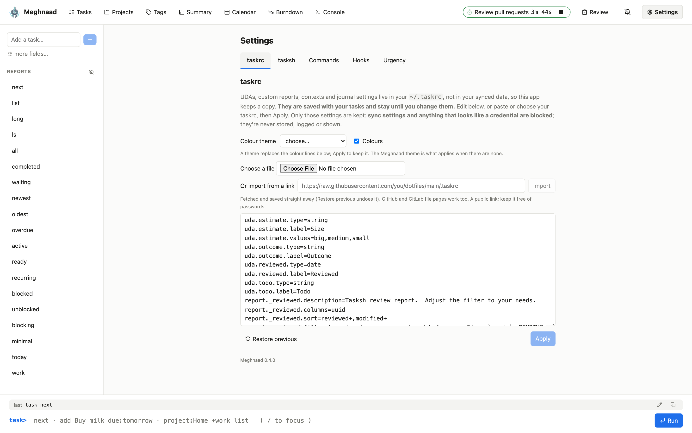
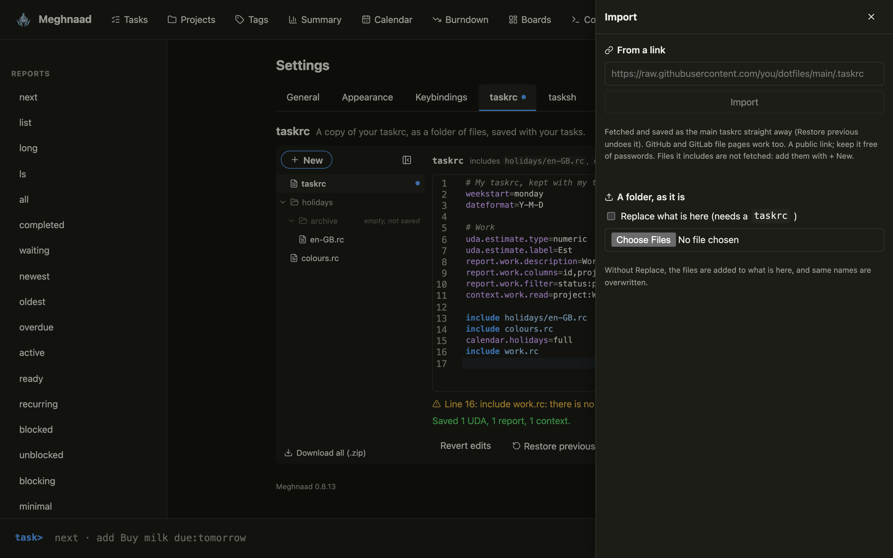
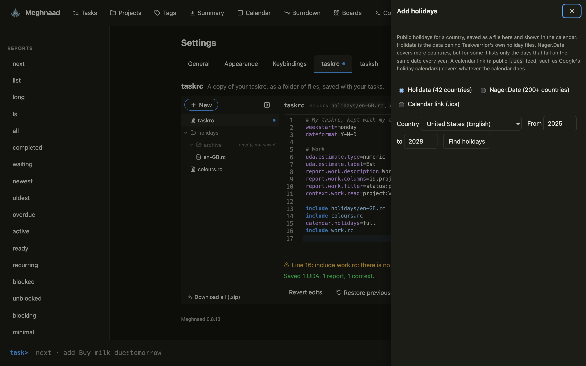
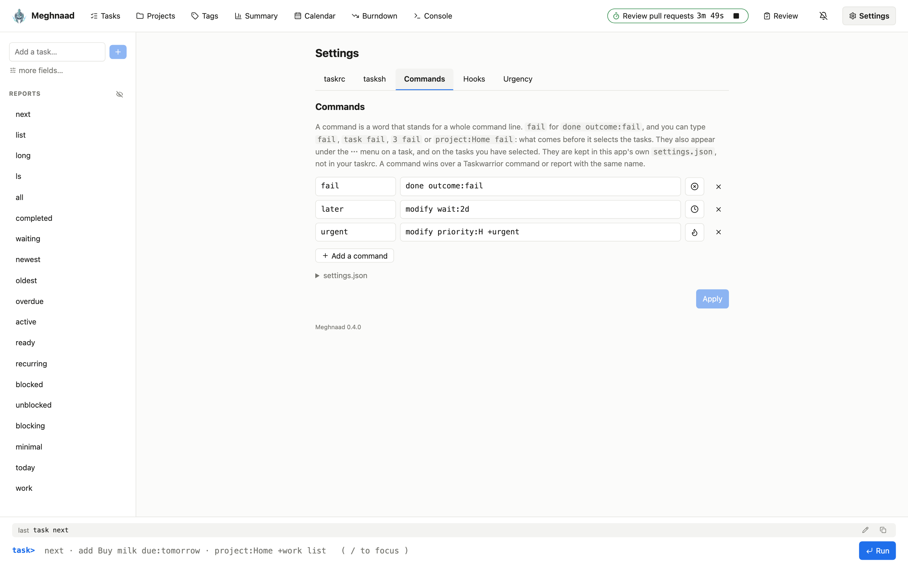
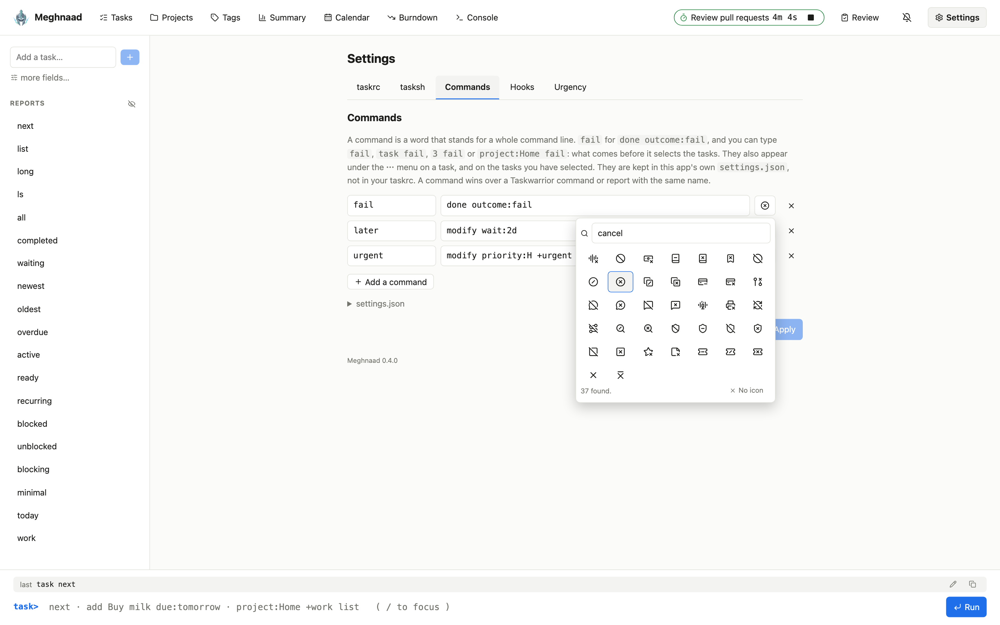
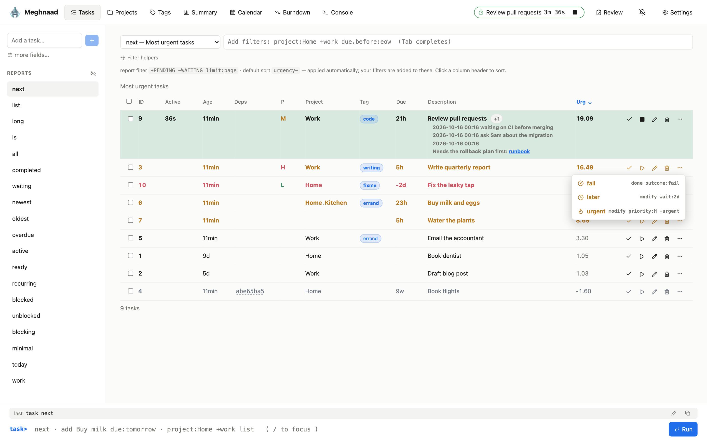
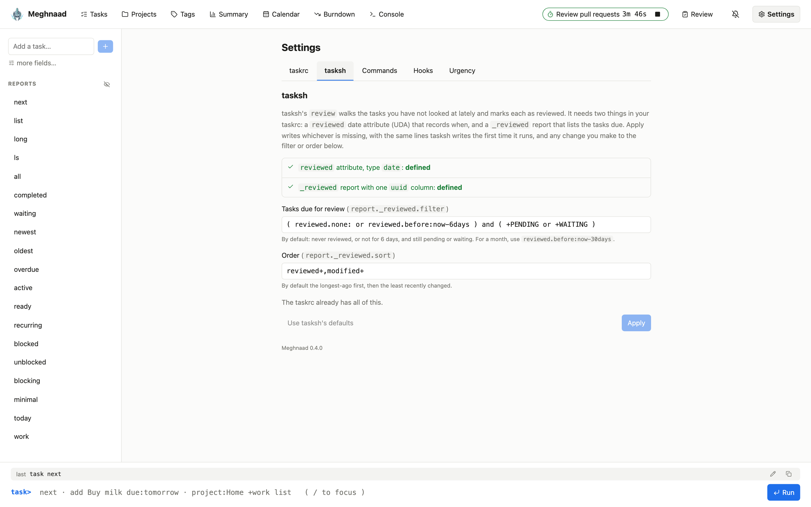
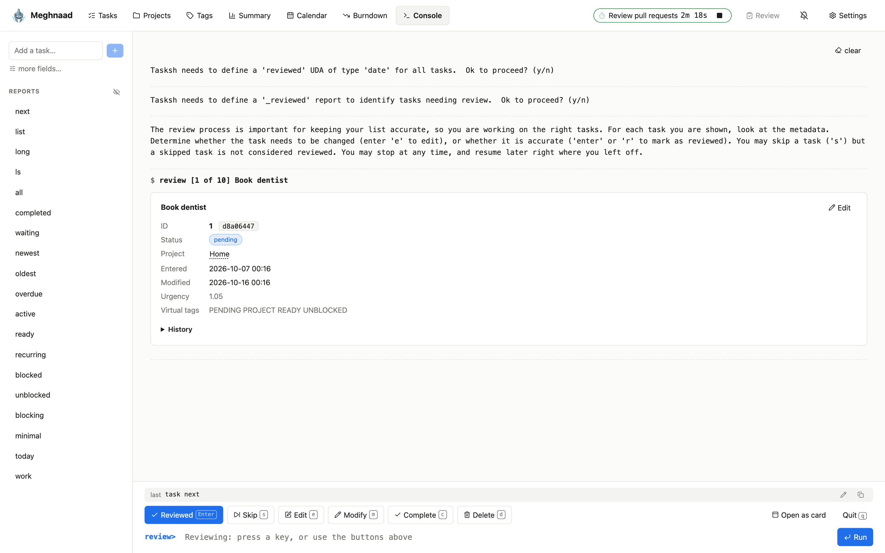
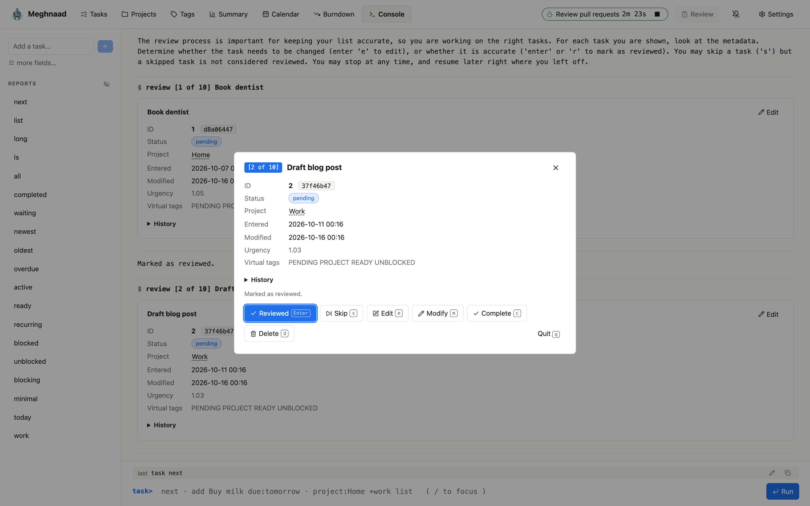
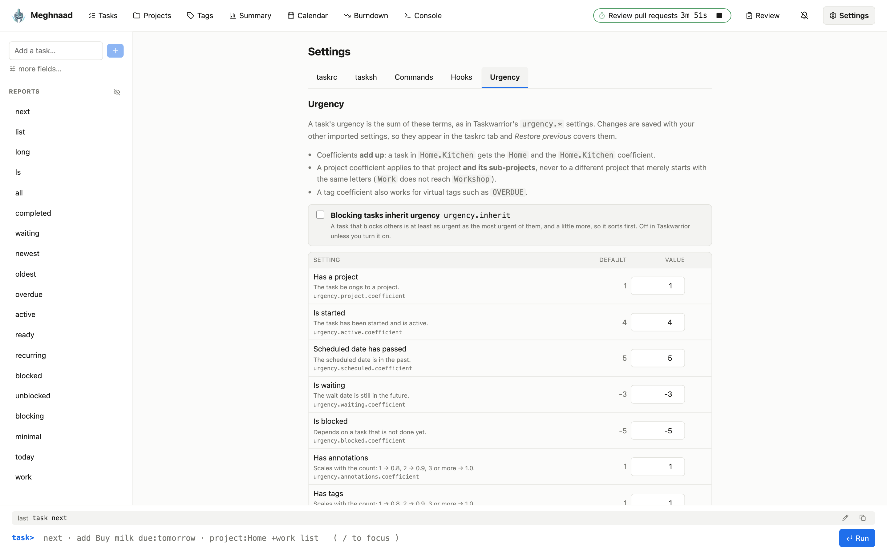

# Settings

**Settings** in the header is in two groups. **Meghnaad** is the app's own: **General**, **Appearance**,
**Keybindings**, **Kanban** and **Commands** (and **Sync** on the phone). **Taskwarrior** is what `task` itself reads:
the **taskrc**, **Urgency**, **Hooks** and **tasksh**. A group's tabs are listed down the left (in a row in the
Android app on a wide screen). On a phone, the Android app has one menu in the title's place instead, showing the group
over the tab: it lists the groups, each folding open to its tabs. An address names the tab alone (`/settings/hooks`), so the group follows from it. Every tab has its own **Apply**
(**Save**, on Hooks), and applying one doesn't touch the others. A tab with unapplied edits has a dot, and so does its
group; the edits stay while you look at another tab, group or page. If the saved settings change elsewhere (the
Console's `config`, another tab), a tab with no edits of its own follows them.

## This device

Every tab of Settings is `settings.json`, the same on every device, except **This device** (in the Meghnaad group),
which holds only what the device you are on can have of its own:

- its **home page**: its own (framed), or **Use everyone's** to give it up;
- its **reminders**, always its own: **Set reminders** opens them;
- its **keys**: only the ones it has of its own, each with the undo button to use everyone's for it again, and **Add**
  in each section to give it one;
- its file as text, and on the static web app, unlocking and trusting it.

Elsewhere, a home page or key this device has its own of says **This device uses its own**, with a link to the tab.

A device has nothing of its own until you first save something in This device. That first save asks for a **Device
ID**: a made-up one is filled in, and you can keep it or type your own (letters, digits, `-` and `_`). It is kept in the
store as `devices/<id>.json`, a small `settings.json` with only what the device has of its own. Another device given
the same ID shares it. The first time you open This device, if other devices already have some, you can **Use**
one of them, **Delete** one nobody uses any more, or make new ones for this device.

Once it has them, **This device** has the **Device ID**: **Change** renames the file, or, for an ID another device has,
uses that one's; **Delete this device's settings** gives them up. At the end is the device's file as text, to edit or
paste over, as `settings.json` is in General.

The [reminders](time-tracking.md) are always the device's own: once it has settings of its own, they are kept in them
too (`"reminders"`), so a device on a shared ID reminds as the others do. The terminal app has none of this: its
`settings.json` is the desktop's own already.

## General

**General** sets the **home page**, the page the app opens on: any report (including your own), any of your boards, or
one of your [kanbans](kanban.md) while Kanban is on. The default is `next`. It is kept in the app's own `settings.json`
(`"homepage": { "report": "list" }`, `{ "board": "week" }` or `{ "kanban": "work" }`), not your taskrc, so it is the same on every device that signs in to the same deployment, unless a device has
[its own](#this-device). A link to a task
still opens that task, and a report, board or kanban that is gone (or a kanban while Kanban is off) opens `next`. (The taskrc's `default.command` is different: it
is the command a line runs when it names none.)

Below it, **settings.json** unfolds to the whole of the app's own settings file (home page, appearance, task commands,
boards and keys, and the terminal app's and the phone's own), in a box you can edit or paste a whole file over. **Copy**
copies it, for the terminal app's `~/.config/meghnaad` or keeping a copy; **Reset** goes back to what is saved; **Apply**
saves it as written. The phone has the same box under General.

The file is linted as you type, and each problem is listed with where it is:

- An **error** stops **Apply**: text that is not JSON or not an object, a file over 64 KB, or a known key in the wrong
  shape (`homepage`, `appearance`, `keys`, `web`, `mobile`, `tui`, `kanban` or `aliasIcons` that is not an object,
  `taskCommands`,
  `boards`, `kanban.kanbans` or `kanban.columns` that is not a list, `appearance.progress` that is not an object, `appearance.transformations` that is not a list, a
  board that is not an object or has no `sections` list).
- A **warning** is something this app can't use, such as a task command with a bad name, a board with a bad id, a
  progress bar with no range or an icon for an alias your taskrc doesn't have. It is saved with the rest and kept in the file until you take it out.

Every front end saves only what you changed. A key it doesn't know, at any depth (another front end's section, a field
added to a board or a task command by a later version), and an entry it can't use are left as they are by every save:
a board, a task command, a key, the appearance, the home page, the terminal app's own settings. Two devices saving at
the same time is still the last one wins.

## Keys

Every front end has its keys in one place: the defaults are `keymaps/default.json` (in the repository,
`web/public/keymaps/default.json`; the web app fetches it, and the terminal app and the phone carry it), and yours go in
`settings.json`. An action is named by where it acts, with dots, as in Zed and VS Code (`app.prompt`, `tasks.done`,
`settings.commands.add`); its group is the name up to the last dot (`app`, `tasks`, `settings.commands`). A key is
written as they write it, the modifiers then the key,
with `+` or `-`: `/`, `G`, `ctrl+k`, `ctrl-shift-tab`, `enter`, `esc`, `space`, `pagedown`, `f5`. Keys pressed one
after the other are written with a space between them (`g g`, `ctrl+k ctrl+s`), or two characters together (`gg`,
`g1`).

Your keys are bound by group, each key to the command it runs, with its words, as the `:` command line takes it
(`done`, `tabn Tasks`, `filter +home`; the commands are vim's where vim has them, listed by `?` and in
[Commands](../commands.md)). Every action has a command, and an action's name is read as its command, so
`"x": "tasks.done"` and `"x": "done"` are the same key. A command that means something on several pages (`next`, `open`,
`back`, `export`) runs what it means in the group it is bound in, and on the `:` line, on the page it is typed on.
`null` unbinds a key.

```json
{
  "version": 2,
  "keys": { "app": { "ctrl+k": "app.prompt" }, "page": { "T": "tabn Tasks" } },
  "tui": { "keys": { "tasks": { "F": "tasks.filter", "f": null, "g h": "filter +home" }, "app": { "u": null } } },
  "web": { "keys": {} },
  "mobile": { "keys": {} }
}
```

`keys` is for every front end and `tui.keys`, `web.keys` and `mobile.keys` for one alone; the front end's own come
last. A key adds to the action's default keys; to move an action to another key, unbind the old one with `null`, as
`f` above. A key you bind is taken from a default that would otherwise come first, so there is nothing else to unbind. A
group's keys act where the group does: `tasks` on the Tasks page, `page` and `app` everywhere, and a page's keys come
before the keys of every group around it, on that page only (a `tasks` key before an `app` key), so the same key can
mean something on one page and something else elsewhere. The groups are `app`, `page`, `move`, `tasks`, `sort`,
`sidebar`, `lists`, `info`, `calendar`, `burndown`, `boards`, `boards.list`, `kanban`, `kanban.list`, `console` and the
Settings pages' (`settings`, `settings.general`, `settings.appearance`, `settings.theme`, `settings.keys`,
`settings.kanban`, `settings.commands`, `settings.sync`). A key whose command is malformed (no such command or action, not enough of a name to say which,
words it does not take, or none where it needs one: `done 3`, `burndown`, `lock now`) is skipped, so it does nothing,
and **Keybindings** warns of it at the top, with **Take out**. A group that is none, a key that can't be read, a key
that starts a longer one (`g` beside `gg`, which could then never be pressed) and two of your keys for one key where both
act are said (on **Keybindings**, and in the terminal app's Settings page), and the rest still applies. The default keys also say in a
line what each action does (`about`), which is what the lists of keys show.

`settings.json` says which shape it is written in (`"version"`). A file without one is version 1, whose keys listed each action with its keys
(`"tui": { "keys": { "tasks.filter": "F" } }`, which replaced the action's own).
Every front end brings an older file up to date when it reads it and saves it so, once: those keys become the same keys
bound by group, with the default keys they replaced unbound. A front end older than the file reads keys it does not
understand and says so; update it.

`/` puts the cursor in the prompt everywhere (`app.prompt`), and `:` puts it there with `:` typed, for a command
(`app.commandLine`): a line that starts with `:` joined to a command (`:tabn Tags`, `:5`, `:done`) runs it, and any
other line goes to `task`. The web app has the terminal app's keys for what it can do, away from a text field and a
dialog (Escape leaves a field), and `?` lists them and the commands. A number before a move repeats it (`5j`), and a
key of two presses (`gg`) waits for the second, shown at the bottom right:

| Key | Does |
| --- | --- |
| `/` | Put the cursor in the prompt |
| `?` | Every key and what it does |
| `:` | The prompt with `:` typed, for a command |
| `g1` to `g9` | Tasks, Projects, Tags, Summary, Calendar, Burndown, Boards, Console, Settings; `gt` `gT` the next and the one before |
| `j` `k`, `gg` `G` | On Tasks, the next row and the one before, the first and the last: the chosen row is the one with the focus |
| `d` `+` `D` `m` `A` `x` `o` `p` `Space` | On Tasks, on the chosen row (or the ticked ones): done, start or stop, delete (asks), modify, annotate, denotate, open its link, duplicate, tick it |
| `X` | On Tasks, delete the completed tasks the filter picks (asks) |
| `u` | `undo`, put on the prompt for Enter |
| `a` | Add a task, from any page (`app.add`) |
| `f` | The page's filter (`app.filter`) |
| `r` | Another report (on Tasks) |
| `C` | The context of the page |
| `v` | Review |
| `S` | Sync now |
| `N` | Reminders |

The phone has `/` alone, with a hardware keyboard; the terminal app's are in [its guide](../terminal.md#the-keys).

### Keybindings

**Settings → Keybindings** (`/settings/keys`) is the keys in four sections, one for each place they go in
`settings.json`: **General** (`keys`, every front end), **Web**, **Mobile** and **Terminal**. It shows only the keys
you set; **Show defaults** lists the others too, with their keys drawn faint. The search at the top narrows every
section to the actions whose name, line or key has what you type in it (`done`, `ctrl+k`).

**Add** in a section searches its actions, each with the command it runs and the keys it has now, and ends with **Add
a command**. Pick one, and the **Command** field has its command (`done`, `info details`), to keep or to change: a preset
is a start for a command of your own (`filter` becomes `filter +home`). **Add a command** opens the same form with the
field empty. Under the field is what the command runs and does, or, while it is malformed, why; a command that acts on
several pages (`next`) asks **Where**. Then press the key, or type it (`ctrl+k`) where a key can't be pressed, and
**Add key**, which stays off while the command is malformed; **No key** leaves it without one. The key is saved as the
command. A key you add replaces the default keys of what it runs, and a second one goes beside the first. **✕** takes out what you set, so the
action has its defaults again. Nothing is saved until **Apply**, and the tab shows a dot while there are changes. The
phone has the same tab, and the terminal app [a Keybindings section](../terminal.md#the-settings-page) of its own.

## Appearance

How the app draws things. It is kept in the app's own `settings.json`, not your taskrc, so it is the same on the web
and on the phone. The one exception is **Task colours** at the top, which is your taskrc's colour lines (see
[Colours](#colours)).

### IDs

A task that is done or deleted has no ID. By default its ID cell is `-`, as in `task all`:

```
ID St UUID     Description
-- -- -------- -----------
 - C  43082644 one
```

Tick **Fall back to UUID.short when ID is missing (e.g. completed or deleted)** to show the first eight characters of
its uuid there instead, dimmed. Either way, hovering the cell shows the whole uuid with a **Copy** button (on the phone,
tapping the cell copies it). It is `"appearance": { "idFallback": true }` in `settings.json`, so the terminal app
follows it too.

### Cards

Tick **Icons in cards** and a card shows Taskwarrior's own fields by an icon rather than the report's label: `#` for the
ID, a flag for the priority, a clock for `due`, and so on, and a UDA as a pill of its label and value. It applies to every
card: a kanban's on the web, the phone and in the terminal app (as symbols there, under Settings → General), and a
report's cards on the phone. It is `"appearance": { "cardIcons": true }` in `settings.json`; before 0.8.38 it was
Kanban's `icons`, and a file that still has it is moved over when it is read.

### Progress bars

Mark a numeric UDA as a progress bar and every report shows it as a bar, with the number beside it (in a table, and on the phone's task cards). Tick the UDA on the
**Appearance** tab and set its **min** (the bar is empty) and **max** (the bar is full); they start at 0 and 100. A
value outside the range fills or empties the bar, and a task with no value shows nothing. The bar turns green when full.
Only numeric UDAs are offered (`uda.progress.type=numeric`).

A numeric UDA's number is drawn without the zeros a decimal ends in, beside a bar or not, on every screen: `task import`
stores a JSON number as Taskwarrior writes a double (`0` as `0.000000`, `2.5` as `2.500000`), and it is shown as `0` and
`2.5`. Only the drawing changes; the task and its exports keep what is stored.

```json
{ "appearance": { "progress": { "progress": { "min": 0, "max": 100 } } } }
```

### Transformations

Find and replace in a text field before it is drawn, so a ticket number can be shown as a link to the ticket. Each rule
has a **Match** (a regular expression), a **Replace** (which may use `$1`, or `${name}` for a named group) and the
**fields** it runs on, ticked: `description`, `annotations`, or any string UDA. There is no "all fields": a field no rule
names is never searched. The result is drawn as [Markdown](tasks.md#notes-and-markdown), so the replacement can make a
link, bold, code and so on.

```json
{ "appearance": { "transformations": [
  { "match": "\\b(BOR-\\d+)\\b", "replace": "[$1](https://jira.example.com/browse/$1)", "fields": ["description", "annotations"] }
] } }
```

shows `fix BOR-23434` as `fix` and a link named `BOR-23434`. The rules run in order, each on what the one before left;
the arrows move a rule up and down. Patterns match as Taskwarrior's do, on the bytes of the text: `\w`, `\d` and `\b` are
ASCII, and `(?i)` at the start makes a rule ignore case. A rule whose pattern does not compile, or that names a field that
is not text, is reported under it and skipped; the others still run, and **Apply** waits until it is fixed.

A rule may also have a **Condition**, a Taskwarrior filter: it then runs only on the tasks the filter matches, so a key
like `FUL-123` becomes a Jira link in `project:FUL` and stays text everywhere else. The filter means what it means to
`task` (`( <condition> ) _uuids`): every status counts, completed tasks included, and the context makes no difference.
An empty condition is none. A condition `task` refuses runs the rule on nothing, and the problem is shown under the
rules (in the terminal app, with its other settings problems).

```json
{ "match": "\\b(FUL-\\d+)\\b", "replace": "[$1](https://jira.example.com/browse/$1)",
  "fields": ["description", "jira"], "condition": "project:FUL" }
```

Only how a field is shown changes: the task, filters, `export`, editing and sync all see the text as you typed it. A
description is drawn as Markdown only when a rule changed it. Where a rule changes how many lines a field has, its
checkboxes are shown but can't be clicked. They apply to tables, the phone's cards, the task's details and, in the
[terminal app](../terminal.md), report rows (where a link is a terminal hyperlink).



## Your taskrc

UDAs, custom reports, contexts, holidays and your other settings live in `~/.taskrc`, not in your synced data, so the app
keeps its own copy: **a folder of files**, kept as you wrote them. Open the **taskrc** tab. It is laid out like a file
drive: the files are a tree on the left (the main one, `taskrc`, first, then each folder, which opens and closes), and
the file you choose fills the rest, with **Apply** under it. The ⓘ next to the title says what is kept. Only an
allowlist of settings is read; the full list is in [taskrc support](../taskrc-support.md).

The panel icon at the top of the tree folds it away for a wider editor (the web remembers it). On a phone, or a narrow
window, the tree starts folded: the icon beside the file's name opens it over the editor, and choosing a file closes it.
In the Android app, the arrows at the end of the file's bar open the editor over the whole screen, the console and
the tabs out of the way, with the file's name in a bar on top and the tree still a tap away; they close it again.

### The editor

The editor numbers the lines and colours each part: a setting's name, its value, a comment, `include` and its file, and
the `[unsupported]` the app writes where it commented a line out. A line that is no setting at all is underlined (it is
commented out when you Apply), and a credential-like name is struck through (it is removed). A line the engine has a
warning for, such as an `include` that points nowhere, is marked in the line numbers. On the web it is CodeMirror
(Tab indents, Ctrl+Z undoes within one file); on the phone it is a text box with the same colours. The engine says what
each piece is, so both agree.

The file is checked as you type, once you stop for a moment: a line the app can't use, an `include` that names no file
and a setting that would be removed as a credential are listed under the editor before you Apply, as well as after.

### What is kept and what is not

Text is kept as written: comments, blank lines, order and spacing. Two things change on the way in:

- **A line the app can't use is commented out** (`# [unsupported] some.key=1`) rather than dropped, and the result says
  which lines and why.
- **Sync settings and anything credential-like are removed** (`sync.*`, `taskd.*`, names containing `secret`,
  `password`, `token`, …), commented-out ones included. They are never stored, logged, shown or synced, and only the
  *names* of what was removed are reported.

A UDA that exists on a task but isn't defined in your taskrc is shown but **read-only**.

### `include`

It works as in Taskwarrior: `include holidays/en-US.rc` reads that file where the line stands, so later lines win. Write
the path from the file that has the line (`include ../taskrc` from inside a folder); includes nest up to ten levels. An
include that points nowhere, outside the folder or at an absolute path is reported with its file and line, and the rest
is still read. `include dark-256.theme` (Taskwarrior's own themes) becomes that theme's lines when you apply. A file no
include reaches is kept but marked *unused*.

### Files

#### + New

Everything that adds something is under **+ New**, at the top of the tree. New files and uploads go in the folder you
last opened or closed in the tree, else in the folder of the file shown.

- **New file** and **New folder**: type the name; what is wrong with it (a name that is there already, `..`) is said as
  you type. A new file is saved empty at once. A new folder is greyed out (*empty, not saved*) until a file goes in it:
  a folder is kept only through its files, since a git branch keeps no empty folder and a bucket has only file names,
  so an empty one is never written, and a folder whose last file is deleted is gone.
- **Upload files**: one or several files, into that folder.
- **Upload a folder**: a whole folder (your dotfiles checkout), as it is. `.taskrc` or `taskrc` at its top becomes the
  main taskrc. Hidden files and folders (`.git`), binary files and anything over 256 KB are left out and listed, and up
  to 64 files or 1 MB are taken. It adds to what is here. One upload is one step, so **Restore previous** undoes all of
  it.
- **Import from a link…** opens a drawer (a bottom sheet on the phone) with the link import (below), and a folder import
  with **Replace what is here**, which makes the folder the whole of it (it needs a `taskrc`).
- **Add holidays…** opens the [holiday picker](#add-holidays) in a drawer.
- **Upload a holiday file**: a holiday file you already have goes in `holidays/`, and the main taskrc gets the
  `include` and `calendar.holidays=full` lines, as **Add holidays** does.

#### Download

**Download** in the **⋯** menu by the file's name keeps the file shown (under its own name), and **Download all (.zip)**
at the bottom of the tree every file, keeping folders. They hold what is *saved*, not unapplied edits, and never a
credential. **Upload a folder** takes an unzipped copy back. On a phone the system's save dialog asks where to keep it.

#### The ⋯ menu

On any file but the main one, **Include this file in…** adds `include <path>` to the file you choose and shows it;
**Apply** keeps it. **Delete file** removes one (the main taskrc can only be emptied). On a file made by Add holidays,
**Update holidays** fetches it again.

#### `config` and the settings pages

They write to the main taskrc, as `task config` does: a line starting with `name=`
changes in place and keeps its comment, a new setting goes on the end, and removing one deletes those lines. A setting
an included file defines isn't edited there: the new line overrides it, or you edit that file to remove it.

#### Restore previous

Undoes the last save, import or delete (all files together).

### Import from a link



Keep your dotfiles repository as the source (**+ New**, then **Import from a link…**): paste the address of the file (a GitHub or GitLab file page works, as does a
raw link or a gist's) and choose **Import**.

- It brings the main taskrc only. Included files aren't fetched, so add them (they show as *not found* until you do).
- The Worker fetches it, so the site's CORS rules don't matter, and the file never reaches the browser. On the static
  site there is no Worker, so the browser fetches it and the host must allow CORS. It keeps what a pasted file would
  keep.
- It saves straight away (**Restore previous** undoes it) and doesn't remember the link, so import again to refresh.
- Only `https://` links to public sites are followed, with no addresses, ports or user names in the link (the same for any
  redirect), up to 256 KB. The request carries no login, so the link must work without one (a secret gist's does). A web
  page rather than the file is refused.

### Add holidays

**+ New**, then **Add holidays…**, opens a drawer that makes a file of a country's public holidays from one of three
sources, and shows the list it found before anything is saved:



#### Holidata

From [holidata.net](https://holidata.net), the data behind Taskwarrior's own holiday files: 42 locales in 34
countries, with the language where a country has several. Saved as `holidays/<locale>.rc` (`holidays/en-US.rc`).

#### Nager.Date

From [date.nager.at](https://date.nager.at): about 200 countries, saved as `holidays/nager-<code>.rc`. For
some countries it lists only holidays that fall on the same date every year, so ones that follow the moon (Eid) can be
missing: look the list over.

#### Calendar link (.ics)

A public feed such as Google's holiday calendars
(`https://calendar.google.com/calendar/ical/en.bd%23holiday%40group.v.calendar.google.com/public/basic.ics`;
`webcal://` works too). The Worker (the browser, on the static site) fetches it under the same rules as the taskrc link import (https, a public host, up
to 1 MB). All-day events become holidays, a multi-day one a stretch (`.start` and `.end`), and a plain yearly repeat is
carried over the years. A **Keep** list has every name; what the calendar calls an observance (Valentine's Day) starts
unticked. The file is named after the calendar unless you give a name.

Pick the country (or paste the link), the years (last year to two years ahead to begin with) and **Find holidays**.
Holidays of one region only (Massachusetts' Patriots' Day, a Swiss canton's) are left out unless you tick the region.

**Save** writes the file and, unless they are there already, adds `include holidays/<file>.rc` and
`calendar.holidays=full` to the main taskrc (you can untick them). If the main taskrc has unapplied edits, the lines go
into its box and **Apply** keeps them. A file made this way records where it came from, so **Update holidays** (in the
**⋯** menu of that file) fetches it again for the years now with the same regions and names (a year with no data is named). A calendar's link is
remembered only if it has no `?`, since such a link can hold a secret. Saving again replaces the file, and **Restore
previous** undoes it.

Holidata and Nager.Date are asked from your browser (or phone) and learn your IP address and the country and years you
asked for, nothing else. A calendar's host learns the Worker's (or the phone's, or on the static site your browser's) address and the link.

### Contexts

A context (`context.<name>.read` / `.write`) filters what you see and tags what you add. It can also carry settings,
`context.<name>.rc.<key>`, in force while it is active. As in Taskwarrior they win over everything, including a
command-line `rc.` override.

## Colours

Rows are coloured by Taskwarrior's colour rules, and the same colours reach the calendar, burndown, summary bar and
history graph. They are resolved as the real `task` resolves them: a setting your taskrc leaves out has Taskwarrior's
default (the `default` theme in the picker), so a row looks as it would in `task` with the same taskrc. The one
exception is `color.alternate`: rows are not shaded every other one unless your taskrc (or a theme) sets it.

- The rules in `rule.precedence.color` blend (`rule.color.merge=yes`, the default), the first in the list on top; with
  `rule.color.merge=no` the first rule that applies decides alone. A rule set to nothing (`color.due=`) is off, and
  the rules after it show through.
- **Priority** is a UDA, as in Taskwarrior: `color.uda.priority.H` colours a row through `uda.`, last in the order, so
  `due` (a task due within `rc.due` days) or `project.` claims the row first. The Priority cell always shows its
  colour too, whatever colour the rest of the row has; that one field is the app's addition, from the same settings.
- **Meghnaad's own theme** (soft colours, due today in bold amber, nothing for due later this week, no zebra) is in
  the theme picker; choosing it saves its lines as `themes/meghnaad.rc` and includes that file from your taskrc.

Your `color.*` lines work as on the desktop:

```
color.active=bold on sage                  # a rule: `sage` is a softer name for green
color.tag.work=sky                         # a tag, `project.Home`, `keyword.milk`, `uda.estimate.big` likewise
color.overdue=bold rgb500
rule.precedence.color=overdue,active,tag.  # which rule wins first; with `rule.color.merge=yes` the rules blend instead
color.alternate=on gray2                   # shade every other row
```

**Task colours**, at the top of the **Appearance** tab, has a **Colour theme** picker (Meghnaad's own, Taskwarrior's
default and the 16 standard themes such as `dark-256` and `solarized-light-256`) and a **Colours** switch. Each saves at
once. A theme is saved as a file of its own, `themes/<name>.rc` (the theme's file as Taskwarrior ships it), and the main
taskrc gets `include themes/<name>.rc` in place of its own colour lines and of the theme picked before; Taskwarrior's
default removes the include. Colour lines you write after the include win over the theme's. The switch writes
`color=off` in the main taskrc or takes it out. Either is one save, so **Restore previous** on the taskrc tab undoes
it. A theme picked before leaves its file in `themes/`, marked *unused*; delete it there if you like. A pasted `include dark-256.theme` is read as that theme. `color=off` (or `rc.color:off`) turns every
colour off, and a task tagged `nocolor` is never coloured.

`colors` in the Console draws the palette, `colors bold coral on sky` a sample, and `colors legend` every colour in force,
each in its own colour. Colours are Taskwarrior's palette (`rgb440`, `gray12`, `color214`, `on bright blue`); the basic
ones are drawn softly for the page, and a colour that wouldn't show on it is nudged toward readable. The friendly names
are `ink`, `coral`/`rose`, `sage`/`moss`, `amber`/`sand`, `sky`/`ocean`, `orchid`/`plum`, `teal`/`aqua`, `snow`/`pearl` and
`slate`. [taskrc support](../taskrc-support.md#colour) lists every colour setting.

## Commands

A command is a word that stands for a whole command line. Define it under **Settings → Commands**: a name, what it stands
for, and optionally a label and an icon. Any [Lucide](https://lucide.dev/icons) icon works, picked by sight, by name, or by what it is
for ("cancel" finds the circled cross). The app carries only the few icons it uses itself; any other is fetched from the
jsdelivr CDN when first shown and remembered by your browser (see *Icons from a CDN* in the README's security notes).
With no network, an icon you haven't used shows as a terminal, and the picker lets you type its name instead.

`fail` for `done outcome:fail` works like this:

```
fail                      → done outcome:fail
task fail                 → the same: the leading `task` is optional
3 fail                    → 3 done outcome:fail
project:Home +work fail   → project:Home +work done outcome:fail
```

What comes before the command word selects the tasks, as it always does (and the active context applies). What comes
after is added to what the command stands for. A command may carry a filter of its own: `late` for `+OVERDUE list` makes
`project:Home late` read `project:Home +OVERDUE list`. Only the command word can be one, so `add fail the test` still
adds a task called "fail the test", and a command used inside another is written out too.

**A name can't be a command already.** Not one of Taskwarrior's (hidden ones such as `_get` too), nor a word `task` would
read as one (`sync` is `synchronize`, `old` is the `oldest` report), nor a report of your taskrc, nor tasksh's `review`
(or `rev`), nor the console's `clear` and `cls`. A command named so is reported as a warning in `settings.json` and left
out. Give it another name and a label: `inreview` labelled "Review" shows as Review in the menus.

**Labels.** The menus show a command by its label. Without one, its name is made into words: each run of `_`, `-` or `.`
is a space and the first letter is upper case (`kanban_next` is "Kanban next", `follow-up.later` "Follow up later"). The
name is still what you type: on the console, in a chain, in a kanban's move.

```json
{ "name": "kanban_next", "command": "modify +next", "label": "Move to next column" }
```

**A command wins over a taskrc `alias.*` of the same name.** It differs from a taskrc alias in two ways: it is yours alone (kept in this app's `settings.json`, not the taskrc that mirrors your desktop one),
and it reads the line as Taskwarrior does, so it applies only where the command goes.

**Several commands.** `wrap` for `done outcome:fail && modify +failed` runs the second only if the first worked; `||` and
`;` work as on the console line. The filter before the name goes in front of every one of them (`3 wrap` is `3 done
outcome:fail && 3 modify +failed`, so use a uuid rather than a number when an earlier step changes what the number
means), and what follows the name goes after the last (`3 wrap +x` ends with `3 modify +failed +x`). A button runs each
on the task it is for, by uuid, and stops where `&&` would.

**Buttons.** Every command is also a button: the **⋯** menu on a task (in the table and the drawer) runs it on that task,
and the bar over selected tasks runs it on all of them, a batch at a time. The menu isn't there while you have no
commands. Where a table is wider than its box (a narrow board card, say), each row's buttons (Done, Start or Stop, Edit,
Delete, then the commands) fold into that menu, and open out again when there's room.

**On an iterative task** (`+ITERATIVE`) a command runs without its `status:` changes, because Taskwarrior refuses to
change one's status by hand ("Clear iter to end the series instead"): `doing` for `modify status:pending
progressState:inprogress` runs `modify progressState:inprogress` there. A statement left with nothing to run is
skipped, and a command that only changes the status says so and runs nothing. This holds wherever the app runs a
command on a task for you (the ⋯ menu, the bar over selected tasks, where iterative tasks get theirs apart from the
rest, the terminal app's `c` menu, and a [kanban's moves](kanban.md#iterative-tasks-on-a-kanban)), on every platform,
but not on the console: what you type there runs as typed. The Commands tab shows, muted under a command, the line it
runs on an iterative task where that is another one. A taskrc alias is `task`'s own to write out, so it runs as it is.

**Your taskrc's aliases** are in the same menus, after the commands, with a terminal icon: each `alias.<name>` your
taskrc defines runs on the task as `task <uuid> <name>` would. Taskwarrior's own (`rm`, `history`, `ghistory`,
`burndown`) are left out unless you change them, as is one that stands for nothing, and a command of the same name
takes its place. They are edited in the taskrc, not here. In the terminal app they are in the `c` menu, marked `$`.

The **Aliases** part of the Commands tab lists them, each with what it stands for and an icon picker: the icon it shows
in the menus, kept in `settings.json` as `"aliasIcons": { "<alias>": "<icon>" }` (no icon: the terminal one). An icon for
an alias your taskrc no longer has is listed there as a warning and kept in the file, unused, in case the alias comes
back. The terminal app draws no icons, so it has no picker, and keeps the icons when it saves.

**Names** are one word that can't be taken for a filter: no spaces, no `+` `-` `/`, no `:` or `=`, not a number.







Other keys in `settings.json` are kept (**General** shows the whole file), and entries it can't use are listed and
kept in the file as they are. The file is at most 64 KB.

## tasksh



**Review** is tasksh's `review`: it walks the tasks you haven't looked at lately, one at a time, and you mark each as
reviewed, skip, edit, change, finish or delete it. Start it with **Review** in the top bar (a card with buttons) or by
typing `review` in the Console. `review 10` stops after ten (a limited review is done from the Console), and `rev` is
enough, as in tasksh. As in tasksh the menu is keybindings, not a shell: a key is the answer, with no Enter after it, and
the same choices are buttons.

### What it needs

Two things in the taskrc, which the **tasksh** tab prepares: a `reviewed` attribute (a date UDA recording when you last
looked at a task) and a `_reviewed` report (one `uuid` column) listing the tasks due for review. If they're missing, the
first review asks, in tasksh's words, whether to define them, and does so with the lines below.

The tab says whether each is defined, defined differently (showing what is there now, since applying changes it) or
missing, and lists the exact `config` lines **Apply** would write, the ones tasksh writes the first time it runs. Nothing
else in the taskrc is touched. You can adjust the report's **filter** (by default never reviewed, or not for 6 days, and
still pending or waiting) and its **order**; **Use tasksh's defaults** puts them back.





### Reviewing

Each task is shown with `[3 of 12]` and everything `info` shows, then the menu:

| Key | |
| --- | --- |
| Enter | Mark it reviewed (`modify reviewed:now`) |
| `s` | Skip it: on to the next, not counted as reviewed |
| `e` | Edit it in the app's editor; closing the editor marks it reviewed and shows it again |
| `m` | Type what to change (`+tag -tag /teh/the/ project:X`), then Enter; Escape cancels. The same task is shown again |
| `c` / `d` | Complete or delete it; both count as reviewed |
| `q` | Stop. What is done stays done, and you can start again where the list left off |

At the end: `End of review. 3 out of 12 tasks reviewed.`

In the Console the prompt is off while the review asks (it reads `review>`), a bar of buttons stands over it, and Escape
quits; the only thing you type is the change after `m`. **Open as card** in that bar carries on in the card from the same
place. In the card the **Reviewed** button has the focus, so Enter marks it, as in tasksh, and the same letters work as keys.

Questions Taskwarrior asks mid-step are asked here too, with Yes and No (or `y` and `n`). For a recurring task: "This is a
recurring task. Do you want to modify all pending recurrences of this same task?" Yes marks the whole series, No only
this one. (`rc.confirmation:no` doesn't silence it, since `recurrence.confirmation` governs it, so tasksh shows it too.)

Every step is an ordinary command (`task <uuid> modify reviewed:now`, `done`, `delete`) sent with `rc.confirmation:no`, so
hooks run, `undo` works and the Tasks table follows. Review steps aren't added to the command history.

## Kanban

The **Kanban** tab sets up [Kanban](kanban.md#setting-it-up), Automatic or Manual, and then holds its settings: the UDA,
the report, filter, Completed since and columns every kanban is drawn with, and each kanban's name, address and what it
has of its own. **Apply** saves them all; **Turn Kanban off** hides the page and keeps them.

## Urgency



A task's urgency is the sum of Taskwarrior's `urgency.*` terms, with its built-in coefficients unless your taskrc changes
them. The **Urgency** tab shows every coefficient next to its default. Edit one, add your own, or send one back to its
default, then **Apply**. Edits are saved with your imported settings (as `urgency.*` lines in the taskrc tab). Your desktop
`~/.taskrc` isn't touched, so copy any change you want there. As with `task config`, a change is written into the main
taskrc; when a file it includes after that line sets the same coefficient, the included file still decides, and the tab
names it after **Apply** so you can change it there. On a git branch one **Apply** is one commit.

It follows Taskwarrior's rules, so nothing is inherited that Taskwarrior doesn't inherit:

- Coefficients add up: a task gets every matching coefficient, not just the most specific.
- `urgency.user.project.Home.coefficient` applies to `Home` and `Home.Kitchen`, but not `Homework`.
- Tags match user and virtual tags (`urgency.user.tag.OVERDUE.coefficient`). Keywords match the description,
  case-sensitively. `urgency.uda.<name>.coefficient` matches any value of a UDA, and `….<value>.coefficient` one value.
- `urgency.inherit` is off, as in Taskwarrior. When on, a task that blocks others takes the highest urgency of what it
  blocks, through the whole chain, plus 0.01.

`rc.urgency.due.coefficient:0 next` and `rc.urgency.inherit:1` also work for a single command.
