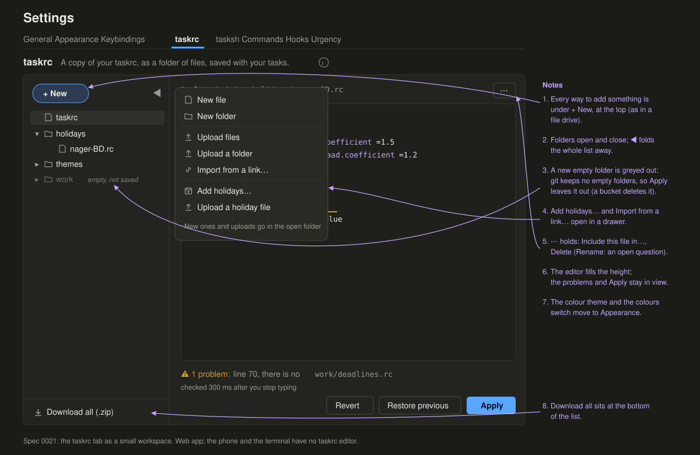

# 0021: The taskrc tab as a small workspace

- **Status:** done
- **Created:** 2026-11-19
- **Layer:** 2 (UI)
- **Front ends:** web and Android (the phone's taskrc tab, `TaskrcPanel.kt`). The terminal has no taskrc editor (it
  reads the desktop's own taskrc).
- **Supersedes / related:** none. Uses the drawer (`web/src/lib/Drawer.svelte`) for secondary flows, as everywhere on the
  web from now on.

## Why

The taskrc tab grew one control at a time, and now it reads as a long form. A paragraph of explanation sits at the top.
The ways to add something are spread out:

- a name box with **Add** under the file list;
- **Add files** and **Import folder** pickers beside it;
- a file picker and an import-from-link row above the editor;
- the holiday form below the whole page.

The colour theme picker lives here too, though it is about how things look. The editor is pushed down, so **Apply** is
often off screen. Every keystroke also recomputes the draft and the checks, so typing in a long file lags, and the
problems with a file show only after **Apply**.

## What

The tab becomes a small workspace, laid out like a file drive, as in the diagram above.

- **A file tree on the left.**
  - Folders open and close (▸ / ▾), and **◀** folds the whole list away for a wider editor. Both are remembered in this
    browser.
  - The open file is highlighted.
  - On a phone, and a phone-width window, the list is folded by default and opens as an overlay over the editor.
- **+ New, at the top of the list, holds every way to add something:**
  - **New file**, and **New folder**.
  - **Upload files**, and **Upload a folder**.
  - **Import from a link…**, which opens a drawer: the link, what it fetches, "Replace what is here".
  - **Add holidays…**, the holiday picker (today's form under the page), in a drawer.
  - **Upload a holiday file**: put in `holidays/`, and included from the main `taskrc` at once, as adding holidays does
    today.

  New files and uploads go in the folder that is open; their names are checked as they are typed.
- **An empty folder is greyed out** ("empty, not saved"). A folder exists only through the files in it: git keeps no
  empty folders, and a bucket has only file names. So **Apply** leaves an empty folder out, and a folder emptied by
  deleting its files is gone after **Apply**. An empty folder lives only in the page, until a file is put in it.
- **Download all (.zip)** is at the bottom of the list.
- **The editor fills the rest of the height.**
  - Above it: the file's name and what it includes (or is included by).
  - **⋯** next to the name holds **Include this file in…** and **Delete**.
  - Below it, always in view: the problems with the file, then **Revert**, **Restore previous** and **Apply**.
- **Checks while typing, without lag.**
  - The draft (and so whether the file counts as edited) follows 150 ms after typing stops.
  - The checks run 300 ms after typing stops, on the engine's taskrc reader: a line this app can't use, an `include`
    that names no file, a setting that would be removed as a credential. They show as markers in the editor and as the
    problems below it, before **Apply** as well as after.
  - **Apply**, **Revert** and leaving the file take any text still waiting first, so nothing typed is lost.
- **The intro is one line**, "A copy of your taskrc, as a folder of files, saved with your tasks.", with an ⓘ that opens
  the rest: kept as written, how `include` works, sync settings and credentials removed.
- **The colour theme moves to Appearance.** The theme picker and the **Colours** switch go to a **Task colours** section
  of the Appearance tab. They change the colour lines of the main `taskrc`, through the same save as this tab, so
  **Restore previous** still covers them. The taskrc tab keeps a one-line pointer: "Colours: set in Appearance".

The address stays `#/settings/taskrc`, with the open file as it is today. The drawers have no address of their own: a
drawer belongs to the page it opens on.

## Not doing

- No taskrc editor in the terminal.
- No renaming or moving files by dragging (see the open questions about renaming).
- No change to what is stored, or how: the folder is still `web/rc/*`, and one **Apply** is one commit on a git branch
  (0.8.13).
- Moving the other modal dialogs to drawers (`QuickAddModal`, `ExportDialog`, `BulkModify`, `TaskEditor`, `KeysHelp`,
  `NotifyDialog`, `SectionInfo`, `ReviewCard`) belongs to a spec of its own. It is listed under the open questions.

## Design

- Split `TaskrcPanel.svelte` (801 lines) into:
  - `RcWorkspace.svelte`, the layout and the state of the drafts;
  - `RcTree.svelte`, the tree, **+ New** and the zip;
  - `RcEditorPane.svelte`, the header, ⋯, the editor, the problems and the footer;
  - `RcImportDrawer.svelte`, import from a link.

  `HolidaysForm.svelte` moves into a `Drawer` as it is.
- The tree is built from the paths the folder listing gives (`listing()` today), plus the empty folders the page holds,
  as a Set in the workspace's state. Which folders are open, and whether the list is folded, are kept in `localStorage`
  (read in a `try`, since it may be missing).
- Debounce: one small helper, `debounce(fn, ms)` with `flush()` and `cancel()`, in `web/src/lib/debounce.ts`, with
  tests. The editor's `onChange` goes through it at 150 ms. The checks are a `$derived` of the debounced text, run 300
  ms after it.
- The checks: the engine already reads a folder (`rcfiles::resolve`, the problems the save answers with). A helper
  `tc_core::helpers::rc_check(files) -> problems`, reached from the page as the highlighting is
  (`web/src/engine/helpers.ts`), returns the same problems without saving. It is layer 1 knowledge handed to the UI, as
  the highlighting is. Measure the engine before and after.
- Icons: Lucide's, as in the rest of the app (the diagram only sketches them).
  - **+ New**: `Plus`; **New file**: `FilePlus`; **New folder**: `FolderPlus`.
  - **Upload files** and **Upload a holiday file**: `Upload`; **Upload a folder**: `FolderUp`.
  - **Import from a link…**: `Link`; **Add holidays…**: `CalendarPlus`.
  - **Download all (.zip)**: `Download`, as today; **⋯**: `Ellipsis`.
  - Folding the list: `PanelLeftClose` and `PanelLeftOpen`; the tree: `ChevronRight` and `ChevronDown`, `File`, `Folder`
    and `FolderOpen`.
- Task colours in Appearance: the theme code (`themes.ts`: `applyTheme`, `withColour`, `colourOff`) moves with the
  picker. The section reads the main `taskrc`, changes its colour lines and saves it through `PUT
  /api/config/files/taskrc`, as the tab does today.

## Acceptance criteria

- [x] The tab looks like the diagram: a tree on the left, folders that open and close, the list foldable with ◀, the
  folding remembered, and on a phone folded by default, opening as an overlay. The same on Android.
- [x] **+ New** offers new file, new folder, upload files, upload a folder, import from a link (drawer), add holidays
  (drawer), and upload a holiday file (put in `holidays/` and included from `taskrc`).
- [x] An empty folder shows greyed out, and is never written. Deleting a folder's last file removes the folder after
  **Apply** (bucket and git branch).
- [x] **Download all (.zip)** is at the bottom of the list.
- [x] The editor fills the height. The problems, **Revert**, **Restore previous** and **Apply** stay in view.
- [x] Typing never waits on the draft or the checks: draft at 150 ms, checks at 300 ms. **Apply**, **Revert** and
  switching files take the waiting text first.
- [x] The problems (unusable line, missing include, credential) show while typing, before **Apply**.
- [x] The theme picker and the Colours switch are in Appearance, under Task colours. The taskrc tab points there.
- [x] Tests:
  - `debounce.ts` unit tests;
  - the tree: building, empty folders, open and closed;
  - the + New actions, with the API mocked;
  - Appearance's Task colours;
  - a Rust test for `rc_check`.

  The existing taskrc panel tests are moved over.
- [x] Docs: `docs/using/settings.md` (the taskrc tab, Appearance), with screenshots of both drawers.
- [x] Size: the engine wasm measured before and after.

## Open questions

- Should picking a theme in Appearance apply at once, or wait for an **Apply** in the section, as the taskrc tab does
  today?
- Should ⋯ also have **Rename**? It is a delete and a create, plus fixing the `include` lines that name the file. Useful,
  but not asked for yet.
- Should the other modals move to drawers in a follow-up spec? They are `QuickAddModal`, `ExportDialog`, `BulkModify`,
  `TaskEditor`, `KeysHelp`, `NotifyDialog`, `SectionInfo` and `ReviewCard`. Some may want to stay modal: the quick add
  is a command palette, and `KeysHelp` is a cheat sheet.

## Implementation notes

2026-11-19, built on the web and on Android.

- Decided while building, from the open questions:
  - **Task colours apply at once** (one save of the main `taskrc`; **Restore previous** on the taskrc tab undoes it), so
    the section needs no **Apply** of its own beside Appearance's.
  - **No Rename** in ⋯. The other modals stay as they are, for a spec of their own.
  - **Choose a file** (replace the box's text with a file) is gone: **Upload files** does the same with the file kept
    under its own name.
- Web:
  - `TaskrcPanel.svelte` stays the workspace (state, editor pane, the two drawers); `RcTree.svelte` is the tree,
    **+ New** with its hidden file inputs, the name box and the zip. Splitting the editor pane and the import drawer into
    files of their own bought nothing, so they were not split.
  - `HolidaysForm.svelte` is a plain block now (no `
`), shown in the Add holidays drawer. The Import drawer
    holds the link and a folder upload with **Replace what is here**.
  - `debounce.ts` (`flush`, `cancel`). The draft follows CodeMirror 150 ms after typing stops and reads the editor's text
    when it runs, so nothing typed in between is lost; the check runs 300 ms after the drafts change.
  - The workspace takes the height left in the page's scrolling area, measured with a `ResizeObserver`, so **Apply**
    sits above the console bar on any screen. Narrow is `(max-width: 760px)`: folded at first, an overlay with a
    backdrop when open, and closed again once a file is chosen.
  - The folding and the closed folders are kept in `localStorage`; the empty folders live only in the page.
  - `TaskColours.svelte` heads the Appearance tab.
- Engine: `tc_core::rcfiles::check(tree)`, reached as the helper `taskrc_check` (the design called it `rc_check`; it
  sits by `taskrc_highlight`). It returns `resolve`'s problems plus, per line, the credentials and the lines that would be
  commented out, without saving. Engine: 892,901 → 897,739 bytes compressed (+4.8 KB).
- Android:
  - `rcTree` and `newNameProblem` in `RcPaths.kt` with the web's tests; `TaskrcState` has the tree, the new file or
    folder, the empty folders, the holiday file and `check()`.
  - Below 760 dp wide the list is folded and opens over the editor with a scrim; wider, it sits beside it. **+ New** and
    ⋯ are dropdown menus; Import and Add holidays are bottom sheets. The Settings page gives the taskrc tab its full
    height (the editor scrolls inside it).
  - A Compose text field must take each keystroke at once, so only the check is put off (300 ms), not the draft.
  - `TaskColours.kt` heads the Appearance panel.
- Checked: the unit tests on both, screenshots of the web at desktop and phone width on a scratch stack, and the APK
  builds. The Android layout was not looked at on a device or in the desktop preview.
- Seen on the way, not changed: in `npm run dev`, the worker flavour's `tc-hooks-wasm?url` alias (a `data:` URL) makes
  Vite's import analysis show an error overlay over the page (`src/engine/pageHooks.ts`); the page works under it.
